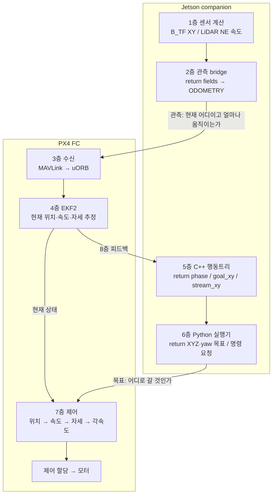
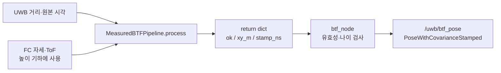
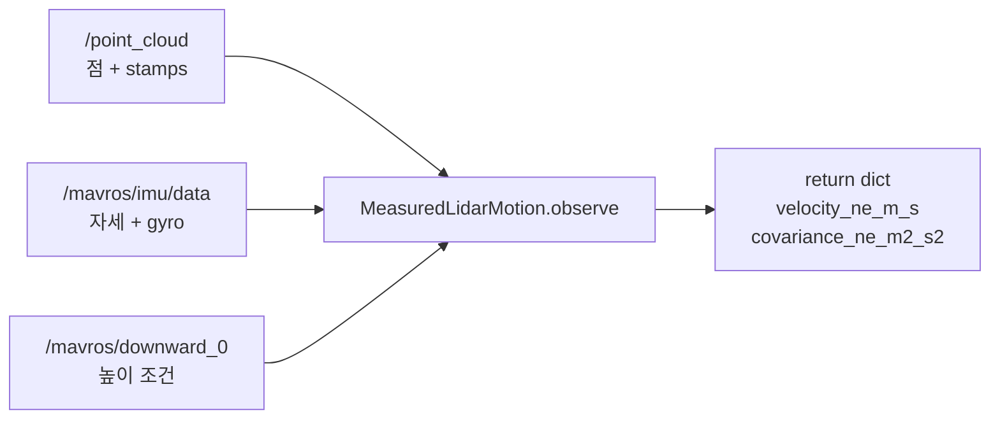
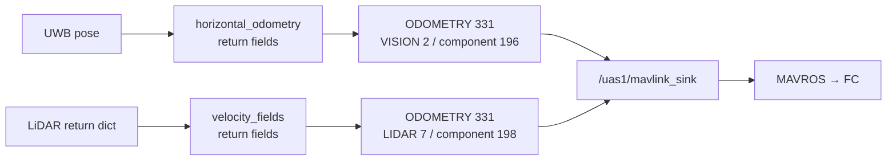
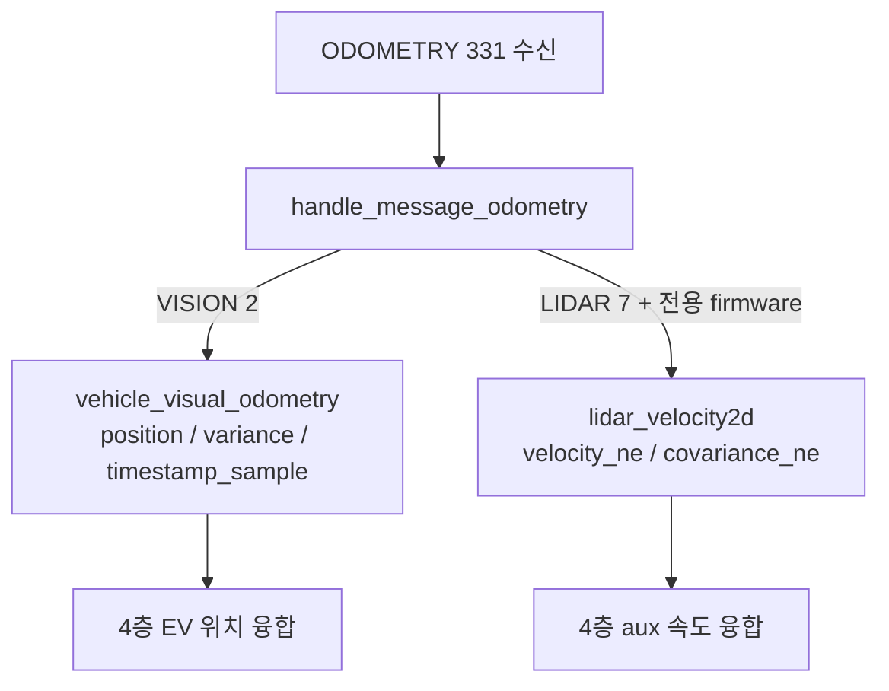
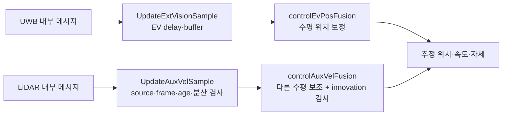
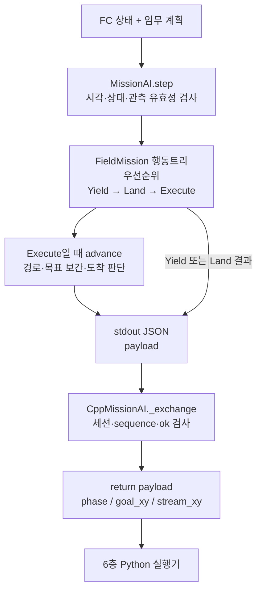
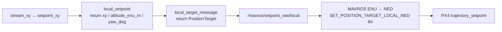
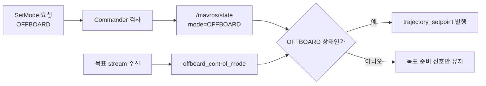
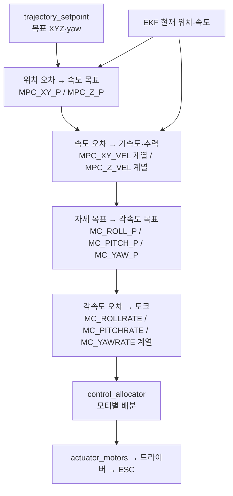

# Companion과 PX4 로직 분석·수정 지점 API 명세
로직을 개선할 때 어떤 코드와 파라미터를 바꿀지 찾는 문서다.
각 층의 입력 → 계산 → 반환값 → 다음 소비자를 따라 읽는다.

**어떤 값을 바꾸면 다음 층의 어떤 계산이 달라지는지**를 추적한다.
장비를 켜서 따라 하는 실습 절차가 아니다.
함수·설정·파라미터의 수정 지점을 설명한다.
예시는 이해를 위한 수치다. 실제 실측 결과가 아니다.
FC 파라미터 기록값은 별도로 날짜를 표시했다.

| 구분 | 이 문서의 기준 |
|---|---|
| companion 코드 | FINAL `20bd603`, 코드 변경은 `99a4a9b`까지 포함 |
| PX4 코드 | `d6f12ad1` + 저장소의 LiDAR2D hardware patch |
| FC 파라미터 기록 | 2026-10-12 MAVROS cache 백업. 오늘 readback 값이 아님 |
| 최신 연결 확인 | 2026-10-13: 점군만 수신, FC 상태·파라미터 응답 없음 |
| `feature_uwb` | FINAL 구조를 이해하도록 같은 문서를 공유. 모든 임무 구현이 같지는 않음 |
| 미커밋 `path_heading` | 이번 기준 코드에서 제외. 기존 작업 파일은 유지 |

필드 전체 사전은 [wire 상세 명세](companion_px4_wire_reference.md)에 보존했다.
조회 결과는 [실물 확인 기록](../report/companion_px4_audit_20261013.md)에 있다.

## 0. 개선할 대상과 수정 지점을 먼저 고른다

같은 “드론이 흔들린다”에도 원인은 여러 층에 있다.
먼저 관측값, 추정 상태, 목표, 제어 출력을 분리한다.
아래 표에서 출발한 뒤 해당 층의 데이터 흐름을 읽는다.

| 바꾸려는 동작·값 | 먼저 읽을 코드 | 수정 후보 | 바뀌는 결과 |
|---|---|---|---|
| UWB XY 계산 자체 | 1A `MeasuredBTFPipeline.process` | 거리 보정·B/B_TF 계산·기하·이상치 판단 | `xy_m`, `ok`, `reason` |
| 회전·가림 중 LiDAR 속도 | 1B `MeasuredLidarMotion.observe` | 점 시각·IMU 보정·`KeyframeMatcher` | `velocity_ne_m_s`, `accepted` |
| 관측을 얼마나 믿을지 | 1–4층 공분산 생성과 EKF noise 처리 | `xy_stddev_m`, LiDAR 오차 모델, `EKF2_EVP_NOISE` | EKF 관측 가중치 |
| 계산은 됐는데 FC로 안 감 | 2층 두 bridge의 `gate`·`parameter_gate` | 거절 이유가 가리키는 계약·설정 | 송신 여부 |
| 관측이 늦거나 시각이 어긋남 | 1B 취득 시각 → 2층 timestamp → 4층 buffer | sensor offset, `EV_DELAY`, `AVEL_DELAY` | 같은 시점의 예측과 관측 비교 |
| 경로·복귀·도착 판정 | 5층 `MissionAI::advance` | `goal_`, 상태 전환, 도착·체류 조건 | `phase`, `goal_xy`, `returning` |
| 목표가 이동하는 속도 | 5층 `MissionAI::advance` | Jetson `speed_m_s`, `stream_` 보간 | 매 주기 `stream_xy` |
| 목표의 좌표·고도·yaw | 6층 `local_setpoint`, `local_target_message` | 지도 정렬, `height_target`, `held_yaw` | FC가 받는 XYZ·yaw |
| 같은 목표에 대한 추종 응답 | 7층 `PositionControl` | `MPC_XY_P`, `MPC_*_VEL_*_ACC` | 속도·가속도·추력 목표 |
| 자세·각속도 응답 | 7층 PX4 attitude/rate controller | `MC_*` 및 PX4 내부 알고리즘 | 각속도·토크 요구 |
| 모드 전환·통신 손실 동작 | 6층 실행기 + PX4 Commander | 실행기 상태기계, `COM_*` | 제어 권한·fallback 상태 |

`enabled`, `AGE`, `QMIN` 같은 문턱을 바꾸면 통과 조건이 바뀐다.
센서 계산의 정확도가 자동으로 좋아지지는 않는다.
마찬가지로 `speed_m_s`, `MPC_XY_P`, 관측 공분산은 서로 다른 조정점이다.

### 전체 데이터 흐름

센서 경로는 “현재 상태”를 만든다.
임무 경로는 “가야 할 상태”를 만든다.
PX4 제어기는 두 상태의 차이를 줄인다.



| 말 | 정확한 뜻 | 예 |
|---|---|---|
| 함수 `return` | 같은 프로그램의 호출자에게 값을 돌려줌 | Python dict, C++ JSON |
| ROS `publish` | 다른 노드가 구독할 메시지를 발행 | `/uwb/btf_pose` |
| MAVLink 전송 | FC까지 가는 통신 패킷을 보냄 | ODOMETRY 331 |
| PX4 uORB | FC 내부 모듈 사이의 메시지 | `vehicle_visual_odometry` |
| PX4 parameter | FC가 저장하고 사용하는 설정값 | `EKF2_EV_CTRL` |
| 상태 응답 | FC가 처리 후 내보내는 관찰값 | `fused`, `armed`, `mode` |

`return {"accepted": True}`만으로 FC에 전달되지는 않는다.
이후 `publish`, 수신, 검사, 융합을 각각 통과해야 한다.

## 1층. Jetson이 센서를 계산하고 무엇을 반환하는가

### 1A. UWB 거리에서 안테나 XY를 만든다



실제 반환 키를 발췌한 **설명용 예시**다.

```python
# MeasuredBTFPipeline.process(event)의 return 중 일부
{
    "ok": True,
    "reason": "<B_TF 판정값>",
    "xy_m": [1.20, 0.80],             # uwb_map, 안테나 기준, m
    "xyz_m": None,                    # 높이까지 유효하지 않으면 None
    "height_ready": False,
    "stamp_ns": 1791800000000000000,  # 원래 관측 시각
    "position_reference": "uwb_antenna"
}
```

| 반환값 | 다음 코드가 하는 일 | 아직 아닌 것 |
|---|---|---|
| `ok` | 발행 후보인지 확인 | FC 융합 성공 |
| `xy_m` | ROS pose의 position.x/y에 복사 | FC IMU 위치 |
| `xyz_m` | 유효하면 별도 `/uwb/btf_xyz` 표시 | EV 높이 융합 입력 |
| `stamp_ns` | ROS header.stamp에 보존 | 발행 시각으로 덮어쓴 값 |
| `reason` | 왜 통과·거절했는지 기록 | 명령 코드 |

`btf_node`가 `xy_stddev_m²`를 pose 공분산에 넣는다.
이 값은 Jetson 설정이다. PX4 parameter가 아니다.
네 앵커 B4의 XY는 조건에 따라 높이 없이도 유효할 수 있다.
그 경우에도 측정하지 않은 Z를 만들어 내지 않는다.

이 층에서 확인할 순서:

1. `process` 반환의 `ok`, `reason`, `xy_m`을 본다.
2. `stamp_ns`가 증가하는지 본다.
3. `/uwb/btf_decision`의 `published`를 본다.
4. `/uwb/btf_pose` 실제 발행을 확인한다.

여기서 `published=true`는 ROS pose 발행이다.
FC 송신·융합 여부는 다음 층에서 따로 확인한다.

소스: [process](https://github.com/Dronestock-SW/ROS2/blob/20bd603/src/drone_uwb/drone_uwb/processing/measured_btf.py), [ROS 발행](https://github.com/Dronestock-SW/ROS2/blob/20bd603/src/drone_uwb/drone_uwb/integration/ros/btf_node.py).

수정 지점을 따라가는 순서:

1. `process`에서 거리 보정 결과 `corrected`를 찾는다.
2. `self.window.process(...)`가 B 후보를 만드는 부분을 읽는다.
3. `self.candidate.process(...)`가 B_TF 결과를 만드는 부분을 읽는다.
4. `btf['xy_m']`이 최종 `xy_m`으로 반환되는지 따른다.
5. `btf_node.raw`가 그 값을 pose로 옮기는 부분을 읽는다.

위치 계산을 바꾸려면 1–3번이 수정 대상이다.
`xy_stddev_m`만 바꾸면 위치 숫자는 그대로다.
그 숫자에 붙이는 불확실성과 이후 EKF 반응이 달라진다.

### 1B. LiDAR 점군에서 수평 속도를 만든다



절차는 점별 시각 복원 → IMU 회전 보정 → 장착 변환이다.
이후 점군 정합 변위를 시간 간격으로 나눈다.
최종 기준점은 LiDAR 중심이 아닌 FC IMU다.

```python
# observe(...)의 return 중 일부. 수치는 설명용이다.
{
    "accepted": True,
    "reasons": [],
    "observed_axes": ["x", "y"],
    "z_observed": False,
    "reference_point": "fc_imu",
    "frame_id": "local_ned",
    "velocity_ne_m_s": [0.10, 0.30],
    "covariance_ne_m2_s2": [[0.25, 0.01], [0.01, 0.25]],
    "representative_stamp_ns": 1791800000000000000,
    "interval_s": 0.10,
    "reset_counter": 0,
    "quality": 1
}
```

| 반환값 | 읽는 방법 |
|---|---|
| `velocity_ne_m_s` | 북쪽 +0.10m/s, 동쪽 +0.30m/s |
| `covariance_ne_m2_s2` | 속도 불확실성. 값이 클수록 관측을 덜 신뢰 |
| `representative_stamp_ns` | 속도를 계산한 구간의 중점 시각 |
| `accepted` | Jetson 정합·기하 검사 통과 |
| `reset_counter` | 정합 연속성이 바뀌었다는 표식 |
| `quality=1` | 통과 표시. 정확도 1%라는 뜻이 아님 |

이 층의 주요 **Jetson 설정**은 다음과 같다.

| 설정 | 저장 값 | 작용 |
|---|---:|---|
| `sensor_to_body_flu_m` | `[0,0,0.10]`m | LiDAR와 FC 원점 차이 보정 |
| `sensor_to_body_yaw_rad` | 약 −1.597rad | 장착 방향 보정 |
| `max_observation_age_s` | 0.18s | 오래된 속도 거부 |
| `max_speed_m_s` | 0.8m/s | 지원 범위 밖 속도 거부 |
| `max_tilt_deg` | 10° | 수평 점군 가정의 범위 제한 |
| `enabled` | false | FC 송신 비활성 |
| `scan_plane_parallel_confirmed` | false | 수평면 확인 미완료 |
| `timing_ref` | 빈 값 | 동적 취득 시각 근거 미완료 |

이 설정 이름을 PX4 parameter 창에서 찾으면 안 된다.
Jetson의 `lidar_velocity_field.json`에 있는 값이다.
현재 `accepted=true` 예시는 실제 송신 성공 기록이 아니다.

소스: [속도 반환](https://github.com/Dronestock-SW/ROS2/blob/20bd603/src/drone_uwb/drone_uwb/processing/lidar_motion.py), [Jetson 설정](https://github.com/Dronestock-SW/ROS2/blob/20bd603/src/drone_uwb/config/runtime/lidar_velocity_field.json).

수정할 내부 연산은 다음 순서로 연결된다.

| 내부 연산 | 코드·설정 | 바꾸면 달라지는 것 |
|---|---|---|
| 점별 취득 시각 | `sdk_points`, `sensor_time_offset_s` | 어떤 시각의 IMU와 점을 맞출지 |
| 회전·장착 보정 | `ImuTimeline.rotations`, `sensor_to_body_*` | 회전 때문에 생긴 가짜 변위 |
| 점군 정합 | `lidar_matching.py`의 `KeyframeMatcher`·`Config` | 변위 추정, 가림·퇴화 거절 |
| 속도 계산 | `observe`: 두 pose 차이 / `duration` | 구간 평균 속도 |
| 평균 구간 | `interval_count` | 잡음·응답 지연의 균형 |
| 공분산 생성 | `velocity_stddev_m_s`, `displacement_stddev_m`, timing·heading·mount 항 | 속도를 EKF가 믿는 정도 |

`interval_count`는 현재 1 또는 2만 허용한다.
길게 잡으면 대표 시각이 더 과거가 되어 AGE 조건에도 영향을 준다.
현재 오차 모델은 임시 공학 모델이다.
분산을 작게 쓰는 것과 실제 오차를 줄이는 것은 별개다.

추가 소스: [정합 로직](https://github.com/Dronestock-SW/ROS2/blob/20bd603/src/drone_uwb/drone_uwb/processing/lidar_matching.py), [IMU 시각 보정](https://github.com/Dronestock-SW/ROS2/blob/20bd603/src/drone_uwb/drone_uwb/processing/lidar_imu_timing.py).

## 2층. Jetson 반환값을 FC 관측 패킷으로 바꾼다

두 bridge는 같은 메시지 번호를 쓰지만 내용과 도착지가 다르다.



### 2A. UWB 반환 필드와 파라미터

```python
# horizontal_odometry(...)가 만드는 핵심 fields
{
    "x": north_m, "y": east_m, "z": 0.0,
    "q": [nan, nan, nan, nan],
    "vx": nan, "vy": nan, "vz": nan,
    "pose_covariance": packed_covariance,
    "time_usec": measurement_stamp_ns // 1000,
    "reset_counter": 0,
    "quality": 0
}
```

`z=0`은 이 경로의 3D 메시지 필수 자리값이다.
높이를 0m로 측정했다는 뜻이 아니다.
`EKF2_EV_CTRL=1`로 높이 융합을 꺼야 한다.
미측정 `vz`는 0으로 채우지 않고 NaN을 보낸다.

| PX4 parameter | bridge가 요구하는 값 | 10/12 기록값 | 어느 단계에 작용하는가 |
|---|---:|---:|---|
| `EKF2_GPS_CTRL` | 0 | 0 | 이 구성에서 GNSS 융합 제외 |
| `EKF2_EV_CTRL` | 1 | 1 | EV 수평 위치만 융합 |
| `EKF2_EV_NOISE_MD` | 0 | 0 | 메시지 분산 사용, 설정 noise는 하한 |
| `EKF2_EV_QMIN` | 0 | 0 | 별도 quality 점수가 없는 UWB 허용 |
| `EKF2_EV_DELAY` | 설정과 일치, 예시 0ms | 0ms | EV 관측과 IMU의 시각 대응 |
| `EKF2_EV_POS_X` | 설정과 일치, 예시 −0.10m | −0.10m | 안테나 전후 레버암 |
| `EKF2_EV_POS_Y` | 설정과 일치, 예시 0m | 0m | 안테나 좌우 레버암 |
| `EKF2_EV_POS_Z` | 실제 장착 설정과 일치 | −0.10m | 안테나 위아래 레버암 |
| `EKF2_EVP_NOISE` | bridge 고정 비교 없음 | 0.10m | 위치 관측 표준편차의 하한 |
| `EKF2_EVP_GATE` | bridge 고정 비교 없음 | 5 | 위치 innovation 허용 범위, 표준편차 배수 |

`EV_CTRL`은 비트마스크다.

```text
bit 0 = 1 : 수평 위치
bit 1 = 2 : 수직 위치
bit 2 = 4 : 3D 속도
bit 3 = 8 : yaw
현재 요구값 1 = 0001 → 수평 위치만 사용
```

최근 사용자 장착 보고는 태그 FRD Z≈−0.07m다.
10/12 기록과 기존 core 기본값은 −0.10m다.
최신 FINAL의 일부 alignment 예시도 −0.10m를 유지한다.
따라서 파일 하나의 값만 보고 적용 완료로 판단하지 않는다.
실제 사용할 설정과 FC `EV_POS_Z`의 일치를 확인해야 한다.

확인 순서:

1. `parameter_gate(settings, params)`의 반환 문자열을 읽는다.
2. `ready`가 아니면 `parameter_mismatch:<이름>` 등 이유를 확인한다.
3. pose 시각·단일 송신자·timesync 검사를 통과하는지 본다.
4. `/uwb/local_odometry_status`의 `counts.published` 증가를 확인한다.

### 2B. LiDAR 반환 필드와 파라미터

```python
# velocity_fields(observation, ...)가 만드는 핵심 fields
{
    "x": nan, "y": nan, "z": nan,
    "q": [nan, nan, nan, nan],
    "vx": 0.10, "vy": 0.30, "vz": nan,
    # velocity_covariance[0]=0.25, [1]=0.01, [6]=0.25
    "velocity_covariance": packed_covariance,
    "time_usec": representative_stamp_ns // 1000,
    "reset_counter": 0,
    "quality": 1
}
```

여기서 `nan`은 IEEE NaN이다.
Python 반환 예시의 표기이며 JSON 전송 문법이 아니다.
MAVLink 부동소수 필드에 미관측 성분을 표시한다.

| PX4 parameter | companion 요구값 | 빌드 기본값 | 10/12 기존 FC 기록 |
|---|---:|---:|---|
| `EKF2_LID2_VER` | 1 | 1 | 없음 |
| `EKF2_LID2_EN` | 1 | 0 | 없음 |
| `EKF2_LID2_AGE` | 180–200ms | 150ms | 없음 |
| `EKF2_AVEL_DELAY` | 5ms | 5ms | 5ms |

`VER`는 전용 입력 규약이다. `EN`은 입력 활성화다.
`AGE`는 허용 나이·수신 공백의 상한이다.
`AVEL_DELAY`는 IMU 대비 보조 속도의 지연이다.
기존 FC에는 전용 파라미터가 없었다.
펌웨어 파일을 빌드한 것만으로 이 표의 요구값이 적용되지는 않는다.

확인 순서:

1. `/lidar/velocity_observation`의 `accepted`를 확인한다.
2. 같은 기록의 `gate`를 확인한다.
3. `accepted=true`와 `gate=ready`가 모두 필요하다.
4. `published=true` 및 status의 `counts.published` 증가를 확인한다.

`fusion_verified`는 이 bridge에서 false로 기록한다.
송신 노드가 FC의 EKF 융합 성공을 대신 선언하지 않기 때문이다.

소스: [UWB fields](https://github.com/Dronestock-SW/ROS2/blob/20bd603/src/drone_uwb/drone_uwb/integration/local_odometry.py), [LiDAR fields](https://github.com/Dronestock-SW/ROS2/blob/20bd603/src/drone_uwb/drone_uwb/integration/lidar_velocity.py).

이 층을 수정하는 경우는 좌표 변환, 직렬화, 송신 조건 변경이다.
관측을 다시 계산하는 위치는 1층이다.
`parameter_gate`는 FC 파라미터를 **읽어 비교**한다.
함수 안의 기대값을 수정해도 FC 저장값이 바뀌지는 않는다.

## 3층. PX4가 MAVLink를 내부 메시지로 받는다

이 층은 계산 결과를 **접수**한다. 아직 EKF 보정은 아니다.



| wire 필드 | UWB에서의 복사 | LiDAR에서의 복사 |
|---|---|---|
| `x/y/z` | `position[3]` | 사용하지 않음 |
| `vx/vy` | NaN이므로 속도 미관측 | `velocity_ne[2]` |
| `vz` | NaN | 반드시 NaN인지 검사 |
| `time_usec` | FC 시각의 `timestamp_sample` | 같은 방식 |
| pose 분산 | 대각 `[0,6,11]` 사용 | 사용하지 않음 |
| velocity 분산 | 미사용 | `[0,1,6]` → `covariance_ne[3]` |
| sysid/compid | 255/196 송신 | 255/198을 EKF 입력부에서 검사 |

UWB는 raw 송신 전에 이미 NED로 바뀌어 있다.
LiDAR도 이미 N/E 속도다.
이 경로는 MAVROS에서 좌표를 한 번 더 바꾸지 않는다.

소스·ULog에서 `vehicle_visual_odometry`와 `lidar_velocity2d`를 찾는다.

메시지가 없으면 먼저 “발행 안 됨 / 전송 안 됨 / 수신 분기 없음”을 구분한다.
이 단계에서 제어 PID를 조정하면 원인을 가릴 수 있다.
전용 `lidar_velocity2d` 토픽은 해당 firmware에서만 존재한다.

수신 인터페이스를 바꾸려면 `mavlink_receiver.cpp`를 읽는다.
LiDAR의 필드·source·frame 계약은 `EKF2.cpp` 검사와도 맞아야 한다.
Python dict의 키만 추가해도 PX4가 그 값을 읽게 되는 것은 아니다.

## 4층. EKF가 관측을 사용할지 결정한다

EKF는 예측한 상태와 관측의 차이를 계산한다.
이 차이가 innovation이다.
관측이 수신됐어도 검사에 실패하면 보정에 쓰지 않는다.



### 4A. UWB가 EKF에 미치는 영향

1. `EKF2_EV_DELAY`를 반영해 IMU 시각과 맞춰 버퍼에 넣는다.
2. 꺼낸 관측에 `EKF2_EV_POS_*`로 안테나→IMU 위치를 보정한다.
3. 분산과 `EKF2_EVP_NOISE` 하한을 사용한다.
4. `EKF2_EVP_GATE` 및 융합 시작 조건을 검사한다.
5. 수평 위치를 보정한다. 조건에 따라 위치 reset도 가능하다.

### 4B. LiDAR가 EKF에 미치는 영향

1. source=255/198, frame=NED/NED, vz=NaN을 검사한다.
2. 속도·공분산·quality·AGE·중복 시각을 검사한다.
3. 첫 표본, reset, gap이면 준비 표본으로 사용한다.
4. 유효하면 aux 버퍼에 전달한다.
5. 다른 수평 보조가 활성이고 innovation을 통과하면 융합한다.

LiDAR 공분산에 교차항이 있으면 분산을 보수적으로 늘린다.

```text
입력 C = [[0.25, 0.01], [0.01, 0.25]]
aux 입력 D = diag(0.25+abs(0.01), 0.25+abs(0.01))
           = diag(0.26, 0.26)
```

| PX4 상태 | 의미 | 성공 판정 범위 |
|---|---|---|
| `lidar_velocity2d_status.reason=1` | 준비 표본 | 수신됨 |
| `reason=2`, `accepted` 증가 | aux 입력 함수로 전달 | 수신 검사 통과 |
| `reason=3/5/6` | 값·시각·중복 문제 | 융합 아님 |
| `estimator_aid_src_aux_vel.fused=true` | 해당 aid 표본 융합 | 최신 sample·last_fuse와 함께 확인 |
| `time_last_fuse` 증가 | 새로운 시각에 융합 지속 | 실제 융합 진행 |

`accepted` 증가와 `fused`는 같은 카운터가 아니다.
버퍼 간격·EKF 초기화·다른 보조원 조건도 남아 있다.

UWB의 대응 상태는 `estimator_aid_src_ev_pos`다.
전체 융합 활성 상태는 `estimator_status_flags`에서 추적한다.

높이와 기존 광류는 별도 파라미터를 사용한다.

| PX4 parameter | 10/12 기록값 | 의미 |
|---|---:|---|
| `EKF2_HGT_REF` | 0 | 높이 기준은 기압 |
| `EKF2_RNG_CTRL` | 1 | 조건부 range 높이 보조 |
| `EKF2_OF_CTRL` | 1 | optical flow 융합 활성 설정 |

설정 활성은 현재 융합 중이라는 증거가 아니다.
실제 aid 상태를 함께 봐야 한다.
LiDAR aux는 다른 수평 보조 없이 단독 위치 유지를 보장하지 않는다.
이 경로는 `vz` 관측을 넣지 않는다.
다만 EKF의 공분산 결합으로 다른 상태에 간접 영향은 가능하다.

소스: [LiDAR 전용 patch](https://github.com/Dronestock-SW/ROS2/blob/20bd603/src/drone_uwb/tools/px4_lidar2d_hardware.patch), [PX4 EKF 기준 소스](https://github.com/PX4/PX4-Autopilot/tree/d6f12ad1c4f70ad3230afd7d86e971421e02fef4/src/modules/ekf2).

이 층에서 조정하는 값의 방향은 다음과 같다.

| 조정점 | 직접 바뀌는 것 | 함께 확인할 것 |
|---|---|---|
| 관측 분산 증가 | 동일한 다른 조건에서 그 관측의 보정 비중 감소 | innovation, 추정 지연·분산 |
| `EVP_NOISE` 증가 | EV 위치 noise 하한 증가 | 메시지 분산이 이미 더 큰지 |
| `EVP_GATE` 증가 | 더 큰 innovation까지 허용 | 잘못된 관측의 수용 여부 |
| `EV_DELAY`·`AVEL_DELAY` | 지연 보정된 표본 시각 | 원래 capture time·단위·부호 |
| `LID2_AGE` 증가 | 더 오래된 표본·수신 공백 허용 | 실제 지연이 줄어든 것은 아님 |
| `EV_POS_*` 변경 | 안테나와 IMU의 상대 위치 보정 | 실제 장착 좌표·body FRD 부호 |

간단한 스칼라 비유로 `K=P/(P+R)`다.
`P`는 예측 불확실성, `R`은 관측 분산이다.
`R`을 줄이면 관측을 더 강하게 반영한다.
실제 EKF는 행렬·상태 상관·gate를 함께 사용한다.
이 식만으로 전체 응답을 계산할 수는 없다.

융합 알고리즘 자체를 수정할 곳은
`ev_pos_control.cpp`와 `auxvel_fusion.cpp`다.
메시지를 버퍼에 넣는 검사만 바꾸려면 `EKF2.cpp`를 본다.
이 둘을 구분하면 수신 성공을 정확도 개선으로 오인하지 않는다.

## 5층. Jetson의 임무 AI가 무엇을 반환하는가

현재 이 경로의 판단기는 C++ 행동트리다.
FC 상태·UWB·임무 계획으로 다음 행동을 정한다.
반환값은 곧바로 모터 명령이 되지 않는다.
실제 C++ 클래스 이름은 `MissionAI`다.
`FieldMission`은 그 안에서 실행하는 행동트리의 ID다.



실제 JSON envelope의 **설명용 축약 예시**다.

```json
{
  "schema": "sangwon-field-ai/1",
  "backend": "sangwon_cpp_bt",
  "session_id": "example-session",
  "sequence": 42,
  "ok": true,
  "fc_transport": false,
  "payload": {
    "phase": "MOVING",
    "goal_xy": [2.0, 1.0],
    "stream_xy": [1.20, 1.0],
    "sample_time_s": 100.0,
    "expires_s": 100.15,
    "leg_sequence": 2,
    "waypoint_index": 0,
    "returning": false
  }
}
```

이 예시는 전체 필드를 생략한 설명이다.
그대로 프로그램에 넣는 완전한 요청·응답 fixture가 아니다.

| 반환값 | Python에서 사용하는 곳 | PX4로 직접 전송되는가 |
|---|---|---|
| `phase` | 진행·대기·복귀·착륙 상태 판단 | 아니오 |
| `goal_xy` | 구간의 최종 목적지·경계 검사 | 직접 복사하지 않음 |
| `stream_xy` | `self.setpoint_xy`에 저장 | 다음 층에서 목표 x/y로 변환 |
| `expires_s` | 결정 유효기간 검사 | 아니오 |
| `leg_sequence` | 새로운 이동 구간 식별 | 아니오 |
| `returning` | 복귀 상태 처리 | 아니오 |
| `fc_transport=false` | C++가 FC 송신자가 아님을 확인 | 아니오 |

예시에서 목적지는 `(2.0,1.0)`이다.
이번 주기에 보낼 중간 목표는 `(1.20,1.0)`이다.
`goal_xy`와 `stream_xy`를 같은 값으로 이해하지 않는다.

Python `_exchange`는 `response['payload']`를 반환한다.
검증된 요청 번호를 `_sequence`로 붙인다.
`apply_cpp_navigation`이 `stream_xy`를 실행기 목표로 복사한다.
기준 코드의 yaw는 실행기가 보관한 `held_yaw`를 사용한다.
미커밋 path-heading의 `yaw_deg` 확장은 현재 배포 계약으로 섞지 않았다.

이 층의 값은 Jetson 임무 설정이다.
`speed_m_s`, `max_leg_m`, `pose_timeout_s` 등은 PX4 parameter가 아니다.
속도·기체 자세·모터 출력을 직접 계산하는 층도 아니다.

확인 순서:

1. C++ JSON의 `ok`, `fc_transport`, `sequence`를 확인한다.
2. payload의 `phase`, `goal_xy`, `stream_xy`를 비교한다.
3. 결정 시각이 만료되지 않았는지 확인한다.
4. Python의 `setpoint_xy`로 무엇이 선택됐는지 확인한다.

소스: [C++ 반환](https://github.com/Dronestock-SW/ROS2/blob/20bd603/src/sangwon_AI/src/field_mission_ai.cpp), [Python 수신](https://github.com/Dronestock-SW/ROS2/blob/20bd603/src/drone_mission/drone_mission/cpp_mission_ai.py).

`MissionAI::advance`의 목표 이동은 다음 계산이다.

```text
distance = |goal_xy - stream_xy|
한 주기에 전진할 길이 = min(distance, speed_m_s × dt)
stream_xy를 goal_xy 방향으로 그 길이만큼 이동
```

예를 들어 `speed_m_s=0.10`, `dt=0.05s`이면
목표를 한 주기 최대 0.005m 이동시킨다.
이는 MAVLink 속도 명령이 아니라 위치 목표의 이동이다.
현재 C++ 설정 검사는 `speed_m_s`를 0.001–0.25m/s로 제한한다.

| 개선 목적 | 수정 위치 | 소비자에게 보이는 변화 |
|---|---|---|
| 경로·복귀 순서 | `choose_goal`, `begin_return`, `advance` | `goal_xy`, `returning` |
| 목표 이동 방식 | `advance`의 `stream_` 보간 | `stream_xy`의 시간 변화 |
| 도착·체류 판단 | `advance`의 `stable(...)` 조건 | `phase`, 완료 시점 |
| 판단 응답 전달 | `CppMissionAI._exchange` | payload 검증·만료 처리 |

도착 허용 오차를 넓히면 완료 판정이 쉬워진다.
PX4가 더 정확하게 제어하게 되는 것은 아니다.

## 6층. Python이 목표 메시지와 모드 요청을 만든다

### 6A. `local_setpoint`의 반환에서 MAVLink까지



```python
# LocalXYMission.local_setpoint()의 return 형태
{
    "xy": (1.20, 1.00),
    "altitude_enu_m": 1.70,
    "yaw_deg": 0.0
}
# 목표 발행 상태가 아니거나 목표가 없으면 return None
```

| 함수 반환 키 | ROS PositionTarget | PX4 내부 값 |
|---|---|---|
| `xy[0:2]` | 지도 정렬 후 `position.x/y`, ENU | `trajectory_setpoint.position[0:2]`, N/E |
| `altitude_enu_m` | `position.z`, Up | `position[2]`, Down |
| `yaw_deg` | 지도 yaw→ENU rad, `yaw` | NED yaw |
| 현재 발행 시각 | `header.stamp` | 목표 시각 |
| 고정 mask | `type_mask=2552` | XYZ 위치와 yaw 사용 |

`type_mask=2552`는 속도·가속도·yaw_rate를 무시한다.
위치 Z는 무시하지 않는다.
따라서 companion이 **고도 목표도 전송한다**.
고도 목표와 고도 PID·추력 제어는 다른 책임이다.

```text
Jetson: height_target = ground_height + expected_mis_takeoff_alt_m
PX4:    현재 고도와 목표 고도의 차이로 제어 계산
```

좌표 변환만 보기 위한 예시:

```text
가정: 지도 정렬 결과 ROS ENU 목표 = (E=1.20, N=1.00, U=1.70)
MAVROS 변환 후 wire NED 목표      = (N=1.00, E=1.20, D=-1.70)
```

raw 관측과 달리 이 API의 숫자는 ROS ENU로 넣는다.
`FRAME_LOCAL_NED` enum을 보고 미리 NED로 바꾸면 안 된다.
MAVROS 플러그인이 한 번 변환하기 때문이다.
임무 tick은 0.05초, 목표 발행은 약 20Hz를 의도한다.
실제 주기와 누락은 기록으로 확인한다.

이 층의 주 수정점은 `map_xy_to_enu`, `map_yaw_to_enu`,
`local_setpoint`, `local_target_message`다.
앞의 두 함수는 좌표 해석을, 뒤의 두 함수는 목표 생성을 맡는다.
`height_target`을 바꾸면 원하는 높이가 바뀐다.
PX4 내부 고도 제어식은 바뀌지 않는다.

속도 제어 방식으로 API를 바꾸려면 목표 값만 채워서는 부족하다.
`type_mask`, 발행 필드, FC 목표 피드백 검사를 함께 설계해야 한다.
현재 계약은 XYZ 위치 + yaw다.

좌표 함수 소스: [integration/planar.py](https://github.com/Dronestock-SW/ROS2/blob/20bd603/src/drone_uwb/drone_uwb/integration/planar.py).

### 6B. 목표가 적용되려면 모드 권한도 필요하다



| Jetson 호출 | 서비스 반환 | 추가로 확인할 FC 상태 |
|---|---|---|
| `SetMode(custom_mode='OFFBOARD')` | `mode_sent` | `/mavros/state.mode` |
| `CommandBool(value=True)` | `success`, `result` | `/mavros/state.armed` |
| `CommandTOL` 착륙 | `success`, `result` | `landed_state`, disarm |

`mode_sent=true`는 실제 모드 전환 완료 확인이 아니다.
현재 상태 메시지가 뒤따르는지 확인한다.
`PositionTarget` publish에는 함수형 ACK가 없다.
FC의 목표 피드백과 상태로 관찰한다.

현재 FINAL에는 두 별도 이륙 backend도 있다.

| Jetson 설정 | 내부 진행 순서 | 목표 생성 주체 |
|---|---|---|
| `takeoff_backend='native'` | AUTO.TAKEOFF → ARM → 상승 → AUTO.LOITER/HOLD_READY | PX4 자동 이륙 |
| `takeoff_backend='local_position'` | 목표 준비 → OFFBOARD → ARM → 높이 목표 → POSCTL/HOLD_READY | Jetson 목표 + PX4 제어 |

`start_mode='takeoff_hold'`에서는 이륙과 임무 START가 분리된다.
HOLD_READY가 됐다고 바로 경로 임무를 시작하지 않는다.
설정 파일의 backend를 확인하고 해당 순서만 따라 읽는다.

| PX4 parameter | 10/12 기록값 | 영향 단계 |
|---|---:|---|
| `MIS_TAKEOFF_ALT` | 1.7m | PX4 자동 이륙 높이. companion의 expected 값과 대조 |
| `MPC_TKO_SPEED` | 0.5m/s | PX4 이륙 상승 속도 |
| `MPC_Z_VEL_MAX_UP` | 0.5m/s | 최대 상승 속도 제한 |
| `COM_OF_LOSS_T` | 1.0s | OFFBOARD 손실 판정 뒤 failsafe 지연 설정 |
| `COM_OBL_RC_ACT` | 0 | OFFBOARD 손실 대응 설정: Position 모드 |
| `COM_RC_OVERRIDE` | 3 | bit0 자동 + bit1 OFFBOARD 스틱 인계 허용 |

실제 failsafe 전환은 추정 상태·다른 실패 조건도 따른다.
이 표는 성공적인 인계를 보장하는 시험 결과가 아니다.

소스: [목표·서비스 생성](https://github.com/Dronestock-SW/ROS2/blob/20bd603/src/drone_mission/drone_mission/node.py), [목표 반환](https://github.com/Dronestock-SW/ROS2/blob/20bd603/src/drone_mission/drone_mission/local_xy.py), [native 이륙](https://github.com/Dronestock-SW/ROS2/blob/20bd603/src/drone_mission/drone_mission/native_takeoff.py), [local 이륙](https://github.com/Dronestock-SW/ROS2/blob/20bd603/src/drone_mission/drone_mission/local_takeoff.py).

## 7층. PX4가 위치 목표를 모터 출력으로 바꾼다

Jetson은 이 층의 내부 계산 결과를 직접 반환하지 않는다.
PX4 내부 제어기들이 순서대로 계산한다.



### 7A. 위치 제어의 직접 계산 예시

다른 항과 제한을 생략한 교육용 1축 예시다.

```text
현재 N 위치 = 1.00m, 목표 N 위치 = 1.20m
위치 오차 = 0.20m
MPC_XY_P = 0.95 1/s
P항 속도 목표 = 0.95 × 0.20 = 0.19m/s
```

이 0.19m/s는 LiDAR가 측정한 속도가 아니다.
PX4 위치 제어기가 만든 “원하는 속도”다.
다음 속도 제어기에서 EKF 추정 속도와 비교한다.

| 제어 층 | PX4 parameter | 10/12 기록값 | 역할 |
|---|---|---:|---|
| 수평 위치 | `MPC_XY_P` | 0.95 | 위치 오차→속도 목표의 P gain |
| 수직 위치 | `MPC_Z_P` | 1.0 | 고도 오차→수직 속도 목표 |
| 수평 속도 | `MPC_XY_VEL_P_ACC` | 1.8 | 속도 오차의 P항 |
| 수평 속도 | `MPC_XY_VEL_I_ACC` | 0.4 | 누적 오차의 I항 |
| 수평 속도 | `MPC_XY_VEL_D_ACC` | 0.2 | D항, 변화 억제 |
| 수직 속도 | `MPC_Z_VEL_P_ACC` | 4.0 | 수직 속도 P항 |
| 수직 속도 | `MPC_Z_VEL_I_ACC` | 2.0 | 수직 속도 I항 |
| 수직 속도 | `MPC_Z_VEL_D_ACC` | 0.0 | 수직 속도 D항 |
| 수평 제한 | `MPC_XY_VEL_MAX` | 2.0m/s | 수평 속도 상한 |
| 기울기 제한 | `MPC_TILTMAX_AIR` | 20° | 비행 중 기울기 상한 |
| 자세 | `MC_ROLL_P` / `MC_PITCH_P` / `MC_YAW_P` | 4.0 / 4.0 / 2.8 | 자세 오차→각속도 목표 |
| 각속도 | `MC_ROLLRATE_P` / `MC_PITCHRATE_P` / `MC_YAWRATE_P` | 0.15 / 0.15 / 0.20 | 각속도 제어 P항 |

표의 값은 튜닝 권장값이 아니다.
10월 12일 기록을 실제 이름과 연결한 것이다.
각속도 제어에는 이 표 외에도 I/D·feedforward 등이 있다.
모터 배분에는 기체 형상·actuator 설정이 사용된다.

### 7B. 이 층에서 관찰할 PX4 출력

| 내부 출력 | 의미 | 만드는 모듈 |
|---|---|---|
| `vehicle_local_position_setpoint` | 제어기 위치·속도·가속도 목표 | mc_pos_control |
| `vehicle_attitude_setpoint` | 목표 자세 quaternion·추력 | mc_pos_control |
| `vehicle_rates_setpoint` | 목표 roll/pitch/yaw 각속도 | mc_att_control |
| `vehicle_torque_setpoint` | 기체 토크 요구 | mc_rate_control |
| `vehicle_thrust_setpoint` | 추력 요구 | mc_rate_control |
| `actuator_motors` | 모터별 정규화 출력 | control_allocator |

`actuator_motors` 값은 물리 RPM·뉴턴 실측값이 아니다.
드라이버와 ESC를 거쳐 실제 모터 동작으로 이어진다.
이 차이를 구분해야 Physical AI의 계산과 물리 결과를 연결할 수 있다.

UWB 또는 LiDAR 관측을 바꾸면 EKF 현재 상태가 달라진다.
목표가 같아도 오차가 달라져 이 층의 출력이 달라질 수 있다.
반대로 목표만 바꾸면 EKF 관측은 그대로이고 제어 오차만 달라진다.

소스: [PX4 위치·속도 제어](https://github.com/PX4/PX4-Autopilot/blob/d6f12ad1c4f70ad3230afd7d86e971421e02fef4/src/modules/mc_pos_control/PositionControl/PositionControl.cpp), [각속도 제어](https://github.com/PX4/PX4-Autopilot/blob/d6f12ad1c4f70ad3230afd7d86e971421e02fef4/src/modules/mc_rate_control/MulticopterRateControl.cpp), [제어 할당](https://github.com/PX4/PX4-Autopilot/blob/d6f12ad1c4f70ad3230afd7d86e971421e02fef4/src/modules/control_allocator/ControlAllocator.cpp).

PX4 소스를 읽는 순서는 `_positionControl()` →
`_velocityControl(dt)` → `_accelerationControl()`이다.
그 다음 attitude controller와 rate controller로 이어진다.

`MPC_XY_P`를 늘리면 같은 위치 오차의 속도 목표가 커진다.
실제 응답은 속도·가속도 제한과 내부 제어기의 영향을 받는다.
UWB 계산의 편향이나 LiDAR 시각 오차가 이 파라미터로 사라지지는 않는다.
추종 응답을 바꾸려는 경우에 이 층을 수정한다.

## 8층. 피드백으로 어디까지 작동했는지 판정한다

소스와 기존 로그를 아래 순서로 대조하면 끊긴 층을 찾을 수 있다.
실제 장비 실행 없이도 각 producer와 consumer를 추적할 수 있다.


### 8A. 소스·기존 로그에서 따라갈 필드

| 보고 싶은 연결 | producer 출력 | consumer에서 찾을 코드·필드 |
|---|---|---|
| UWB 계산 → pose | `xy_m`, `stamp_ns` | `btf_node.raw`의 position·header 복사 |
| pose → wire | pose position·covariance | `horizontal_odometry`의 fields |
| LiDAR 계산 → wire | `velocity_ne_m_s`, covariance | `velocity_fields`의 vx/vy·packed covariance |
| wire → EKF | ODOMETRY | receiver의 uORB publish → `Update*Sample` |
| AI → 실행기 | `payload.stream_xy` | `apply_cpp_navigation` → `setpoint_xy` |
| 실행기 → PX4 목표 | `PositionTarget` | `trajectory_setpoint` |
| FC 목표 확인 → 실행기 | `/mavros/setpoint_raw/target_local` | `applied_local_target` → `target_applied` |
| 현재 상태 → 다음 AI 판단 | FC pose·velocity, UWB XY | `MissionAI::step`의 state |

`applied_local_target`은 목표 피드백을 확인한다.
현재 기체 위치가 목표에 도달했다는 검사는 5층에 따로 있다.
함수 이름만 보고 두 성공 조건을 합치지 않는다.

### 8B. 출력에 따라 다음으로 볼 곳

| 보이는 결과 | 현재까지 확인한 것 | 다음 확인 |
|---|---|---|
| B_TF `ok=true`, ROS `published=false` | 계산만 성공 | pose 발행 조건·나이 |
| LiDAR `accepted=true`, `gate=disabled` | 속도 계산 성공, FC 송신 차단 | Jetson 설정 |
| bridge `counts.published` 증가 | Jetson이 전송을 시도 | FC uORB 수신 |
| LiDAR `reason=2` | FC 관측 검사 통과 | aux aid 실제 융합 |
| `fused=true`, `time_last_fuse` 증가 | 실제 EKF 융합 진행 | innovation·추정 상태·독립 오차 |
| `mode_sent=true`만 있음 | 모드 요청 전송 | 실제 state.mode |
| `target_local` 수신 | FC 목표 피드백 | 현재 위치가 목표를 따라가는지 |
| 위치가 목표에 도달 | 추정값 기준 도달 | 독립 기준과 물리 결과 |

현재 확인 가능한 범위는 다음과 같다.

| 항목 | 기록상 상태 |
|---|---|
| 10/12 전용 펌웨어 빌드 | 성공 |
| 10/12 실제 FC 설치 | 미실시 |
| 10/12 LiDAR bench 송신 | 0건 |
| 10/13 FC 재조회 | 응답 부족으로 설치·융합 확인 불가 |
| 이 문서 개선 작업 | 코드·기록 분석. 실물 설정 변경 없음 |

## 9. 반환값과 PX4 파라미터를 한 표로 연결한다

| Jetson이 내놓는 핵심 값 | 중간 API | PX4에서 사용되는 곳 | 주요 파라미터 |
|---|---|---|---|
| B_TF `xy_m` | pose → ODOMETRY VISION | EKF 외부 수평 위치 | `EKF2_EV_CTRL`, `EV_POS_*`, `EVP_NOISE`, `EVP_GATE` |
| LiDAR `velocity_ne_m_s` | ODOMETRY LIDAR | EKF aux 수평 속도 | `EKF2_LID2_*`, `EKF2_AVEL_DELAY` |
| AI `stream_xy` | local_setpoint → PositionTarget | 위치 목표 | `MPC_XY_P`, `MPC_XY_VEL_*_ACC` |
| 실행기 `altitude_enu_m` | PositionTarget.position.z | 고도 목표 | `MPC_Z_P`, `MPC_Z_VEL_*_ACC` |
| 실행기 `yaw_deg` | PositionTarget.yaw | yaw 목표·자세 제어 | `MC_YAW_P`, `MC_YAWRATE_*` |
| `SetMode`·ARM 요청 | MAVROS service | Commander 상태 전환 | `COM_*`, 상태·arming 조건 |

`EKF2_*`를 보면 “무엇을 믿고 현재 상태를 추정하는가”를 생각한다.
`MPC_*`를 보면 “위치·속도 목표를 어떻게 따라가는가”를 생각한다.
`MC_*`를 보면 “자세·각속도를 어떻게 따라가는가”를 생각한다.
`COM_*`를 보면 “어떤 비행 상태와 권한을 허용하는가”를 생각한다.

근거 파일:

- [파라미터 발췌와 원본 해시](../report/evidence/companion_px4_api_20261013/parameter_snapshot_20261012.json)
- [층별 개정의 소스 기준](../report/evidence/companion_px4_api_20261013/source_manifest_v2.json)
- [원래 확인 기록](../report/companion_px4_audit_20261013.md)
- [wire 필드·상태 코드 상세 명세](companion_px4_wire_reference.md)
