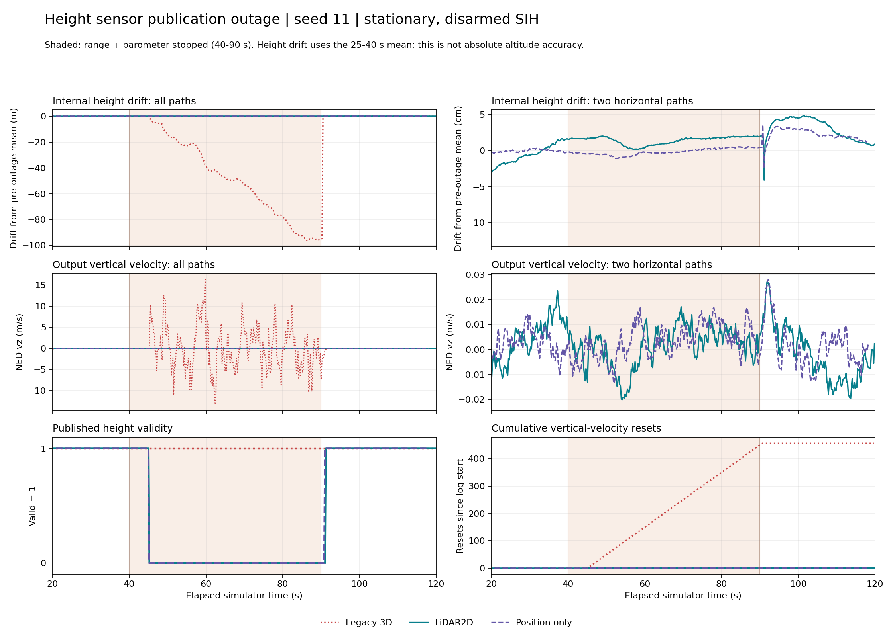

# 2D LiDAR 입력의 높이 센서 공백 검증
다른 채팅의 실제 2D 구현을 검증한 결과 보고서다.
높이 센서 중단 때 기존 수직 문제가 남는지 확인할 때 읽는다.

## 결론

**정지 SIH에서 기존 반복 리셋·수직 발산은 재현되지 않았다.**
2D 입력이 사라진 높이를 측정해 준다는 뜻은 아니다.
높이 센서를 모두 끊으면 높이 유효성은 꺼졌다.
센서가 돌아오면 유효성이 복구됐다.

| 높이 입력 상태 | 2D 입력 결과 | 기존 3D 입력 결과 |
|---|---|---|
| 거리계·기압계 정상 | 수직 반복 리셋 없음 | 수직 반복 리셋 없음 |
| 거리계만 중단 | 기압계 융합·높이 유효 유지 | 같은 반복 문제 없음 |
| 거리계·기압계 모두 중단 | 상실 처리 전환 리셋 1회 | 50초 동안 449–450회 리셋 |
| 모두 중단한 뒤 복구 | 높이 유효성 다시 참 | 큰 높이 보정 뒤 복구 |

세 입력 방식·세 상황·다섯 seed를 비교했다.
최종 비교에는 유효한 45회 기록을 썼다.
로그 누락 1회를 재실행해 총 46회를 실행했다.
앞선 예비 1회는 최종 통계에서 제외했다.
실기·운영 설정·기존 작업은 수정하지 않았다.

이 결과는 이번 고장 유형의 통과 근거다.
실제 LiDAR 융합·공중 안전·S14 완료 근거는 아니다.

## 제품과 입력 경로

수평 LiDAR와 하방 거리계는 다른 제품이다.
장비명은 [장비 목록](../equipment_inventory.md)을 따른다.

| 제품 | 역할 | 이번 시험의 대응 |
|---|---|---|
| YDLIDAR T-mini Pro | 360° 수평 스캔 | 이미 보정된 합성 수평 속도 |
| Benewake TFmini Plus | 아래 방향 거리 측정 | SIH의 합성 하방 거리 |
| Pixhawk 기압계 | 기압 기반 높이 보조 | SIH 기압 센서 모듈 |

두 제품의 광학 특성이나 실제 지연은 모델링하지 않았다.
TFmini Plus 실물 연결을 끊은 시험도 아니다.
PX4에 들어오는 해당 종류의 데이터 공백을 재현했다.

```text
합성 UWB XY 위치 ── VISION ODOMETRY ── EV XY 융합
합성 LiDAR NE 속도 ─ LIDAR ODOMETRY ── 전용 2D 수용 검사
                                           │
                                           └─ 수평 보조 속도 융합
합성 하방 거리 ───── distance_sensor ──────── 높이 융합
합성 기압 ───────── sensor_baro_sim ──────── 높이 융합
```

2D 입력은 `LOCAL_NED` 속도 두 개만 보낸다.
`vz`에는 NaN을 넣는다. 수직 속도 관측은 없다.
위치·자세·각속도는 이 2D 경로에서 융합하지 않는다.
기울기·장착·IMU 기준점 보정은 완료됐다고 가정했다.
T-mini Pro의 body XY를 그대로 NED로 바꾼 것이 아니다.
UWB 수평 보조는 시험 내내 의도적으로 유지했다.

## 고정 구현과 격리

다른 채팅의 runtime을 복사해 그대로 실행했다.
라이브러리 대조군에 그친 이전 시험과 구분한다.
이번에는 MAVLink 수신기부터 EKF2까지 실행했다.

| 항목 | 값 |
|---|---|
| 원본 채팅 | `final 브랜치의 XY LiDAR 기록 확인` |
| 원본 runtime | `/home/dronestock/uwb_sim/uwb-lidar-integration-20261012/runtime-lidar2d-v2` |
| 새 작업 경로 | `/home/dronestock/uwb_sim/lidar2d-height-outage-20261012` |
| PX4 기반 커밋 | `d6f12ad1c4f70ad3230afd7d86e971421e02fef4` |
| 바이너리 SHA-256 | `fb2223618291204051402a940e7fddf30768b7d62d02bf8092493194f0618988` |
| 2D 패치 SHA-256 | `c5c789b5f08de04f4a0924a5811a3f02a13ab3efd59ca4ee498635ea001f3e1a` |
| 원본·복사본 보존 | 262개 파일·심볼릭 링크 전후 동일 |
| 시험 네트워크 | 실행마다 새 공간, loopback만 허용 |
| 기체 상태 | 정지·DISARM, ARM 명령 없음 |
| ROS·직렬 장치·실기 접속 | 사용하지 않음 |

원본 패치·보드·바이너리의 SHA-256을 확인했다.
다른 채팅의 미커밋 코드를 수정하거나 합치지 않았다.
새 도구와 문서는 현재 작업 복제본에만 추가했다.

## 방법과 계산 기준

40초에 발행을 멈추고 90초에 복구했다.
EKF2 높이 융합 설정은 계속 켜 두었다.
기존의 파라미터 비활성 시험과 구분한다.

| 항목 | 값·방법 |
|---|---|
| 각 실행 | 120초, 요청 가속 10배 |
| seed | 11, 22, 33, 44, 55 |
| 합성 관측 | 20초부터 명목 10Hz |
| XY 위치·속도 잡음 | 표준편차 각각 0.01m·0.01m/s |
| 관측 분산 | XY 각각 0.01, 3D의 vz만 10,000 |
| 정상 구간 | 25초 이상 40초 미만 |
| 중단 중 평가 | 55초 이상 85초 미만 |
| 전체 중단 구간 | 40초 이상 90초 미만 |
| 복구 과도 구간 | 90초 이상 105초 미만 |
| 복구 후 평가 | 105초 이상 120초 미만 |
| 거리 발행 중단 | `SIH_DISTSNSR_OVR=10000` |
| 거리 발행 복구 | 합성값 `0.2m`로 복원 |
| 기압 발행 중단·복구 | `sensor_baro_sim stop/start` |

SIH의 거리 발행 조건은 절댓값 10,000 미만이다.
이 조건을 이용해 새 거리 메시지를 멈췄다.
센서 중단은 ULog의 실제 기록 공백으로 확인했다.
높이 융합 플래그도 함께 꺼졌는지 검사했다.

높이 변화 RMS는 중단 전 평균에 맞춘 값이다.
정지 참값의 움직임도 뺐다.
절대 고도 정확도를 뜻하지 않는다.
`ref_alt=NaN`을 0으로 바꾸지 않았다.
전역 XY 원점이 없어도 내부 z는 해발 기준일 수 있다.
이 기준 차이가 수백 m 오류처럼 보일 수 있기 때문이다.

초기 파라미터와 시작 중 변경값을 함께 읽었다.
관측 시작 20초 시점의 유효 설정을 복원했다.
그 이후 EKF2 파라미터 변경은 없었다.
seed는 합성 XY 잡음에 적용했다.
SIH 내부 센서 난수 구현은 변경하지 않았다.

## 세 상황의 비교

아래 범위는 seed 5개의 최소–최대다.
모두 중단 중 평가 구간 55–85초다.
리셋 수는 실행 한 번의 값이다.

| 상황 | 입력 방식 | 내부 높이 변화 RMS m | 출력 vz RMS m/s | vz 리셋 |
|---|---|---:|---:|---:|
| 정상 | 2D | 0.00495–0.01358 | 0.00741–0.00954 | 0 |
| 정상 | 위치만 | 0.00637–0.01959 | 0.00848–0.01116 | 0 |
| 정상 | 기존 3D | 0.02604–0.06318 | 0.01069–0.02321 | 0 |
| 거리만 중단 | 2D | 0.00343–0.01958 | 0.00790–0.01180 | 0 |
| 거리만 중단 | 위치만 | 0.00506–0.01001 | 0.00724–0.01070 | 0 |
| 거리만 중단 | 기존 3D | 0.01689–0.09326 | 0.00743–0.02732 | 0 |
| 모두 중단 | 2D | 0.00369–0.01389 | 0.00695–0.00870 | 0 |
| 모두 중단 | 위치만 | 0.00206–0.00866 | 0.00542–0.00807 | 0 |
| 모두 중단 | 기존 3D | 22.11683–86.86532 | 4.67838–6.46096 | 300 |

위치만 쓰는 대조군도 반복 문제가 없었다.
따라서 2D가 고도 정확도를 높였다는 결론은 내리지 않는다.
새 경로가 기존 3D의 수직 문제를 만들지 않았다는 근거다.

## 높이 관측이 모두 사라진 경우

2D는 수평 융합을 계속하면서 높이를 무효로 표시했다.
기존 3D는 높이 유효를 계속 참으로 표시했다.

| 지표 | 2D | 위치만 | 기존 3D |
|---|---:|---:|---:|
| 내부 상태 표본 수, 5회 합계 | 15,000 | 15,000 | 15,000 |
| 높이 유효 참 / 출력 표본 | 0 / 18,748 | 0 / 18,750 | 18,750 / 18,750 |
| 수직 속도 유효 참 / 출력 표본 | 0 / 18,748 | 0 / 18,750 | 18,750 / 18,750 |
| 55–85초 vz 리셋, 실행당 | 0 | 0 | 300 |
| 40–90초 vz 리셋, 실행당 | 1 | 1 | 449–450 |
| 수평 2D 실제 융합, 5회 합계 | 1,498 | 해당 없음 | 해당 없음 |

2D의 높이 유효는 45.072–45.136초에 꺼졌다.
중단 명령 기준 약 5.07–5.14초 뒤다.
즉시 무효화되는 동작은 아니다.
높이·수직 속도 유효는 같은 OR 조건으로 발행된다.

2D에서 전체 구간 리셋 1회는 따로 구분한다.
PX4의 fake-height 전환에서 발생했다.
이 경로는 마지막 높이를 내부 유지값으로 사용한다.
`resetFakeHgtFusion()`이 속도를 한 번 0으로 리셋한다.
LiDAR 관측마다 vz=0을 계속 융합한 동작은 아니다.
seed 11의 이 리셋은 45.096초에 기록됐다.

실제 보조 속도 융합 횟수도 확인했다.
seed별로 300, 298, 300, 300, 300회다.
수용 카운터 증가만으로 융합 완료를 판단하지 않았다.
일부 실행에는 전달 간격 초과에 따른 재준비가 있었다.
이때도 수직 반복 리셋은 나타나지 않았다.



그림은 seed 11이다. 통계는 전체 기록을 사용했다.
그림 선만 25표본마다 줄여 표시했다.
짧은 최고값은 그림보다 원시 통계를 우선한다.

## 센서가 돌아온 뒤

2D 5회 모두 높이 유효가 복구됐다.
복구 시점은 90.208–91.120초였다.
105–120초에서는 9,303/9,303 표본이 유효했다.
기압계·거리계 융합도 다시 확인했다.

복구 과도 변화까지 없었던 것은 아니다.
90–105초의 2D 내부 높이 변화 최댓값은 0.175m다.
출력 높이는 최대 0.172m였다.
출력 수직 속도 최댓값은 0.0283m/s였다.
이는 중단 전 기준 대비 변화다. 실기 정확도가 아니다.
기존 3D는 복구 초기에 62.98–111.81m가 남았다.
큰 상태 보정이 뒤따랐다.

## 기록 품질과 보존

로그가 온전한 45개 조합으로 최종 표를 만들었다.
최종 검사에는 실패 항목이 없다.

| 항목 | 확인 |
|---|---|
| 최종 비교 | 45회, ULog dropout 0 |
| 재실행 이유 | 위치만·정상·seed 44의 29.576초 로그 누락 |
| 원래 누락 기록 | 0ms·468ms dropout 두 항목, 원본 보존 |
| 재실행 | 같은 조건, 별도 `matrix-retry` 폴더 |
| 예비 실행 | 2D·모두 중단·seed 11 한 번, 통계 제외 |
| 초기 분석 수정 | 내부 높이 기준과 기압계 기록률 처리 수정 |
| 결과 유지 | 초기 분석 파일도 압축본에 보존 |

기압계 원시 로그는 약 1Hz로 제한된다.
기압계 재시작은 uORB 인스턴스 1을 사용했다.
모든 인스턴스를 합쳐 중단·복구를 확인했다.
기록 표본 수는 실제 센서 발행 횟수가 아니다.

원시 기록·runtime·제외 실행은 압축본에 보관했다.
46개 ULog를 포함한 기록 파일 414개를 해시 대조했다.
압축본 내부의 불일치는 0개였다.
Windows 복사본의 SHA-256도 원본과 같았다.

```text
C:\Users\A\Documents\ChatGPT\DroneStock\outputs\
  lidar2d-height-outage-raw-20261012.tar.gz
  lidar2d-height-outage-supplement-20261012.tar.gz
```

압축본 내부 파일 해시는 [보존 감사](evidence/lidar2d_height_outage_20261012/preservation_audit.json)에 있다.
전체 통계와 표본 수는 [비교 JSON](evidence/lidar2d_height_outage_20261012/comparison.json)에 있다.
재실행은 [절차](../runbooks/lidar2d_height_outage_20261012.md)를 따른다.

## 남은 검증과 판단

이번 특정 실패 유형에 대한 2D 후보 근거가 생겼다.
기존 `vz=0` 3D 후보는 계속 보류한다.
실기 채택과 전체 S14는 여전히 보류다.

| 남은 항목 | 이번에 완료하지 않은 이유 |
|---|---|
| 공중 높이 센서 동시 상실 | 이번 시험은 정지·DISARM |
| 실제 스캔 입력 | 합성 수평 속도를 직접 전달 |
| 장착·기울기 보정 | LOCAL_NED 보정 완료를 가정 |
| UWB까지 동시에 상실 | 정상 UWB 보조를 유지 |
| TFmini Plus 실물 고장 | SIH 발행 공백만 재현 |
| 센서 복구 뒤 비행 제어 | 고도·자세 제어 명령을 실행하지 않음 |

높이가 무효이면 수평 LiDAR만으로 높이를 알 수 없다.
작은 변화량은 정지 조건과 PX4 내부 유지 처리의 결과다.
비행 중 고도 유지 성공으로 확대 해석하지 않는다.
