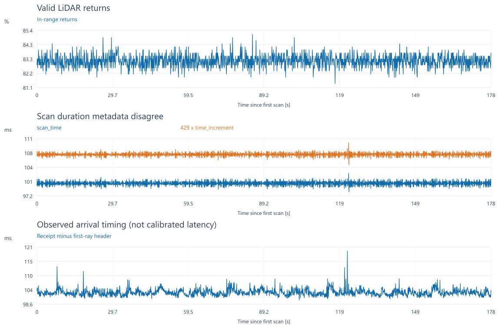
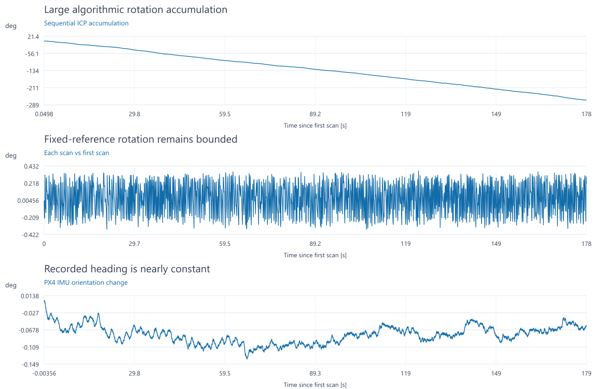

# 수평 LiDAR 지상 분석 — 2026-10-12
지상 원본의 스캔매칭 결과를 설명하는 기록이다.
LiDAR 수평 관측과 SITL 후속 작업을 시작할 때 읽는다.

## 결론

1번 방식은 후보로 유지한다. 바로 적용하지 않는다.
이번 간이 정합은 연속 누적에서 큰 회전 오차를 보였다.
첫 스캔 기준 정합은 상대적으로 안정적이었다.
기준 스캔·IMU 회전 일관성 검증을 먼저 진행한다.

| 항목 | 완료 범위 |
|---|---|
| 지상 원본 품질·스캔매칭·동시 센서 비교 | 오프라인 분석 완료 |
| 가까운 점 제외 범위 비교 | 0.03/0.20/0.35/0.50m 비교 완료 |
| 실기 PX4 커밋의 외부 속도 처리 | 소스 확인 |
| 같은 커밋의 SITL | 14개 시험 설계. 실행 미실시 |
| 비행 원본·동일 시행 ULog 분석 | 원본 회수·시각 대응 미완료 |
| FC 관측 입력·설정·실제 비행 | 이번 작업에서 변경·실행하지 않음 |

이 기록은 LiDAR 센서 자체의 정확도 인증이 아니다.
간이 구현의 결과와 실제 기체 움직임을 구분한다.
[후속 절차](../runbooks/lidar_uwb_sitl_handoff_20261012.md)를 따른다.

## 센서와 장착 기준

분석 대상은 360° 수평 LiDAR의 `/scan`이다.
하향 센서의 바닥 거리는 비교 자료로만 사용했다.

| 센서 | 역할 | 장착 정보 |
|---|---|---|
| YDLIDAR T-mini Pro | 360° 수평 형상·이동량 후보 | UWB 안테나 바로 아래 약 10cm |
| Benewake TFmini Plus | 하향 거리·PX4 고도 관측 | 위 LiDAR와 별도 센서 |

10cm는 10월 12일 사용자 추정값이다.
실측값이나 FC IMU 기준 거리가 아니다.
수평 오프셋은 UWB 기준으로 거의 0으로 본다.
장착 회전은 아직 실측하지 않았다.
body FRD 가정 벡터는 `r_UWB→LiDAR=(0,0,+0.10)m`다.
FRD의 +Z는 아래쪽이다.

같은 몸체 좌표로 표현한 속도는 아래 관계를 따른다.

```text
v_UWB = v_LiDAR - ω × r_UWB→LiDAR

UWB 안테나 위치 ------------------------┐
수평 LiDAR 속도 → 장착 거리 보정 --------┤
                       공통 시각·기준점의 관측
                                      ↓
                          단일 외부 관측 입력
                                      ↓
                              PX4 EKF2
```

수평 차이가 0이면 yaw 회전의 영향은 작다.
roll/pitch에는 수직 거리도 영향을 준다.
10cm·10°/s의 계산 예시는 약 0.017m/s다.
PX4의 기존 UWB→IMU 보정과 중복하지 않는다.
실측은 UWB 안테나와 LiDAR 광학 중심 사이에서 한다.

과거 TF의 2cm는 제조사 기본값이다.
현재 수집 코드는 이 미측정 TF를 발행하지 않는다.
과거 전방 14cm와 ToF→태그 15cm도 별개다.
이유: 서로 다른 센서와 기준점의 거리이기 때문이다.

## 원본과 동시 관측

지상 약 3분 기록을 분석했다. 비행 기록은 아니다.

| 항목 | 값 |
|---|---|
| 수집 시각 | 2026-10-11 16:18:12–16:21:13 KST |
| capture ID | `capture-1791703092109574820-28f571f8` |
| LiDAR | 1,781개. 관측 시각 범위 178.447451초 |
| UWB B_TF 위치 | 7,201개 |
| PX4 IMU | 17,856개 |
| PX4 odom | 5,357개 |
| 상태 | 모든 상태 표본이 지상·DISARM |
| 실행 모드 | sensor-only. 외부 UWB 출력 비활성 |
| 좌표·시각 확인 | `/tf`, `/tf_static` 없음. 확인 플래그 false |
| PX4 위치 상태 | `const_pos_mode_status_flag=True` 전 구간 |

원본 `events.jsonl`의 SHA-256은 다음과 같다.

```text
80f1c6c94ee0aa1d7ec392c8922a1676e5366c29d7b40642213c8f4ea620ac79
```

지상·DISARM만으로 정지를 확정하지 않았다.
IMU 자세 변화와 UWB·점군 변화도 함께 확인했다.
roll/pitch/yaw 변화 폭은 0.085/0.099/0.141°다.
하향 거리는 0.38–0.39m였다.
이 근거로 정지에 가까운 기록으로 추정한다.
독립적인 위치 정답은 없다.

## 수신과 광선 시각

수신은 일정하다. 광선 시각의 의미는 확인이 필요하다.

| 지표 | 결과 |
|---|---|
| 유효 광선 중앙값 | 357/430개, 83.0% |
| 최대 수신 간격 | 약 115.7ms. 250ms 초과 공백 없음 |
| 한 바퀴 `scan_time` 중앙값 | 약 100.22ms |
| `429 × time_increment` 중앙값 | 약 107.35ms |
| 위 두 시간의 비율 중앙값 | 1.0725 |
| 수신−header 중앙값 | 약 102.94ms |
| 최소 유효 거리 | 0.379m |
| 0.5m 미만 점 중앙값 | 스캔당 67개 |

광선 시간 합이 회전 시간보다 약 7.25% 크다.
`fixed_resolution=true`의 재표본화 경로를 확인한다.
수신−header를 그대로 EKF 지연값으로 쓰지 않는다.
이유: 한 바퀴 수집 시간도 포함될 수 있다.
이번 분석은 deskew를 적용하지 않았다.
가까운 점을 기체 반사로 확정하지도 않았다.



## 스캔매칭 방법과 검증

이번 구현은 point-to-line ICP의 간이 기준선이다.
Censi의 정확한 PLICP 알고리즘 재현은 아니다.

| 처리 | 사용값 |
|---|---|
| 양쪽 점군의 기하 필터 | 연속 5점의 평면성. 같은 조건 적용 |
| 이웃 점 최대 간격 | 0.30m |
| 국소 고유값 비율 상한 | 0.12 |
| 최근접 대응 최대 거리 | 0.20m |
| Huber 기준 | 0.03m |
| 잔차 제외 | 상위 10% |
| 최대 반복 | 30회 |
| 간이 게이트 | 대응 60개·겹침 50% 이상 |
| 잔차 게이트 | 남은 잔차 p90 ≤ 0.05m |
| 기하 게이트 | 각도 열을 거리로 정규화한 조건수 ≤ 1,000 |
| 쌍별 이동 게이트 | ≤ 0.20m·10°, 시각 간격 < 0.25초 |

현재 스캔을 이전 스캔 좌표로 옮기는 변환을 구한다.
이동량은 두 관측 시각의 차이로 나눈다.
별도로 각 스캔을 첫 스캔에 직접 정합했다.
첫 스캔 정합은 매번 0 이동에서 시작했다.
정지에 가까운 이 자료용 진단 방법이다.

알려진 이동·회전 복원 시험을 통과했다.
같은 스캔의 0 이동과 변환 합성도 확인했다.
실제 처음·중간·끝 스캔의 동일 입력도 확인했다.
단일 벽의 관측 퇴화를 거절하는 시험도 통과했다.
이 시험들은 비행 정확도를 검증하지 않는다.

## 결과와 한계

작은 잔차와 높은 통과율만으로 누적 오류를 막지 못했다.

| 지표 | 결과 |
|---|---|
| 0.20m 필터의 속도 p95 | 약 0.0578m/s |
| 간이 게이트 통과 | 1,734/1,780쌍, 약 97.4% |
| 전체 쌍 누적 yaw | −267.13° |
| 전체 쌍 누적 XY 종점 거리 | 약 0.155m |
| 통과 쌍만 더한 yaw | −258.34° |
| 첫 스캔 정합 통과 | 1,749/1,781개 |
| 첫 스캔 정합 위치 변동 p95 | 자기 중앙값 주위 약 5.88mm |
| UWB 위치 변동 p95 | 자기 중앙값 주위 약 11.61mm |
| PX4 위치 변동 p95 | 자기 중앙값 주위 약 2.54mm |
| PC 전처리+정합 시간 p95 | 약 2.64ms. I/O·ROS 제외 |

267°는 실제 기체 회전이 아니다.
이번 간이 연속 정합에서 누적한 결과다.
거절 쌍 포함 누적은 진단용이며 정식 odometry가 아니다.
통과 쌍만 더한 값도 거절 구간을 정지로 둔 진단이다.

세 위치 변동은 각자 좌표계의 반복성이다.
공통 관측 시간 구간에서 계산했다.
UWB는 이미 시간창을 사용하는 출력이다.
PX4는 지상 constant-position 상태였다.
따라서 수치의 크기로 센서 정확도를 순위 매기지 않는다.
이유: 어느 것도 독립 정답 대비 오차가 아니기 때문이다.



0.03/0.20/0.35m는 같은 점들을 남겼다.
최소 유효 거리가 0.379m였기 때문이다.
0.50m에서는 속도 p95가 약 0.0999m/s였다.
가까운 점을 더 제거한다고 결과가 좋아지지는 않았다.

회전 누적의 원인은 아직 분리하지 못했다.
대응점·국소해·각도 재표본화 등을 검토한다.
센서 고장이나 실내 자력계 이상으로 단정하지 않는다.
Jetson 실행 시간과 비행 중 성능도 미측정이다.

## PX4 후보 입력과 논문 근거

표준 입력의 가능성과 실제 사용 가능성을 구분한다.
실기 확인 커밋은 다음과 같다.

```text
d6f12ad1c4f70ad3230afd7d86e971421e02fef4
```

| 확인 항목 | 후보 방식에 미치는 영향 |
|---|---|
| 속도 3축 `isAllFinite()` | `vz=NaN`으로 수평만 보내는 단순 방식은 불가 |
| body FRD 축별 갱신 | 유한 vz와 큰 분산은 시험 후보 |
| `EKF2_EV_NOISE_MD=0` | 공급 분산이 실제 사용되는 경로 확인 필요 |
| 리셋 시 평균 회전·분산 대각 ×5 | 큰 z 분산만으로 수직 영향이 사라지지 않음 |
| 수평·수직 마지막 융합 시각 갱신 | 큰 z 분산은 수직 aiding 완전 비활성과 다름 |
| 공통 EV 시각·품질·리셋 상태 | 두 센서를 임의로 번갈아 발행하면 안 됨 |

`vz=0`은 실측 수직 속도가 아니다.
큰 유한 분산을 쓰는 후보는 격리 SITL에서만 시험한다.
시작·복구·기울기·수직 상태 영향을 확인한다.
실기 설정으로 채택한 값은 없다.

| 근거 | 이 작업에서 사용한 내용 |
|---|---|
| [PX4 ev_vel_control.cpp](https://github.com/PX4/PX4-Autopilot/blob/d6f12ad1c4f70ad3230afd7d86e971421e02fef4/src/modules/ekf2/EKF/aid_sources/external_vision/ev_vel_control.cpp) | 3축 유효성·body 융합·융합 시각 |
| [PX4 ev_vel.h](https://github.com/PX4/PX4-Autopilot/blob/d6f12ad1c4f70ad3230afd7d86e971421e02fef4/src/modules/ekf2/EKF/aid_sources/external_vision/ev_vel.h) | 장착 속도와 리셋 처리 |
| [PX4 EKF2.cpp](https://github.com/PX4/PX4-Autopilot/blob/d6f12ad1c4f70ad3230afd7d86e971421e02fef4/src/modules/ekf2/EKF2.cpp) | 외부 관측·분산 수신 |
| [Petrlík 외, ICUAS 2021](https://aerial-core.eu/wp-content/uploads/2021/11/ICUAS_2021_Matej.pdf) | 2D LiDAR UAV의 연속·지도 정합과 자세 보상 |
| [Censi, ICRA 2008](https://authors.library.caltech.edu/records/vcxzb-61e65) | point-to-line 정합. 이번 구현과는 구분 |
| [Zhang 외, ICRA 2016](https://www.cs.cmu.edu/~kaess/pub/Zhang16icra.html) | 관측이 약한 방향의 퇴화 처리 |
| [Bonnabel 외, ACC 2016](https://arxiv.org/abs/1410.7632) | ICP 공분산·대응점 재선정의 주의점 |

조건수를 곧바로 EKF 공분산으로 사용하지 않는다.
이유: 현재 지표는 보정된 측정 오차 모델이 아니다.
논문의 비행 성공도 우리 구성의 성공을 대신하지 않는다.

## 보존 자료

저장소에는 요약·시험 명세·주요 그림을 보존한다.
158MB 원본과 전체 재생 산출물은 로컬에 보존했다.
원시 로그는 기존 저장소 경계에 따라 올리지 않는다.

| 자료 | 위치 |
|---|---|
| 수치·방법·소프트웨어 시험 | [summary.json](evidence/lidar_ground_20261012/summary.json) |
| 장착 정정·추가 진단 | [supplement.json](evidence/lidar_ground_20261012/supplement.json) |
| 10초 구간 비교 | [ten_second_blocks.csv](evidence/lidar_ground_20261012/ten_second_blocks.csv) |
| SITL 14개 시험 명세 | [sitl_plan.json](evidence/lidar_ground_20261012/sitl_plan.json) |
| 보관 경로·원본/분석 코드 해시 | [provenance.json](evidence/lidar_ground_20261012/provenance.json) |

로컬 산출물은 프로젝트 루트의 아래 폴더에 있다.

```text
output/lidar-ground-analysis-20261012/
  analyze.py, supplement.py, make_figures.py, make_report.py
  report.html, plot_data.npz, 스캔별 CSV, 그림 6개
work/lidar-archive-20261011/
  capture-1791703092109574820-28f571f8/events.jsonl
```

분석 스크립트는 당시 로컬 배치를 참조한다.
저장소 clone만으로 원본 재생이 되지는 않는다.
다른 호스트에서는 자료를 찾아 해시부터 확인한다.
원본 부재를 새 측정이나 비행 성공으로 대체하지 않는다.
