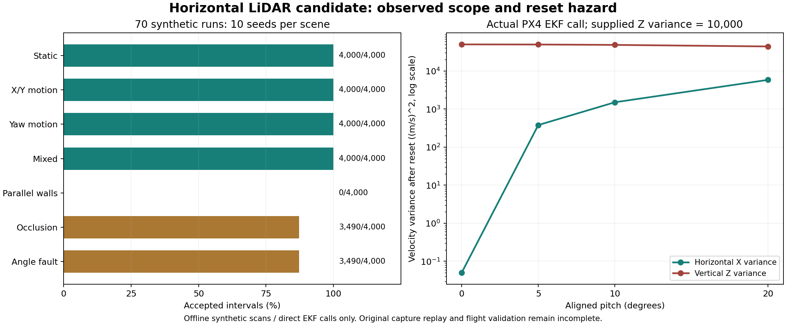
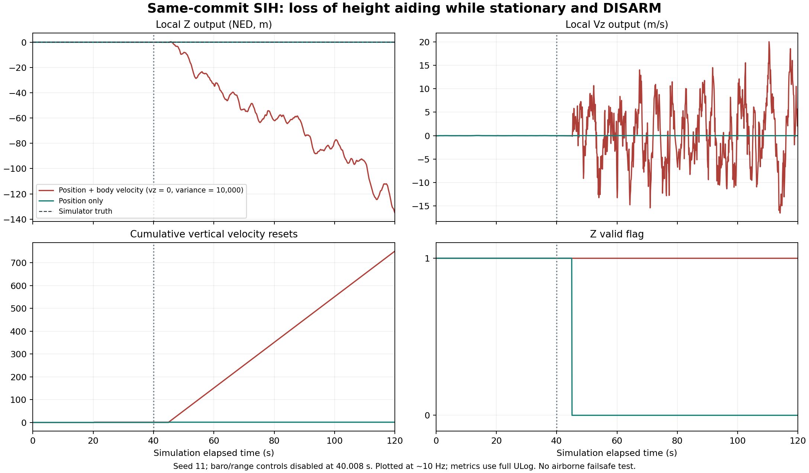

# 수평 LiDAR 개선 후보와 PX4 진단 — 2026-10-12
기준 스캔·IMU 개선과 격리 시험의 결과 기록이다.
원본 재실행과 비행 입력 채택을 판단할 때 읽는다.

후속 [수직 원인 분리 결과](lidar_vertical_followup_20261012.md)를 추가했다.
아래 17개·합성 70회·SIH 140회 이력은 그대로 보존한다.
새 라이브러리 70회와 원본 회수 상태는 후속 문서를 따른다.

## 결론

**현재 `vz=0`·큰 분산 후보는 채택 보류다.**
실기와 같은 EKF 코드에서 위험을 재현했다.
속도 리셋은 큰 분산에도 평균을 바꾼다.
기울기에서는 z 분산이 수평으로 투영된다.
높이 관측 제거 후에는 수직 출력도 크게 발산했다.
정지 SIH 5회에서 z RMS는 55.98–100.76m였다.
그동안 고도 유효 플래그는 참으로 유지됐다.
S14 폐루프 시험의 선행 조건을 만족하지 못했다.

기준 스캔+IMU 알고리즘은 오프라인 후보로 구현했다.
합성 이동 시험에서 실제 이동을 제거하지 않았다.
그러나 기존 −267.13° 결과의 재현은 미완료다.
해당 원본과 기존 분석 스크립트를 회수하지 못했다.
이를 실제 기록의 개선 성능으로 보고하지 않는다.

| 작업 | 근거의 종류 | 완료 범위 |
|---|---|---|
| 원본 −267° 재현 | 기존 보고서·탐색 기록 | 원본·분석기 부재로 미완료 |
| 기준 스캔+IMU 후보 | 새 코드·합성 ray casting | 7종 장면 × 10 seed |
| 재실행 도구 | 파일 해시·원본 행 번호 | 준비 및 작은 fixture 검증 |
| PX4 속도 리셋 | 실제 EKF 라이브러리 호출 | roll/pitch 각각 4 기울기 × 4 분산 |
| 표준 EV 입력 진단 | 격리 SIH·원본 ULog | 28조건 × 5 seed = 140회 종료·집계 |
| UWB+광류 대비 추가 가치 | S12 | 미실시 |
| 비행 추종 | S14 | 위험 발견으로 보류 |
| 실기 설정·서비스·비행 | 이번 작업 범위 밖 | 변경·실행 없음 |

사용자는 임무 허용 오차를 아직 정하지 않았다.
먼저 수치를 기록하고 나중에 기준을 정하기로 했다.
따라서 작은 오차를 임무 합격으로 판정하지 않는다.
코드의 관측 게이트는 실험값으로만 기록한다.

## 기준 버전과 원본

분석용 저장소와 실기 작업 공간을 분리했다.

| 항목 | 확인값 |
|---|---|
| ROS2 시작 커밋 | `8cfe94cd80e5e6094f1fb5bd173b47ebed5e293e` |
| 작업 브랜치 | `codex/lidar-keyframe-sitl-20261012` |
| PX4 HEAD·ULog `ver_sw` | `d6f12ad1c4f70ad3230afd7d86e971421e02fef4` |
| PX4 실행 | 새 WSL 체크아웃, SIH, DISARM |
| 격리 | 별도 network namespace, loopback만 사용 |
| ROS 환경 | domain 99·localhost. 실제 ROS 발행 없음 |
| FC 접근 | 시리얼 장치와 실기 주소에 접속하지 않음 |

PX4 EKF·SIH 소스는 수정하지 않았다.
Gazebo·DDS 의존성을 뺀 새 board 설정만 만들었다.
가속 board는 실제 컴파일 옵션도 확인한다.
`ENABLE_LOCKSTEP_SCHEDULER`가 없으면 실행을 거절한다.

원본은 Git에 포함되어 있지 않았다.
Windows 작업 폴더에서도 찾지 못했다.
연결된 Linux의 읽을 수 있는 경로도 확인했다.
기본 capture 저장 경로는 읽기 권한이 없었다.
`pgyxn`의 `feature_uwb` fetch는 수행했다.
원격 checkout·기존 원시 기록은 바꾸지 않았다.
fetch는 별도 사용자의 capture 권한을 바꾸지 않는다.

| 필요한 파일 | 기존 기록의 위치·식별자 |
|---|---|
| `events.jsonl` | `work/lidar-archive-20261011/capture-1791703092109574820-28f571f8/` |
| 기존 `analyze.py` | `output/lidar-ground-analysis-20261012/` |
| 동반 분석 파일 | 같은 폴더의 `supplement.py`, `summary.json` 등 |
| Linux capture 후보 경로 | `/home/arialhanho/.local/share/dronestock/manual-captures/` — 읽기 불가 |

원본과 분석기의 기대 SHA-256:

```text
events.jsonl
80f1c6c94ee0aa1d7ec392c8922a1676e5366c29d7b40642213c8f4ea620ac79
analyze.py
654bc5471f63e0685b8811236fc1fa122d36a5ba5c8a1c96fad34454f7c4ffc5
```

경로는 과거 프로젝트 기준 상대 경로다.
읽기 불가 경로에 파일이 있다고 확정하지 않는다.
새 comparator를 기존 `analyze.py`로 부르지 않는다.

## 광선 시각 조사

**고정 각도 격자와 원시 점 수의 차이가 유력하다.**
아래 수치 관계는 기존 1.0725를 정확히 설명한다.
다만 설치 바이너리의 원본 커밋은 확인하지 못했다.
이 경로가 −267° 누적 회전의 원인이라는 증거도 없다.

| 확인 대상 | 확인 내용 |
|---|---|
| 설치 SDK 표시 버전 | `1.2.20` |
| 설치 정적 라이브러리 SHA-256 | `443a490d04a566136076fc4610fd7a31f0fabff3fca56e141ab303bb67b377ac` |
| ROS 드라이버 커밋 | `4ef70d3f32a85704ade0be54b214f3763b1ab3e8` |
| 대조한 공식 SDK 커밋 | `42a82ed10d2304094c111fc63dee8e4a229b79b7` |
| SDK 시간 간격 | `scan_time / 원시 count` |
| SDK 고정 각도 간격 | `field_of_view / (fixed_size - 1)` |
| SDK 고정 크기 경로 | `(sample_rate + 0.3) × 1000 / scan_frequency` |
| ROS 재배치 | 각도를 `ceil`로 격자 index에 배치 |
| ROS 시간 필드 | SDK 값을 그대로 복사 |

```text
가정: 원시 count = 400, 4 kHz, 10 Hz
고정 각도 격자 = (4 + 0.3) × 1000 / 10 = 430
(430 - 1) × (scan_time / 400) / scan_time
                                             = 1.0725
```

이 계산은 SDK 경로와 기존 통계의 일치다.
원시 packet·설치 SDK 소스의 검증을 대신하지 않는다.
조회 시점의 설치 파일과 과거 실행 파일의 동일성도 미확인이다.
격자 순서와 실제 광선 획득 순서도 같다고 보지 않는다.
`reversion`·`inverted` 설정이 추가로 관여한다.
따라서 현재 후보는 `deskew_applied=false`다.
`time_increment`를 임의로 고쳐 원본에 덮어쓰지 않았다.

## 기준 스캔·IMU 후보

직전 쌍의 작은 회전 오차를 계속 더하지 않는다.
여러 스캔을 유지한 기준 스캔에 직접 정합한다.

```text
원본 /scan ── 유효 광선·국소 선 ──┐
                                 ↓
보존 기준 스캔 ─────────── 양방향 ICP
                                 ↑
IMU 각속도 ── 장착 회전 ── 구간 적분
                                 ↓
기하·잔차·양방향·IMU 회전 게이트
                                 ↓
신선한 두 관측의 이동량·구간 평균 속도
                                 ↓
파일 저장만 수행 — ROS/FC 연결 없음
```

| 항목 | 후보의 처리 |
|---|---|
| 변환 정의 | 현재 scan 좌표 → 기준 scan 좌표 |
| 회전 Jacobian | 회전한 점 사용. 평행이동을 넣지 않음 |
| 양방향 검사 | 정·역 ICP를 각각 최적화 |
| IMU | scan Z축 각속도 적분으로 초기값·일관성 검사 |
| 독립성 | PX4 융합 위치·자세를 LiDAR 관측으로 되먹이지 않음 |
| 기준 교체 | 기준에서 0.35m 또는 12° 이동 |
| 양방향 게이트 | 병진 0.02m·회전 0.30° |
| IMU 회전 게이트 | 차이 1° |
| 수치 수렴 | 갱신 병진 < 0.1mm, yaw < 0.00005rad |
| 긴 공백 | 0.25초 이상이면 새 구간 |
| 거절 뒤 복구 | pose만 재획득한 뒤 다음 신선한 구간부터 속도 |
| 속도 시각 | 두 관측의 중간 시각·구간 길이 보존 |
| 공분산 | 잔차·조건수를 보정된 공분산으로 변환하지 않음 |

그 외 기하 필터는 기존 문서의 값으로 시작했다.
연속 5점·0.30m 경계·고유값 비율 0.12를 사용한다.
대응 거리 0.20m·Huber 0.03m·상위 10% 제외다.
대응 60개·겹침 50%·잔차 p90 0.05m를 검사한다.
정규화 조건수 상한은 1,000이다.
모든 게이트는 현물 검증 전 실험 설정이다.

첫 구현의 0.01mm 수치 수렴 조건은 너무 엄격했다.
합성 이동에서 작은 갱신에도 수렴 실패가 반복됐다.
최종값은 3mm 합성 거리 잡음보다 작게 정했다.
수정 전 결과와 수정 후 결과를 모두 보존했다.
X/Y·seed 11의 첫 설정을 재실행해 대조했다.
356/400 승인과 오차 수치가 초기 결과와 일치했다.
추가 seed는 같은 장면의 잡음만 달리한다.
다른 실물 환경에 대한 일반화 검증은 아니다.

실제 replay의 IMU 검사는 장착 회전 파일이 필요하다.
파일이 없으면 LiDAR 단독 진단이라고 명시한다.
gyro bias 보정과 기울어진 스캔 복원은 미구현이다.
장기간 새 장면에서 정합이 안 되면 보류할 수 있다.
이 후보는 전체 SLAM이나 전역 재위치추정이 아니다.

## 합성 평가 결과



실제 움직임을 지우지 않고 잡음과 거절을 평가했다.
각 시행은 40초·401스캔·400구간이다.
기본 seed는 11/22/33/44/55다.
추가 seed는 66/77/88/99/110이다.
거리 잡음은 독립 정규분포 σ=3mm다.
gyro에는 0.01°/s rate 잡음을 별도로 넣었다.
각 스캔은 순간 360° 광선이다. 회전 수집 모델이 아니다.

| 합성 장면 | 승인 구간/전체 | seed별 XY RMS의 최댓값 | seed별 yaw RMS의 최댓값 |
|---|---:|---:|---:|
| 정지 | 4,000/4,000 | 0.645mm | 0.0107° |
| X/Y 각 1m 왕복 | 4,000/4,000 | 1.343mm | 0.0181° |
| ±30° 회전 | 4,000/4,000 | 1.138mm | 0.0214° |
| 이동·회전 혼합 | 4,000/4,000 | 1.063mm | 0.0159° |
| 특징 없는 평행 벽 | 0/4,000 | 계산 불가 | 계산 불가 |
| 5초 동안 240/430 광선 가림 | 3,490/4,000 | 0.654mm | 0.0107° |
| 5초 동안 미기록 각도 편차 3° | 3,490/4,000 | 0.654mm | 0.0107° |

오차는 승인 구간에서만 계산했다.
가림·각도 편차에서는 시행당 50구간을 거절했다.
이어지는 1구간은 pose 재획득에 사용했다.
평행 벽의 오차를 0으로 표시하지 않는다.
사람 이동·반복 선반·실제 반사와 진동은 미평가다.
새 연속 정합 comparator도 −267°를 보이지 않았다.
따라서 기존 실패의 재현 또는 완전 해결 주장은 없다.

## PX4 리셋 경로의 실제 실행

큰 분산은 평균 리셋을 막는 스위치가 아니다.
동일 커밋의 `libecl_EKF.a`에 probe를 연결했다.
기존 SensorSimulator로 자세를 먼저 정렬했다.
`EvVelBodyFrameFrd::resetVelocity()`를 직접 호출했다.
펌웨어 내부 함수나 수식을 복사해 대체하지 않았다.

수평 자세에서 기존 `vz=0.4m/s`를 설정했다.
이어 `vz=0` 자리값으로 리셋했다.
분산 1/100/10,000/1,000,000 모두 `vz≈0`이 됐다.
이는 리셋 경로의 결과다. 비행 중 자동 발동 시험은 아니다.

| pitch | 입력 z 분산 | 리셋 뒤 수평 X 속도 분산 | 리셋 뒤 z 속도 분산 |
|---:|---:|---:|---:|
| 0° | 10,000 | 0.0500 | 50,000.0 |
| 5° | 10,000 | 379.8559 | 49,620.2 |
| 10° | 10,000 | 1,507.7329 | 48,492.3 |
| 20° | 10,000 | 5,848.9336 | 44,151.1 |

분산 단위는 `(m/s)²`다.
입력 수평 분산은 양축 각각 0.01이다.
실제 경로는 `diag(R·diag(var)·Rᵀ) × 5`다.
표의 yaw·roll은 0이며 pitch만 바꿨다.
roll도 별도 실행했다. 원시 JSON에 32조합이 있다.
동적 시작·복구·제어 영향 검증은 남았다.

장착 보정은 18개 조합을 추가로 실행했다.
높이 5/10/15cm와 세 축 ±10°/s를 사용했다.
LiDAR→UWB 보정 뒤 실제 PX4 보정 경로를 호출했다.
가상의 IMU→UWB 벡터는 `(0.02,-0.03,0.04)m`다.
이 벡터는 실측값도 실제 기체에 대한 추정도 아니다.
합성 벡터 합에 대한 수학·코드 일관성 시험이다.
roll/pitch 10°/s의 보정 크기는 다음과 같다.

| UWB→LiDAR 높이 | 속도 보정 크기 |
|---:|---:|
| 0.05m | 0.008727m/s |
| 0.10m | 0.017453m/s |
| 0.15m | 0.026180m/s |

순수 수직 벡터의 yaw 회전 보정은 0이다.
실물 TF와 시각을 포함한 통합 검증은 남았다.

### 수직 전용 리셋의 추가 차이

기본형 참조 호출은 몸체 z를 그대로 사용할 수 있다.
`controlEvVelFusion`은 `ExternalVisionVel &`를 받는다.
기본형의 `resetVerticalVelocity()`는 virtual이 아니다.
몸체 FRD 파생형의 동명 함수로 자동 전환되지 않는다.
따라서 기울기 회전·분산 ×5 경로와 결과가 다르다.

실제 함수 두 경로를 8개 기울기에서 대조했다.
입력 몸체 속도는 `(0.5,0.2,0)m/s`다.
20° pitch에서 기본형 호출은 `vz≈0`이었다.
파생형 직접 호출은 `vz≈−0.171010m/s`였다.
z 분산도 각각 10,000과 44,151.1이었다.
이는 해당 커밋의 호출 분기 대조 결과다.
이 probe는 자동 높이 복구 분기를 계측하지 않았다.
아래 SIH에서는 수직 리셋의 반복을 추가로 관측했다.
PX4 소스를 수정해 이 차이를 없애지는 않았다.

body 속도 융합은 큰 z 분산에도 수직 시각을 갱신한다.
`fuseBodyFrameVelocity()`의 실제 소스에서 확인했다.
`_time_last_hor_vel_fuse`와 `_time_last_ver_vel_fuse`다.
큰 분산이 수직 aiding을 완전히 비활성화하지는 않는다.
공중 고장·failsafe 영향은 S13의 남은 검증이다.

## 격리 SIH 진단의 범위

SITL에서는 합성 외부 관측의 전달 경로를 시험했다.
실제 LiDAR 알고리즘을 비행 센서로 연결한 시험은 아니다.
UWB 40Hz와 LiDAR 10Hz의 시각 결합도 아직 없다.
공통 10Hz 패킷에 독립 잡음 위치·속도를 넣었다.
위치 XY와 속도 XY 잡음의 σ는 각각 0.01이다.
위치 z와 속도 z는 0 자리값이다.
EV yaw·height 제어는 켜지 않았다.

가상 위치·속도 정답은 오차 계산에만 사용했다.
입력에는 groundtruth나 EKF 상태를 사용하지 않았다.
다만 입력 일정과 timestamp에는 PX4 시계를 사용했다.
이는 실제 companion 시계 동기화 검증을 대신하지 않는다.

각 실행은 120초·seed 11/22/33/44/55다.
이 seed는 합성 EV 잡음에만 적용된다.
SIH 자체의 센서 seed는 1234로 고정이다.
0–20초 정렬, 20–40초 정상, 40초 조건 주입이다.
로그 집계의 정상 구간은 25–40초다.
결함 구간은 40–45초, 복구는 50–120초다.
`vertical_aiding`에서는 높이 관측을 다시 켜지 않는다.
이 조건의 50–120초는 제거 후 관찰 구간이다.
0.2/1초 공백도 40–45초 집계에 포함된다.
세밀한 공백·복구 시각은 별도 수치로 확인한다.

송신 수와 실제 융합 수를 구분했다.
ULog의 `timestamp_sample`을 기준으로 관측을 셌다.
양의 서로 다른 `time_last_fuse`로 갱신을 셌다.
PX4는 관측으로 리셋할 때도 이 값을 갱신한다.
따라서 이 수는 융합과 관측 리셋을 포함한다.
리셋 횟수를 별도로 세어 단순 융합과 구분했다.
uint8 counter의 255→0도 1회로 센다.
이는 기록된 EKF 갱신 수다.
모든 MAVLink 패킷의 완전 수신을 뜻하지 않는다.

### 실행 수와 정상 구간

140회 모두 종료됐고 집계 오류는 없었다.
실행당 1,000개, 총 140,000개 패킷을 송신했다.
이는 프로그램 종료 성공이며 시나리오 합격이 아니다.
140개 ULog 모두 같은 PX4 커밋을 기록했다.
전체 로그에서 `armed=0`, `landed=1`을 확인했다.

정상 기준은 `variance-m0-z10000`의 5회다.
25–40초의 위치·속도 관측 갱신은 각각 149회다.
이 구간의 위치·속도 리셋은 0회다.
정답 대비 XY RMS는 5.84–10.35mm였다.
XY 속도 RMS는 0.01047–0.01664m/s였다.
모두 seed별 수치의 최솟값–최댓값이다.
이 수치는 정지 SIH의 합성 입력에만 적용된다.

### S02: 분산 전달

`EKF2_EV_NOISE_MD` 선택은 결과를 크게 바꾼다.
각 행은 정상 구간 5회, 총 40회 실행 결과다.

| noise mode | 송신 z 속도 분산 | 기록된 관측 z 속도 분산 |
|---:|---:|---:|
| 0 | 1 | 1 |
| 0 | 100 | 100 |
| 0 | 10,000 | 10,000 |
| 0 | 1,000,000 | 1,000,000 |
| 1 | 1 / 100 / 10,000 / 1,000,000 | 모두 약 0.0100000007 |

분산 단위는 `(m/s)²`다.
이번 `EKF2_EVV_NOISE`는 0.1m/s였다.
mode 1에서는 송신 분산으로 z를 약하게 만들 수 없다.
mode 0도 앞서 본 평균 리셋 위험을 없애지 않는다.

### S03·S06–S09: 결측과 시각

결측 상태를 신선한 0 속도로 채우면 안 된다.
아래 횟수는 40–45초의 관측 갱신이다.
각 조건은 5회이며 범위는 시행 간 차이다.

| 주입 조건 | 위치 갱신 | 속도 갱신 | 확인 결과 |
|---|---:|---:|---|
| vz만 NaN, 5초 | 49 | 0 | 수평 속도도 함께 보류 |
| 잘못된 velocity frame, 5초 | 49 | 0 | 위치와 속도 수용을 구분 |
| 속도 5초 결측 | 49 | 0 | 속도 갱신 공백 5.080–5.104초 |
| 위치 5초 결측 | 0 | 49 | 위치 갱신 공백 5.080–5.104초 |
| quality=0, QMIN=1 | 0 | 0 | 전체 EV 관측 중단 |
| 오래된 속도에 새 시각 부여 | 49 | 49 | 오래된 값도 계속 수용됨 |
| 동일 시각 반복 | 0–2 | 0–2 | 갱신 정지·수평 리셋 발생 |
| 시각 역행 | 0–1 | 0–1 | 갱신 정지·수평 리셋 발생 |
| 시각을 10초 과거로 이동 | 0 | 0 | 최대 갱신 공백 5.312초 |

속도 0.2/1초 결측의 최대 갱신 공백은
각각 0.280–0.304초와 1.080–1.096초였다.
5초 결측 후 신선한 속도의 첫 기록은
공백 끝에서 0.160–0.280초 뒤에 나타났다.
그 구간의 위치·속도 reset counter 증가는 없었다.
위치 결측 0.2/1초에서는 위치 리셋 1회가 있었다.
5초 위치 결측에서는 같은 집계 구간에 없었다.
공백 길이에 따른 복구 경로를 동일하다고 보지 않는다.

위치 전용·속도 전용 패킷을 교대로 보낸 대조도 있다.
이는 10Hz 패킷 스트림에서 각각 5Hz인 조건이다.
정상 15초에 XY 리셋이 75회 발생했다.
50–120초에는 348–350회 발생했다.
표면적인 갱신 빈도를 안정적인 융합으로 볼 수 없다.
실제 비동기 센서 결합 정책을 검증한 결과도 아니다.

지연 주입은 실제 수신−관측 시각으로 확인했다.
아래는 40–45초의 시행별 중앙값 범위다.

| 주입 지연 | 기록된 수신−관측 시각 |
|---:|---:|
| 50ms | 53.90–56.04ms |
| 100ms | 103.84–103.99ms |
| 150ms | 153.94–157.78ms |

동적 지연 오차·지터·실제 시계 drift는 남았다.

### S13: 높이 관측 제거의 정지 대조

**큰 z 분산을 둔 속도 입력에서도 수직 위험이 나타났다.**
40초에 SIH의 baro/range 관측을 비활성화했다.
원시 ULog의 파라미터 변경 기록으로 확인했다.
위치·속도 후보와 위치 전용 대조를 각각 5회 실행했다.
두 조건 모두 정지·DISARM·동일 EV 잡음 seed다.
실기 설정은 바꾸지 않았다.

| 50–120초 지표 | 위치+몸체 속도, z 분산 10,000 | 위치 전용 |
|---|---:|---:|
| 시행별 z RMS 범위 | 55.98–100.76m | 0.01048–0.03262m |
| 시행별 vz RMS 범위 | 5.448–6.642m/s | 0.00781–0.00981m/s |
| 시행별 수직 속도 리셋 증가 | 687–700회 | 0회 |
| `z_valid=true` 로그/전체 | 43,593/43,593 | 0/43,744 |
| `v_z_valid=true` 로그/전체 | 43,593/43,593 | 0/43,744 |
| `cs_fake_hgt` | 0 | 1 |
| `cs_baro_hgt`, `cs_rng_hgt` | 모두 0 | 모두 0 |
| `cs_in_air` | 0 | 0 |



seed 11의 마지막 local z는 −135.14m였다.
같은 시각의 시뮬레이터 정답 z는 약 0.000153m다.
표와 그림은 `vehicle_local_position` 출력 기준이다.
그림은 약 10Hz로 줄였고 표는 전체 로그를 사용했다.

소스의 수직 갱신 시각·리셋 경로와 정합되는 증상이다.
다만 발산 원인을 단일 함수로 확정하지 않았다.
EKF 내부 상태와 output predictor의 분리 계측이 남았다.
위치 전용 대조의 작은 오차는 고도 유효를 뜻하지 않는다.
대조군은 실제로 고도·수직 속도 유효를 해제했다.
공중 failsafe·제어 영향은 아직 시험하지 않았다.
이 결과만으로도 현재 후보의 채택을 보류한다.

### 근거 파일

실행별 수치·분모·해시를 다음 파일에 남겼다.

- `evidence/lidar_keyframe_sitl_20261012/sitl_summary.json`
- `evidence/lidar_keyframe_sitl_20261012/sitl_runs.json`
- `evidence/lidar_keyframe_sitl_20261012/vertical_trace_seed11.json`
- `evidence/lidar_keyframe_sitl_20261012/artifact_manifest.json`

원시 matrix의 초기 `analysis.json`에는
`unique_fusion_times`라는 과거 필드명이 남아 있다.
새 집계는 이를 `unique_aid_update_times`로 바로잡았다.
원본 바이트·해시는 보존했고 리셋을 별도로 집계했다.
분석기 종료 성공을 시나리오 통과로 바꾸지 않았다.

검증한 코드 범위는 다음과 같다.

| 검증 | 실행 수·결과 | 한계 |
|---|---|---|
| Python 단위 검증 | 17개 통과 | 소규모 합성 fixture |
| 최종 합성 장면 | 70회, 28,000구간 | 실제 원본·수집 시간 모델 없음 |
| EKF 직접 호출 | 리셋 32·장착 18·수직 호출 8조합 | 비행 자동 분기의 대체가 아님 |
| 같은 커밋 SIH | 140회 종료·집계, 위험 조건 포함 | 정지·DISARM 입력 진단 |
| 운영 ROS/C++ 통합 빌드 | 미실시 | 새 도구는 오프라인 Python·독립 probe |

## S01–S14 상태

전체 시나리오의 합격과 부분 진단을 구분한다.

| ID | 이번 실행·확인 | 남은 항목·판정 |
|---|---|---|
| S01 | 같은 커밋의 수신·EV pos/vel 융합·시각 기록 | 이동·축·UWB 40Hz 결합 미완료 |
| S02 | 4종 z 분산 × noise mode 0/1 전달 진단 | 정지 전달 결과이며 비행 채택 기준이 아님 |
| S03 | NaN vz·잘못된 velocity frame 주입 | 전송 단계와 융합 중단을 구분. 이동 검증 남음 |
| S04 | 실제 EKF 리셋에서 수직 평균 소실 재현 | ±0.3m/s 동적 시작·다른 aiding 비교 미실시 |
| S05 | roll/pitch 각각 0/5/10/20° × 4종 분산의 실제 리셋 | 동적 복구·제어 영향 미실시 |
| S06 | 속도만 0.2/1/5초 NaN 처리 | 복구 시 reset_counter 증가 조합 미실시 |
| S07 | 위치만 0.2/1/5초 NaN 처리 | 이동 중 절대 위치 유효성 검증 미완료 |
| S08 | 단일 패킷·교대 입력·quality·reset 음성 대조 | 실제 비동기 센서 결합 정책 미구현 |
| S09 | 50/100/150ms 지연·중복·역행·10초 시계 이동 | 실제 시계 drift·20ms 지터·동적 오차 미실시 |
| S10 | 5/10/15cm·세 축 ±10°/s, 실제 PX4 경로와 가상 벡터 합 비교 | 실측·동적 장면·실물 이중 보정 통합 미완료 |
| S11 | 합성 평행 벽·가림·각도 편차 | 실제 장면·반복 선반·사람 이동 미실시 |
| S12 | 미실시 | UWB+광류 기준선·광류 저하·UWB 편향 필요 |
| S13 | 높이 aiding 제거 후 수직 발산·유효 플래그 유지 재현 | 공중 수직 고장·failsafe·상세 원인 분리 미완료 |
| S14 | 보류 | S04/S05 위험과 선행 검증 미완료 |

## 다음 자료와 결정

원본과 장착 자료를 확보한 뒤 실물 개선을 판단한다.

1. 위 해시의 `events.jsonl`과 `analyze.py`를 회수한다.
2. 같은 원본에서 기존 −267° 결과를 재실행한다.
3. scan↔IMU 장착 회전과 광선 시각을 검증한다.
4. 독립 거리·각도 정답을 둔 X/Y 왕복을 기록한다.
5. UWB·LiDAR·IMU·ULog를 같은 시행으로 맞춘다.
6. 2D 속도의 안전한 입력 표현을 다시 설계한다.
7. S04/S05/S12/S13을 마친 뒤 S14를 판단한다.

UWB 아래 약 10cm는 추정값으로 유지한다.
대상은 360° YDLIDAR T-mini Pro다.
하향 TFmini Plus와 FC 기준 거리를 섞지 않는다.
companion z·자세 제어는 추가하지 않았다.

## 근거와 재실행

- [기존 지상 분석](lidar_ground_analysis_20261012.md)
- [새 재실행 절차](../runbooks/lidar_keyframe_validation_20261012.md)
- [원래 S01–S14 명세](evidence/lidar_ground_20261012/sitl_plan.json)
- [PX4 같은 커밋의 EV 속도 경로](https://github.com/PX4/PX4-Autopilot/blob/d6f12ad1c4f70ad3230afd7d86e971421e02fef4/src/modules/ekf2/EKF/aid_sources/external_vision/ev_vel.h)
- [PX4 EV 속도 시작·수직 시각 갱신](https://github.com/PX4/PX4-Autopilot/blob/d6f12ad1c4f70ad3230afd7d86e971421e02fef4/src/modules/ekf2/EKF/aid_sources/external_vision/ev_vel_control.cpp)
- [YDLIDAR 공식 SDK 대조 소스](https://github.com/YDLIDAR/YDLidar-SDK/blob/42a82ed10d2304094c111fc63dee8e4a229b79b7/src/CYdLidar.cpp)
- [Censi, PLICP](https://authors.library.caltech.edu/records/vcxzb-61e65)
- [Zhang 외, 관측 퇴화 연구](https://www.cs.cmu.edu/~kaess/pub/Zhang16icra.html)

논문은 정합·퇴화 진단의 설계 근거다.
이번 코드는 정확한 PLICP 재현이 아니다.
논문의 성능 수치를 이번 시스템 결과로 옮기지 않았다.
