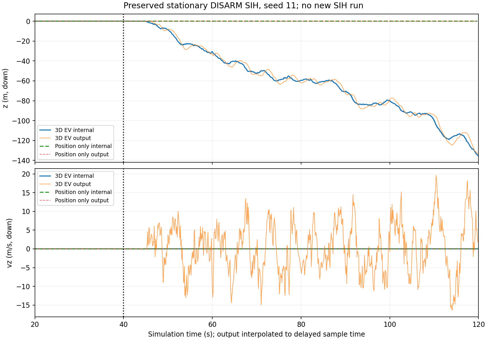
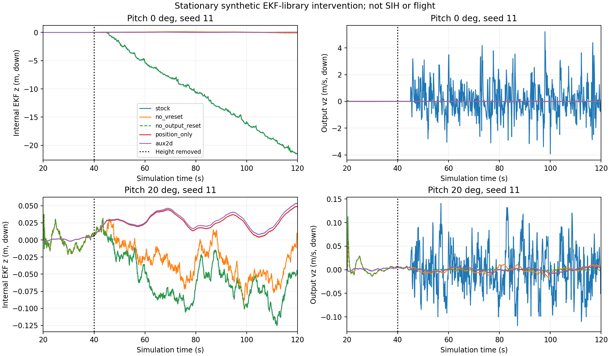

# LiDAR 수직 리셋·EKF 내부 상태 후속 진단
2026-10-12 수직 발산의 원인을 분리한 결과 보고서다.
입력 대안과 S14 보류 근거를 확인할 때 읽는다.

후속 [실제 2D 입력의 높이 공백 검증](lidar2d_height_outage_20261012.md)을 추가했다.
아래 라이브러리 실험과 별도로 SIH 45조합을 비교했다.
높이 센서 중단·복구와 2D 수신·융합을 확인했다.
아래 원인 분리 실험과 보류 이력은 그대로 보존한다.

## 1. 결론과 검증 범위

**현재 `vz=0` 후보와 S14의 보류를 유지한다.**
큰 수직 분산은 평균 리셋을 막지 못했다.
기존 SIH의 위치 발산은 EKF 내부에도 있었다.
출력 속도 급변에는 output predictor 리셋이 관여했다.
두 현상을 하나의 출력 문제로 묶을 수 없다.

| 조사 항목 | 이번 확인 | 남은 한계 |
|---|---|---|
| 수직 리셋 | 높이 관측 만료 후 EV 주기마다 반복 | 공중·실제 LiDAR 시험 없음 |
| 위치 발산 | 보존 ULog의 내부 z RMS 55.867–100.768m | 정지·DISARM 5회 조건 |
| 출력 영향 | 출력 리셋만 제거한 10쌍의 내부 기록값 일치 | 출력 리셋 제거는 수정안이 아님 |
| 고도 유효 | EV 3축 활성 상태를 수직 보조로 셈 | 분산 크기가 유효 플래그를 해제하지 않음 |
| 수평 2D | 합성 NE 2축 대조군에서 수직 리셋 0회 | body XY LiDAR와 같은 입력이 아님 |
| 기존 −267° | 원본 두 파일 미회수 | 재현 미완료 |

기존 17개 단위 테스트를 다시 통과했다.
기존 합성 스캔 평가 70회는 재실행하지 않았다.
기존 SIH 140회의 원시 해시를 다시 확인했다.
그중 높이 제거 10회를 상세 재분석했다.
새 실험은 EKF 라이브러리 70회다.
SIH나 전체 비행 스택을 새로 실행한 결과가 아니다.
원본 라이브러리 일치 확인 1회는 별도다.
임무 허용 오차와 합격 기준은 아직 정하지 않았다.

## 2. 기준과 보존

원래 두 작업 디렉터리는 그대로 두었다.
별도 복제본에서 도구와 문서만 추가했다.

| 항목 | 확인한 값 |
|---|---|
| 인계 FINAL HEAD | `a0fa040148fa35a9c02192a4bef48015b0347bc9` |
| fetch 당시 원격 FINAL | `c6f38246b3ec14187e8abc1c76b75055af074628` |
| 관계 | 인계 FINAL이 원격보다 4커밋 앞섬 |
| feature 인계 | `e7abf48` 포함, 별도 기존 작업 보존 |
| 작업 브랜치 | `codex/lidar-vertical-diagnosis-20261012` |
| 작업 복제본 | `C:\Users\A\Documents\ChatGPT\DroneStock\ROS2` |
| PX4 고정 커밋 | `d6f12ad1c4f70ad3230afd7d86e971421e02fef4` |
| 기존 ULog | 140/140 SHA-256 일치 |
| 기존 실행 기록 | 840/840 SHA-256 일치 |
| 기존 압축본 | 1,418,169,048바이트, SHA-256 일치 |

근거는 [보존 감사](evidence/lidar_vertical_followup_20261012/preservation_audit.json)다.
기존 PX4 추적 소스와 라이브러리는 수정하지 않았다.
계측 코드는 새 출력 폴더에만 만들었다.
기존 WSL/PX4/Gazebo 프로세스를 종료하지 않았다.
실기 파라미터·서비스·비행을 변경하지 않았다.
사용자가 요청한 원격 Codex CLI 복구는 별도 작업이다.
[접속 복구 기록](remote_codex_cli_recovery_20261012.md)에 범위를 적었다.

## 3. 보존 SIH: 내부 위치도 발산했다

50초 이상 120초 미만을 비교했다.
각 값은 해당 seed의 기록 전체로 계산했다.
수치는 NED z와 vz의 정지 참값 대비 오차다.

| seed | 내부 표본 수 | 출력 표본 수 | 내부 z RMS m | 출력 z RMS m | 내부 vz RMS m/s | 출력 vz RMS m/s | vz 리셋 |
|---|---:|---:|---:|---:|---:|---:|---:|
| 11 | 6,987 | 8,750 | 73.802 | 73.648 | 0.001360 | 6.642 | 700 |
| 22 | 6,858 | 8,593 | 81.618 | 81.436 | 0.001339 | 5.448 | 687 |
| 33 | 6,986 | 8,750 | 100.768 | 100.761 | 0.001352 | 5.678 | 700 |
| 44 | 6,987 | 8,750 | 55.867 | 55.982 | 0.001319 | 5.819 | 700 |
| 55 | 6,986 | 8,750 | 98.356 | 98.423 | 0.001301 | 5.805 | 700 |

`z_valid`와 `v_z_valid`는 각각 43,593/43,593 참이었다.
위치 전용 대조군에서는 각각 0/43,744였다.
위치 전용의 내부 z RMS는 0.01008–0.03257m다.
이 대조군은 `fake_hgt`가 활성인 지상 조건이다.
낮은 오차가 공중 높이 관측을 뜻하지 않는다.

내부 vz는 리셋 직후의 값이 주로 기록된다.
작은 내부 vz RMS가 갱신 사이의 급변을 부정하지 않는다.
계측 실험에서 축별 융합 전후를 별도로 확인했다.

상태 배열은 고정 커밋의 생성 헤더와 대조했다.
`states[6]`은 지연된 내부 vz다.
`states[9]`는 음의 AMSL이다.
로컬 z는 여기에 유효한 원점 고도를 더한다.
원점 고도가 없으면 PX4와 같이 0을 사용한다.
공분산 배열의 5번은 vz, 8번은 z다.
내부 vz 분산은 이 5회에서 모든 표본이 10,000이었다.

내부 상태 시각은 `timestamp_sample`이다.
출력 비교 시 이 시각으로 선형 보간했다.
정확한 predictor 내부 버퍼를 읽은 값은 아니다.
RMS 표의 출력은 원래 출력 시각과 참값으로 계산했다.
표본 누락을 채워 동일 분모로 만들지 않았다.
평균·표준편차·p95·최댓값은 [전체 지표](evidence/lidar_vertical_followup_20261012/state_output_comparison.json)에 있다.



그림은 seed 11의 축약 시계열이다.
지표는 그림용 축약 전의 모든 표본을 사용했다.

## 4. 계측 실험: 한 경로씩 분리했다

같은 라이브러리에 합성 센서를 넣었다.
운영 송신기·ROS·MAVLink·센서 장치를 사용하지 않았다.
네트워크는 별도 namespace의 loopback만 허용했다.

| 공통 조건 | 값 |
|---|---|
| 횟수 | 7방식 × 5 seed × 2기울기 = 70회 |
| seed / pitch | 11, 22, 33, 44, 55 / 0°, 20° |
| 상태 / 기간 | 정지·DISARM 플래그 / 120초 |
| 관측 시작 / 높이 제거 | EV 20초 / 기압·거리 40초 |
| IMU / EV | 200Hz / 10Hz |
| IMU 백색 잡음 표준편차 | 가속도 0.02m/s², 각속도 0.001rad/s |
| 위치·속도 XY 잡음 표준편차 | 각각 0.01m, 0.01m/s |
| 입력 분산 | XY 0.01, 속도 z 10,000 |
| 참값 | 위치·속도 0, 주어진 고정 자세 |
| 기록 | 회당 12,000개, 총 840,000개 |
| 평가 구간 | 25–40초: 1,500개 / 50–120초: 7,000개 |

입력 분산은 실제 잡음 분산과 같게 보정한 값이 아니다.
이전 후보와 같은 큰 분산의 위험을 분리하는 설정이다.
초기화 전 NaN은 원시 로그에 보존했다.
지표에는 전체 수와 유한 표본 수를 함께 적었다.

| 방식 | 바꾼 항목 |
|---|---|
| `stock` | 원래 body FRD 3축 EV 경로 |
| `no_vreset` | 높이 만료에 따른 수직 리셋 호출만 생략 |
| `rotated_vreset` | 파생 클래스의 회전된 리셋 함수를 직접 호출 |
| `no_output_reset` | 내부 리셋 유지, predictor로 delta 전달만 생략 |
| `position_only` | EV 수평 위치만 입력 |
| `aux2d` | 위치 전용 + 기존 aux의 독립 합성 NE 2축 속도 |
| `ned3d` | 독립 합성 NED 3축 EV 속도, z 자리값 유지 |

다음 값은 50–120초의 seed 5개 RMS 최솟값–최댓값이다.
각 행은 35,000개 표본을 포함한다.
리셋 수는 회당 값이다.

| pitch | 방식 | 내부 z RMS m | 출력 vz RMS m/s | vz 리셋 |
|---|---|---:|---:|---:|
| 0° | stock | 9.9457–13.1860 | 0.8789–1.0254 | 700 |
| 0° | no_vreset | 0.0902–0.4907 | 0.00499–0.01512 | 0 |
| 0° | rotated_vreset | 16.1624–21.5545 | 1.4403–1.6660 | 700 |
| 0° | no_output_reset | 9.9457–13.1860 | 0.000668–0.000725 | 700 |
| 0° | position_only | 0.0275–0.0381 | 0.00300–0.00540 | 0 |
| 0° | aux2d | 0.0119–0.0341 | 0.00321–0.00424 | 0 |
| 0° | ned3d | 0.00681–0.02652 | 0.000555–0.000593 | 700 |
| 20° | stock | 0.0449–0.1438 | 0.03809–0.04156 | 700 |
| 20° | no_vreset | 0.0272–0.1338 | 0.00537–0.00644 | 0 |
| 20° | rotated_vreset | 0.0449–0.1438 | 0.03388–0.03758 | 700 |
| 20° | no_output_reset | 0.0449–0.1438 | 0.000663–0.000729 | 700 |
| 20° | position_only | 0.0179–0.0286 | 0.00376–0.00574 | 0 |
| 20° | aux2d | 0.0127–0.0313 | 0.00361–0.00620 | 0 |
| 20° | ned3d | 0.00462–0.02602 | 0.000549–0.000596 | 700 |

0°에서도 자세 추정에는 잡음이 있다.
정확한 항등 회전 행렬을 강제로 넣은 실험이 아니다.
20°의 작은 위치 RMS는 일반적인 우월성 근거가 아니다.
같은 리셋과 잘못된 수직 유효 상태가 남았다.
실기 잡음과 SIH의 잡음은 다르다.
두 시험군의 RMS 크기를 직접 성능 순위로 쓰지 않는다.



`no_output_reset`과 stock의 내부 선은 겹친다.
10쌍 × 12,000표본 × 17필드가 일치했다.
일치는 소수 유효숫자 9자리로 기록한 값 기준이다.
원본 라이브러리 직접 연결 결과도 별도로 비교했다.
seed 11·0°의 12,000표본 × 19필드가 일치했다.
[검증 기록](evidence/lidar_vertical_followup_20261012/verification.json)에 필드 목록이 있다.

## 5. 원인: 내부 위치 갱신과 출력 리셋의 결합

높이 만료 조건은 수직 속도 리셋으로 해소되지 않았다.
아래 경로가 관측 주기마다 반복됐다.

```text
높이 관측 중단
  -> 마지막 높이 융합 시각 만료
  -> body 3축 EV 속도 융합
       -> 공분산을 통해 내부 z도 갱신
       -> 수직 속도 융합 시각 갱신
  -> 높이 만료 조건은 계속 참
  -> 수직 평균을 자리값 0으로 리셋
       -> vz 분산을 다시 10,000으로 설정
       -> predictor에 내부 속도 delta 전달
  -> 다음 예측과 관측에서 반복
```

다음은 고정 PX4 커밋의 로컬 소스를 직접 확인한 위치다.

| 소스 위치 | 확인 내용 |
|---|---|
| `EKF/aid_sources/external_vision/ev_vel_control.cpp:107` | 높이 만료 시 수직 리셋 호출 |
| 같은 파일 `:168–204` | 몸체 3축 순차 융합, 수직 융합 시각 갱신 |
| `EKF/aid_sources/external_vision/ev_vel.h:71` | base의 non-virtual 수직 리셋 |
| 같은 파일 `:114` | body 파생 클래스의 회전·분산 5배 함수 |
| `EKF/velocity_fusion.cpp:122–147` | 평균·공분산·출력·카운터·시각 리셋 |
| `EKF/ekf_helper.cpp:48` | 마지막 높이 융합 시각의 만료 판정 |
| `EKF/output_predictor/output_predictor.cpp:156` | 출력 버퍼 속도에 delta 합산 |

base 참조의 호출은 파생 동명 함수로 분기하지 않는다.
body 입력의 z 성분을 NED 수직 평균으로 사용한다.
이는 좌표 처리 문제다.
그러나 파생 함수를 호출한 대조군도 발산했다.
0°에서는 오히려 내부 z RMS가 더 커졌다.
회전 함수만 바꾸면 해결된다고 판단할 수 없다.

큰 분산의 재설정은 다음 융합의 이득에도 영향을 준다.
속도 예측은 위치와 속도의 교차 공분산을 다시 만든다.
body XY 융합은 자세와 공분산을 통해 z를 바꾼다.
`vz=0` 리셋은 이미 바뀐 z 평균을 되돌리지 않는다.

seed 11·0° stock의 축별 계측값은 다음과 같다.
구간은 지연 EKF 시각 50–120초다.
표본 시각 기준 700리셋과 경계가 다르다.
여기서는 각 축 699회·리셋 호출 699회다.

| 호출 | z 변화 합 m | 표본 수 |
|---|---:|---:|
| body x 축 융합 | −19.78306 | 699 |
| body y 축 융합 | −18.10986 | 699 |
| body z 축 융합 | +18.12067 | 699 |
| 수직 리셋 자체 | 0 | 699 |

합계는 해당 호출의 변화만 센 값이다.
예측과 다른 관측의 변화까지 포함한 총오차가 아니다.
x·y 축의 `|gain_z|` 최댓값은 31.60·33.15였다.
계측 시 마지막 높이 융합 시각은 39.88초였다.
그 시각으로부터의 최대 경과는 79.92초였다.
리셋 직후 수직 속도 융합 경과는 0이었다.
높이 시각과 수직 속도 시각을 구분해야 한다.

출력 리셋만 끄면 내부 z 발산은 그대로였다.
반면 출력 vz RMS는 크게 줄었다.
따라서 관측된 큰 출력 속도는 이 경로의 영향을 받았다.
이 조작은 리셋 계약을 일부러 깨는 원인 분리 실험이다.
운영 수정안으로 적용하지 않는다.

## 6. 유효 플래그가 유지된 이유

이 커밋은 EV 속도 활성을 수직 보조로 센다.
분산이 크다는 이유로 수직 보조에서 빼지 않는다.

| 단계 | 근거 |
|---|---|
| 수직 보조 활성 | `estimator_interface.cpp:685–693`: GNSS 속도 + EV 속도 |
| 내부 수직 유효 | `ekf_helper.cpp:900`: 보조 활성 시 dead reckoning 초과 해제 |
| 내부 조회 | `ekf.h:237–244`: 해당 초과 플래그의 반전 |
| 외부 출력 | `EKF2.cpp:1588–1590`: 내부 z 유효 OR 내부 vz 유효 |

새 실험의 모든 방식에서 내부 z 유효는 0/70,000이었다.
이 분모는 방식별 10회의 50–120초 표본 합계다.
stock·no_vreset·rotated_vreset·ned3d·no_output_reset은
내부 vz 유효가 각각 70,000/70,000이었다.
position_only·aux2d는 각각 0/70,000이었다.
aux2d는 회당 700회 수평 융합했다.
수평 융합이 계속돼도 수직 유효를 붙이지 않았다.

라이브러리 실험은 `vehicle_local_position`을 발행하지 않는다.
외부 OR 결과는 소스에서 확인했다.
실제 출력 플래그의 관측 근거는 기존 SIH ULog다.
이 구분을 섞어 새 SIH 검증으로 세지 않는다.

## 7. 수평 2D 입력 대안

속도 관측의 차원을 명시하는 경로가 필요하다.
큰 z 분산이나 NaN만으로 2D 의미를 보장할 수 없다.
이 EV 경로는 3축 유한값을 요구한다.

| 대안 | 이번 결과 | 적용 전 조건 | 상태 |
|---|---|---|---|
| 위치 전용 유지 | 리셋 0, 수직 유효 해제 | 기존 XY 관측의 독립성·시각 유지 | 대조군 |
| 기존 aux NE 2D | 합성 10회, 리셋 0 | 독립 NE 관측, 다른 수평 보조, 입력 경로 검증 | 연구 후보 |
| body 2D 전용 모델 | 실행하지 않음 | 2행 관측 모델·시각·리셋·유효 계약 구현 | 설계 후보 |
| NED 3D+z 자리값 | 위치 RMS 감소, 리셋 700 유지 | 수직 부재를 표현하지 못함 | 미채택 |
| non-virtual 호출 수정만 | 리셋·발산 유지 | 전체 관측·리셋 계약 재설계 필요 | 단독 해결책 아님 |

aux는 `fuseHorizontalVelocity()`를 호출한다.
수평 융합 시각만 갱신한다.
또한 `isHorizontalAidingActive()`가 참이어야 한다.
이번 실험에서는 EV XY 위치가 이 조건을 충족했다.
단독 보조로 자동 시작·복구한 결과는 아니다.

aux 입력은 처음부터 NE인 합성 관측이다.
body XY 두 숫자의 프레임 이름만 바꾸지 않았다.
좌표 변환에는 알 수 없는 body z 항이 남는다.

```text
v_NE = R_NE,xy · v_body_xy + R_NE,z · v_body_z
```

pitch 20°에서 누락된 body z가 0.3m/s라면,
수평 변환 누락 항의 크기는 약 0.103m/s다.
이는 `sin(20°) × 0.3`의 기하 예다.
실측이나 이번 동적 시험 결과가 아니다.

body 2D 전용 모델은 다음 형태를 검토할 수 있다.
`h = S_xy · R_NBᵀ · v_NED`이며 두 성분만 융합한다.
장착 회전·레버암·회전 속도 보상은 따로 필요하다.
수직 평균의 자리값 리셋은 하지 않아야 한다.
수평 관측만으로 수직 유효를 새로 선언하지 않아야 한다.
단, 공분산에 따른 수직 상태 보정까지 0이라는 뜻은 아니다.
companion에 별도 고도·자세 제어기를 만드는 안이 아니다.
PX4 추정치를 독립 관측으로 되먹이지 않는다.

## 8. 미완료와 필요한 자료

−267° 원본은 승인된 계정으로도 회수하지 못했다.
파일이 삭제됐다고 단정하지 않는다.
이번 탐색 범위 밖에 있을 수 있다.

| 자료 | 이번 상태 |
|---|---|
| `capture-1791703092109574820-28f571f8/events.jsonl` | 로컬 문서 폴더·두 원격 홈 탐색에서 미발견 |
| 기존 `analyze.py` | 같은 범위와 관련 압축파일 9개에서 미발견 |
| 소유자 계정 capture 디렉터리 | 읽기 성공, 대상 capture 없음 |
| scan↔IMU 회전 | 실측 자료 미확인 |
| FC↔LiDAR / FC↔UWB 레버암 | 실측 자료 미확인 |

두 기대 SHA-256은 [인계 절차](../runbooks/lidar_next_session_20261012.md)에 보존했다.
다른 capture를 원본 대신 사용하지 않았다.
UWB 아래 약 10cm는 사용자 추정이다.
FC 기준 레버암의 실측값으로 쓰지 않았다.
대상 센서는 360° 수평 YDLIDAR T-mini Pro다.
하향 TFmini Plus와 구분한다.

| 시나리오 | 이번 진전 | 다음에 필요한 검증 |
|---|---|---|
| S04/S05 | 수직 리셋의 반복·출력 영향을 분리 | ±0.3m/s 실제 수직 운동·시작·회복 |
| S10 | 2D 프레임 변환의 누락 항 명시 | 장착 회전·레버암 실측 |
| S12 | 미실시 유지 | UWB+광류 기준·열화 비교 |
| S13 | 정지 발산·유효 플래그 원인 분리 | 공중 고장·failsafe·실제 입력 |
| S14 | 보류 유지 | 앞선 관측 계약과 비교 검증 완료 |

## 9. 실행 산출물

재실행 순서는 [전용 절차](../runbooks/lidar_vertical_diagnosis_20261012.md)에 있다.

| 산출물 | 위치 |
|---|---|
| 상세 지표·해시·그림 | `docs/report/evidence/lidar_vertical_followup_20261012/` |
| 현재 시나리오 상태 | [scenario_status.json](evidence/lidar_vertical_followup_20261012/scenario_status.json) |
| WSL 새 원시 자료 | `/home/dronestock/uwb_sim/lidar-vertical-followup-20261012/` |
| Windows 새 압축본 | `C:\Users\A\Documents\ChatGPT\DroneStock\outputs\lidar-vertical-followup-raw-20261012.tar.gz` |
| 압축본 SHA-256 | `efcf418a037e9ab8178e128a8aa0adfe3f62cfad9d641a480c2bb8384967ab29` |

새 압축본은 성공한 matrix·빌드·원본 대조만 포함한다.
초기 컴파일·로그 형식 진단 폴더는 WSL에 남겨 뒀다.
이 폴더는 70회 결과에 포함하지 않았다.
첫 JSON의 융합 횟수는 경계 이전 값을 하나 포함했다.
원시 파일을 보존하고 후속 지표에서 다시 셌다.
새 `aux_updates`·`ev_updates`는 구간 내 시각 변화 수다.
`height_reset_branch_entries`는 분기 진입 수다.
`no_vreset`에서는 진입해도 실제 리셋을 생략한다.
실제 리셋 횟수는 `vz_resets` 카운터로 구분한다.
압축본의 70개 로그 해시도 다시 확인했다.
결과와 라이브러리 보존 확인은 [최종 감사](evidence/lidar_vertical_followup_20261012/final_audit.json)에 있다.

기존 테스트는 Windows Python에서 17/17 통과했다.
WSL PX4 venv는 SciPy가 없어 수집 단계에서 실패했다.
그 환경을 바꾸지 않고 사용 가능한 Windows 환경에서 실행했다.
기존 테스트와 별도로 원시 70개 해시를 확인했다.
계측 일치와 10쌍의 내부 일치도 검증했다.
그림 두 장은 렌더링 후 직접 확인했다.
colcon 전체 빌드·실기 통합·새 비행은 미실시다.

EKF와 출력 예측기의 일반 구조는 [PX4 공식 설명](https://docs.px4.io/main/en/advanced_config/tuning_the_ecl_ekf)을 참고했다.
위 수치와 원인 판정은 고정 커밋·원시 기록에 근거한다.
