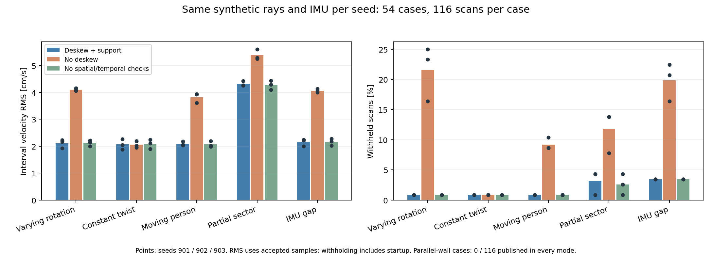
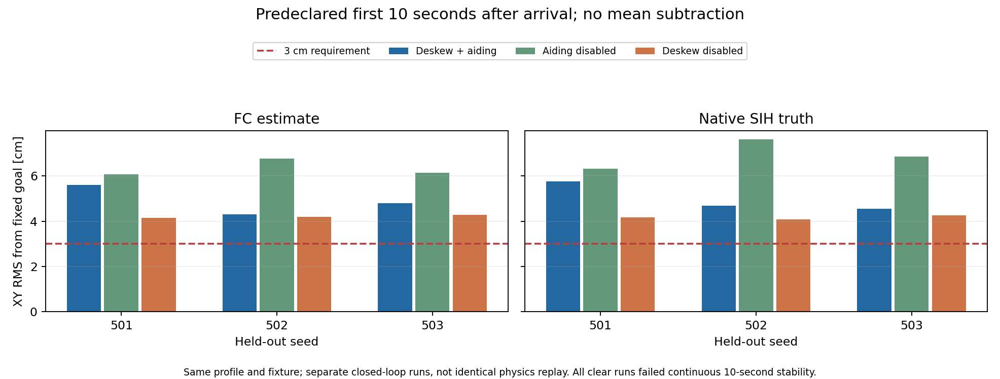
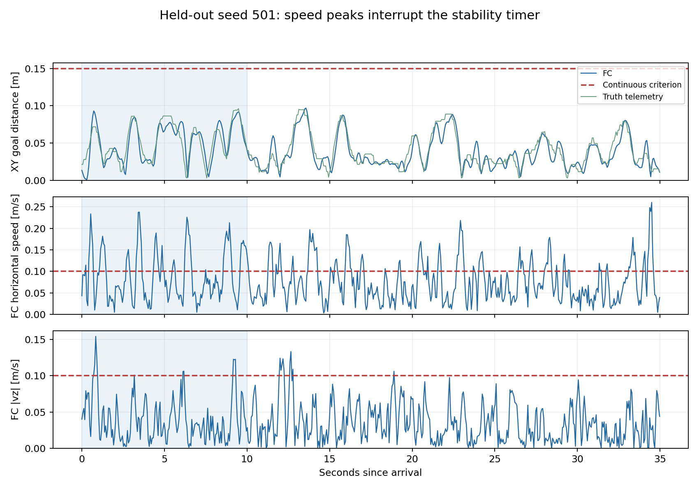

# 회전 LiDAR·deskew·부분 가림 검증
2026-10-12 격리 구현과 수행 결과를 기록한다.
개선된 관측과 미달인 호버 성능을 구분할 때 읽는다.

## 결론

**회전 관측 경로는 구현했지만 호버 목표는 미달이다.**
광선별 시각과 FC 측정 자이로로 deskew를 수행한다.
공간 지지·방향별 정보·시간 일관성을 검사한다.
사람이 일부를 가려도 충분한 형상이 남으면 발행한다.
평행 벽만 남아 이동이 모호하면 발행하지 않는다.

새 시드 501·502·503에서 정상 비행을 검증했다.
첫 10초 FC 목표점 XY RMS는 4.31–5.59cm다.
SIH 실제 위치는 4.56–5.76cm다.
3cm와 연속 안정 10초를 함께 만족한 시행은 0/3이다.
실기 설정·운영 입력·실물 RAW는 변경하지 않았다.
이 결과를 실기 성능으로 표현하지 않는다.

## 구현한 변경

한 스캔 안의 측정 시각과 이동을 반영한다.
[설계 문서](../architecture/spinning_lidar_timing_20261012.md)에 계약을 정리했다.

| 부분 | 변경 |
|---|---|
| 가상 센서 | 430광선·10Hz, 각 광선 시각의 3D 위치에서 추적 |
| 가림 | 벽·기둥·이동 원통을 광선별로 처리 |
| 시계 | 오프셋·주파수 차이·비대칭 지연을 넣고 추정 |
| IMU | FC 측정 자이로의 취득 시각으로 적분 |
| deskew | 중간 광선 시점으로 회전·병진 보정 |
| 정합 | 공간 셀 가중치, 방향별 정보, 3스캔 일관성 |
| 거리 편향 | 공통 거리 오차를 병진과 별도로 추정 |
| PX4 입력 | 구간 중점 시각의 XY 속도, vz 미관측 유지 |
| 장애물 | 보정 광선의 미관측 영역과 가장 오래된 시각 유지 |
| UWB·광류 fixture | 취득 시각 사용, 광류 구간 적분 |
| 시험용 PX4 | 부동소수점 원시 궤적과 취득 시각 전송 |

정답 궤적은 가상 센서와 오프라인 평가에만 쓴다.
정합기에는 정답·FC·UWB 속도를 전달하지 않는다.
독립 위치 EKF나 companion 고도·자세 제어는 추가하지 않았다.
지도 최적화와 재방문 보정은 구현하지 않았다.

기존 순간 스캔은 HIL 좌표 양자화의 영향을 받았다.
새 광선 생성은 별도 부동소수점 전송을 사용한다.
UWB fixture는 기존 HIL 좌표 경로를 유지한다.
이 차이로 이전 시험과 단순 성능 비율을 만들지 않는다.

## 수행 분모

실행 실패와 불리한 결과도 남겼다.
[전체 카탈로그](evidence/spinning_lidar_20261012/spinning_trial_catalog_20261012.json)에 원본 hash가 있다.

| 종류 | 수량·범위 |
|---|---|
| 개발 SITL | 14회, 시간 버퍼·출력 응답·제어 이득 등 |
| 검증 SITL | 20회, 정상 9회·벽 3회·가림/고장 8회 |
| 총 SITL | 34회 |
| 실행 전 실패 | 시나리오 이름 오타 1회, 출력·ARM 전 종료 |
| 센서 비교 | 3시드 × 6장면 × 3방식 = 54개 사례 |
| 각 센서 사례 | 12초 시험, 관측 116개 |

오타 `partial` 시행은 비행 수에 넣지 않았다.
`partial_occlusion`으로 별도 재실행했다.
원래 실패 로그의 hash도 카탈로그에 보존했다.
센서 비교와 폐루프 비행의 분모를 섞지 않는다.
SIH 내부 sensor RNG는 변경하지 않았다.
같은 외부 seed라도 스케줄링과 궤적은 달라진다.

## 동일 입력의 센서 비교

변하는 회전에서 deskew의 관측 이득을 확인했다.
시드 901·902·903의 각 방식에 같은 입력을 사용했다.
아래 속도 RMS는 수용된 관측의 벡터 오차다.
보류율에는 처음 준비 스캔도 포함한다.

| 장면 | 전체 보정 수용/116 | 전체 보정 RMS | deskew 없음 RMS |
|---|---|---|---|
| 회전 변화 | 115 / 115 / 115 | 1.92–2.22cm/s | 4.06–4.16cm/s |
| 일정 회전·이동 | 115 / 115 / 115 | 1.87–2.27cm/s | 1.95–2.20cm/s |
| 오른쪽 사람 통과 | 115 / 115 / 115 | 2.04–2.18cm/s | 3.61–3.94cm/s |
| 약 137도 구간 가림 | 115 / 111 / 111 | 4.26–4.43cm/s | 5.24–5.61cm/s |
| IMU 일부 공백 | 112 / 112 / 112 | 2.00–2.24cm/s | 4.00–4.13cm/s |
| 평행 벽만 남음 | 0 / 0 / 0 | 발행 없음 | 발행 없음 |

사람 통과의 보류는 각각 1/116이다.
모두 시작 시 상대이동이 아직 없는 스캔이다.
보정 없음은 각각 12·10·10/116을 보류했다.
전체 보정의 사람 장면 처리 p95는 27.2–46.3ms다.
Windows 측정이며 Jetson 실시간 성능을 뜻하지 않는다.
광선 취득 시간과 PX4 전달 지연은 포함하지 않는다.

공간·시간 검사 비활성 대조도 별도 수행했다.
정확도는 전체 보정과 대체로 비슷했다.
평행 벽은 기존 검사도 보류했다.
새 검사만의 정확도 향상이나 우월성을 주장하지 않는다.
일정 회전에서는 deskew의 뚜렷한 이득도 없었다.

합성 시계의 최대 변환 오차는 약 0.093ms다.
부분 가림의 명목 95% 타원 포함률은 95.5% 이상이다.
이는 합성 모델 공분산의 확인이다.
실물 공분산이나 독립 실물 정확도의 검증은 아니다.

## 고정한 SITL 설정

실기 파라미터 대신 격리 프로세스만 조정했다.
[최종 프로파일](evidence/spinning_lidar_20261012/profiles/captured_sensors.json)을 보존했다.

| 항목 | 최종값 |
|---|---:|
| EKF 지연 버퍼 | 200ms |
| LiDAR 입력 최대 나이 | 200ms |
| 미사용 대기속도 지연 | 0ms |
| 속도·위치 출력 응답 | 0.05s / 0.10s |
| 위치·속도 P | 2 / 3 |
| PX4 수평 속도 상한 | 0.25m/s |
| 합성 UWB 메시지/하한 표준편차 | 0.03m |
| 합성 광류 지연 | 0ms, 구간 적분 시각 사용 |
| EKF 가속도·자이로 과정 잡음 | 1.0m/s² / 0.10rad/s |
| SIH 실제 IMU 잡음 | 기존 코드 그대로 |

150ms 입력 나이는 회전 관측 일부를 만료시켰다.
정상 관측의 구간 중점은 취득 완료보다 오래됐다.
그래서 200ms 제한과 버퍼를 명시했다.
이를 실물 LiDAR의 측정 지연으로 채택하지 않는다.
개발에서 더 큰 P·필터·출력 응답도 시험했다.
최종 프로파일에 넣지 않은 실패 후보도 보존했다.

## 목표점 오차와 10초 조건

첫 도착 후 10초를 사전에 고정해 평가했다.
평균 위치를 빼서 흔들림만 작게 표시하지 않았다.
각각 FC ULog 1,251개, SIH 위치 500개를 평가했다.

| 시드 | 첫 10초 FC RMS | 첫 10초 SIH RMS | 전체 35초 FC RMS | 최장 연속 안정 |
|---|---:|---:|---:|---:|
| 501 | 5.592cm | 5.765cm | 4.613cm | 2.040s |
| 502 | 4.308cm | 4.680cm | 4.797cm | 1.624s |
| 503 | 4.806cm | 4.560cm | 4.852cm | 1.392s |

세 시행 모두 `hover_stability_timeout`이다.
연속 안정 조건은 기존 값을 유지했다.
XY 15cm, UWB 25cm, 수평 속도 0.1m/s 이하다.
고도 오차 15cm, 수직 속도 절댓값 0.1m/s 이하다.
안정 검사에서 수평·수직 속도 초과가 발생했다.
3cm RMS 기준을 만족한 시행도 없다.

| 대조 | 첫 10초 FC RMS, 시드 501 / 502 / 503 | 10초 합격 |
|---|---|---|
| deskew + LiDAR 융합 | 5.592 / 4.308 / 4.806cm | 0/3 |
| LiDAR 융합 비활성 | 6.081 / 6.767 / 6.136cm | 0/3 |
| deskew 비활성, 융합 유지 | 4.141 / 4.187 / 4.278cm | 0/3 |

deskew를 끈 비행의 RMS가 더 작았다.
따라서 호버에서 deskew가 성능을 높였다고 말할 수 없다.
동일 입력의 회전 센서 비교와 다른 결과다.
폐루프 시각·IMU 오차·제어 응답의 분리가 남았다.
대조군은 완전히 동일한 물리 궤적 replay가 아니다.
보정 없음 시드 503은 착륙 완료도 확인되지 않았다.

## PX4의 실제 수용·융합

전용 입력의 수신과 EKF 융합을 각각 확인했다.
분석 창은 MOVING·DWELL·RETURNING이다.
창 경계의 송수신 시각 차이로 개수가 1개 다를 수 있다.

| 시드 | 관측 수용/전체 | PX4 융합 reports/fused | 수신 나이 p95 / 최대 |
|---|---:|---:|---:|
| 501 | 435/435 | 435/435 | 135.5 / 183.5ms |
| 502 | 442/442 | 441/441 | 139.5 / 167.7ms |
| 503 | 440/443 | 438/438 | 151.8 / 199.8ms |

503에서는 IMU gap 2개와 재준비 1개를 보류했다.
PX4에도 만료·재개 검사가 발생했다.
검증 20회 모두 이동 중 Z·VZ reset은 0이다.
이는 수직 속도를 LiDAR가 관측했다는 뜻이 아니다.

## 벽·가림·고장

외곽 여유는 유지했지만 전체 임무 성공은 아니다.
기체 반경 20cm의 가상 fixture를 사용했다.
실측 프로펠러 반경으로 확정한 값이 아니다.

| 벽 시드 | 최소 외곽 여유 | 종료 |
|---|---:|---|
| 501 | 0.967m | 착륙·모드 완료 미확인 |
| 502 | 0.982m | 장애물 대기 timeout 후 착륙 처리 |
| 503 | 1.058m | 장애물 대기 timeout 후 착륙 처리 |

50cm 간격 자체는 3/3에서 충족했다.
501의 종료 확인 실패는 별도 잔여 결함이다.
이 결과를 전체 안전 검증 통과로 표시하지 않는다.

| 시험 | 관측·명령 결과 | 최종 상태 |
|---|---|---|
| 사람 | 이동 창 관측 64/64 수용, PX4 63회 융합 | 장애물 대기 timeout |
| 부분 가림 | 이동 창 474/476 수용, 473회 융합 | 호버 timeout |
| IMU 2초 공백 | 22개 보류 후 재개 | 호버 timeout |
| 시계 교환 2초 공백 | 만료·재준비 등 18개 보류 후 재개 | 호버 timeout |
| guard 스캔 2초 공백 | 120ms 안에 제로 속도 명령 | 호버 timeout |
| LiDAR 속도 송신 2초 공백 | 실제 융합 중단·재개 | 착륙·모드 완료 미확인 |
| UWB 2초 공백 | `uwb_unavailable` 착륙 처리 | 임무 실패 |
| UWB 1.2m 점프 | `px4_local_frame_or_pose_jump` 착륙 처리 | 임무 실패 |

부분 가림의 476개는 전체 이동 창의 분모다.
2초 가림 구간만의 수용률로 읽으면 안 된다.
센서 비교의 장기 가림 결과와 함께 해석한다.
`scan_gap`과 `lidar_gap`은 각 경로만 끊는 시험이다.
센서 전체 전원 상실과 같지 않다.
사람 관측이 수용돼도 충돌 경로 이동은 제동했다.
속도 추정 유지가 사람 방향 이동 허가를 뜻하지 않는다.

## 검사·보존

현재 구현 부위의 회귀 검사는 통과했다.
`drone_mission`·`drone_uwb`는 255 passed, 9 skipped다.
ROS·웹 의존성 때문에 다섯 파일을 제외했다.
정확한 명령은 [재현 절차](../runbooks/spinning_lidar_reproduce_20261012.md)에 있다.
ROS FlightNode 통합 비행은 미실시다.

추가로 `drone_demo`까지 넓힌 검사는 15개 실패했다.
312 passed, 11 skipped도 함께 기록한다.
실패는 Windows의 symlink placeholder 읽기에서 발생했다.
`gazebo_shadow.json`에 실제 JSON 대신 링크 문자열이 있다.
그 파일과 운영 설정은 이번 작업에서 바꾸지 않았다.
앞선 수집 오류는 없는 ROS·웹 패키지 때문이다.
전체 저장소 검사가 모두 통과했다고 표현하지 않는다.

네 실물 RAW 파일의 SHA256을 다시 확인했다.
[원본 보존 결과](evidence/spinning_lidar_20261012/raw_preservation.json)를 남겼다.
이전 보고서·실험 patch·manifest도 보존했다.
그림 세 개는 렌더링 후 육안 검사했다.
표와 그림은 [종합 JSON](evidence/spinning_lidar_20261012/spinning_summary_20261012.json)에서 재생성한다.

## 후속 작업

| 남은 과제 | 이유 |
|---|---|
| 낮은 회전율에서 gyro·병진 보정 오차 분리 | deskew가 호버 RMS를 개선하지 못함 |
| FC 지연 상태·출력·제어 응답 분석 | 관측 개선만으로 연속 속도 조건 미달 |
| 착륙·모드 완료 확인 경로 | 검증 3회에서 종료 확인 실패 |
| 실물 광선 시각·시계·장착 보정 | 현재는 합성 fixture |
| 실물 공분산과 독립 정확도 | 합성 coverage로 대체할 수 없음 |
| RF2O·SRF 실행 비교 | 공식 코드만 조사, 실행 미실시 |

RF2O·SRF의 역할과 공식 출처는 설계 문서에 연결했다.
실험하지 않은 비교 결과는 만들지 않았다.
