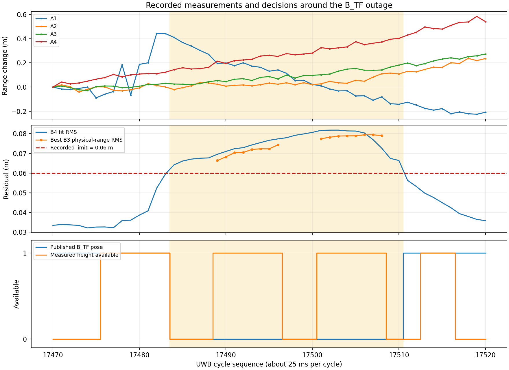
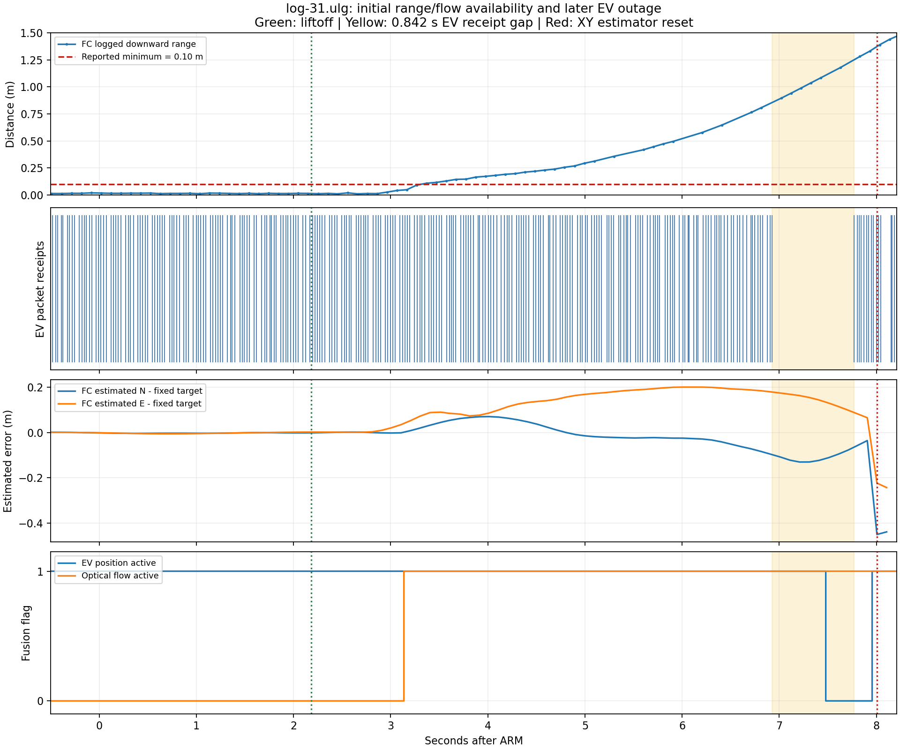

# 자동 이륙 관측 공백 원인 분석
13일 자동 이륙의 공백과 착륙 원인 기록이다.
공백 수정의 우선순위를 정할 때 읽는다.

**공백은 B_TF 출력 거부에서 시작했다.**
원시 UWB 수신은 계속됐다.
출력 복구 뒤 브리지가 150ms를 더 기다렸다.
PX4는 EV 융합을 중단한 뒤 다시 시작했다.
이때 XY를 리셋했고 C++가 보호 착륙했다.
이 연쇄는 같은 비행의 원본으로 확인했다.
이륙 직후의 첫 물리적 밀림은 별도 문제다.

## 공백이 생긴 위치

27회 연속 거부가 0.700초 관측 공백을 만들었다.

```text
A1 원시 거리의 22~25cm 급변
  -> 0.8초 H80 계산 이력에 반영
  -> B4 계산 잔차가 6cm 기준 초과
  -> B3 대체 경로도 높이 시각/거리 일치 검사 실패
  -> B_TF 관측 시각 간격 0.699959초
  -> 브리지 재개 대기 0.150055초 추가
  -> FC 관측 시각 간격 0.850초
  -> EV 위치 융합 중단과 재개
  -> FC XY 리셋 N -0.437m / E -0.271m
  -> C++ px4_local_frame_or_pose_jump 보호 착륙
```

시각 종류를 구분해야 한다.
수집기 수신 시각은 노드 실행 시각과 다르다.

| 단계 | 측정값 | 근거 |
|---|---:|---|
| 거부 중 원시 UWB | 31주기 | 최대 주기 간격 25.184ms |
| B_TF 연속 거부 | 27회 | seq 17484~17510 |
| B_TF 관측 시각 간격 | 699.959ms | 마지막 17483 → 복구 17511 |
| 수집기의 pose 수신 간격 | 738.067ms | 같은 두 관측의 수신 시각 |
| 브리지 추가 보류 | 6개 관측, 150.055ms | 실제 카운터 26 → 32와 guard 재생 일치 |
| PX4 관측 시각 간격 | 850.000ms | ULog timestamp_sample |
| PX4 패킷 수신 간격 | 841.613ms | ULog timestamp |
| C++ 목표 송신 최대 간격 | 54.512ms | 착륙 전 실행기 기록 |

브리지 재생의 합은 850.015ms다.
PX4의 850.000ms 기록과 약 15µs 차이다.
FC 변환 시각과 원시 관측 시각을 혼동하지 않는다.
명령 송신 공백이 이 EV 공백을 만든 근거는 없다.

## B_TF가 거부한 이유

원시 거리 이상과 대체 경로 실패가 겹쳤다.

| seq | A1 직전 대비 변화 | 같은 주기의 다른 앵커 최대 변화 |
|---|---:|---:|
| 17478 | +22.058cm | 1.931cm |
| 17479 | -24.940cm | 1.603cm |
| 17480 | +25.273cm | 1.405cm |
| 17482 | +24.316cm | 1.487cm |

각 주기는 약 25ms다.
A1 거리 불연속은 원본에서 확인된다.
반사·차폐·안테나·전원 중 물리 원인은 미확정이다.

seq 17482의 원시 잔차는 10.244cm였다.
B4 이력 잔차는 5.237cm라 관측을 발행했다.
17483도 5.944cm로 발행했다.
17484에서 6.416cm가 되어 B3 경로로 넘어갔다.

| 거부 사유 | 횟수 | 실제 기록 |
|---|---:|---|
| ToF 유효시간 초과 | 7 | max_tof_age_s=0.100 |
| ToF와 선택된 IMU 시각 불일치 | 4 | 22ms > max_attitude_skew_s=20ms |
| B3 물리 거리 일치 실패 | 16 | 가장 좋은 RMS 6.636~7.945cm > 6cm |

처음 거부한 17484의 A4 높이 나이는 102.055ms다.
A1~A3 높이 나이는 95.185~99.721ms다.
같은 주기의 마지막 표본에서 높이가 무효가 됐다.
주변 ToF 시각 간격 중앙값은 102.002ms다.
최대는 304.003ms다.
100ms 제한은 정상적인 약 10Hz 공급과도 충돌한다.
FC ULog에도 202~304ms 거리 표본 간격이 있다.
MAVROS 이후의 문제만으로 단정할 수 없다.
이 사실만으로 I2C 드라이버 오류도 확정하지 않는다.

17497~17500은 같은 ToF에 묶인 IMU를 거부했다.
선택된 IMU가 ToF보다 22ms 오래됐다.
수집기에는 12ms·2ms 전 IMU도 있다.
센서 전체 송신 중단으로 설명할 근거는 없다.
B_TF 수신·실행 순서·선택 경로를 고쳐 검증해야 한다.
수집기 기록만으로 B_TF 콜백 손실 원인은 확정 못 한다.

B3의 가장 좋은 후보는 16회 모두 A1 제외였다.
그래도 물리 거리 RMS가 6cm를 넘었다.
이 값은 H80 내부 계산 잔차와 다르다.
17489의 A1 제외 계산 잔차는 1.561cm다.
하지만 높이를 대입한 물리 거리 RMS는 6.636cm다.
A1 하나를 제외하는 것만으로 충분하다고 볼 수 없다.

17507의 원시 잔차는 0.344cm까지 회복했다.
B4 이력 잔차는 약 7.698cm라 계속 거부했다.
17511에서 5.631cm로 내려가 관측을 재개했다.
그때도 measured height는 없었다.
복구 경로는 높이 검사 강제가 꺼진 unchanged_B4다.
ToF 복구만이 재개 원인은 아니었다.
0.8초 창은 정상 관측의 고정 지연을 뜻하지 않는다.
이상 표본이 계산에 남는 기간과 구분한다.



## 계산 속도와 상태 표시

이번 0.7초 중단은 연속적인 판단 거부로 확인됐다.

| 거부 27회의 처리 지표 | 값 |
|---|---:|
| 계산 시간 중앙값 | 21.383ms |
| 계산 시간 p95 | 28.943ms |
| 계산 시간 최대 | 36.037ms |
| 시계 모델 큐 나이 최대 | 5.857ms |

계산 일부는 40Hz의 25ms 예산을 넘었다.
센서 콜백 수신 여유도 함께 검증해야 한다.
큐 나이는 독립적으로 교정한 물리 지연이 아니다.
이 수치로 전체 실행 경로의 지연을 배제하지 않는다.

브리지 gate=ready는 입력 신선도 표시가 아니다.
공백 중에도 이전 last_reason=ready가 남았다.
last_send_age_s는 0.726초까지 증가했다.
화면의 ready만으로 정상 관측을 판단하면 안 된다.
또한 jump_guard_enabled=false여도 시간 재개 대기는 남는다.

## PX4와 C++에서 일어난 일

EV 재개 때의 위치 리셋이 보호 착륙을 유발했다.

| PX4 부팅 후 시각 | 사건 |
|---:|---|
| 441.868051s | 이륙 판정 |
| 442.822270s | Optical Flow 융합 활성 |
| 446.613431s | 공백 전 마지막 EV 수신 |
| 447.164934s | EV 위치 융합 중단 |
| 447.455044s | EV 수신 재개 |
| 447.642243s | EV 위치 융합 재개 |
| 447.691839s | XY 리셋 |
| 447.696777s | OFFBOARD 종료 |

ULog의 PX4 리비전은 d6f12ad1이다.
이 코드의 EV 무입력 중단은 2×EV_MAX_INTERVAL이다.
기준은 지연된 EKF 융합 시계의 400ms다.
수신 시각에서 정확히 400ms 뒤란 뜻은 아니다.
[EV 중단 코드](https://github.com/PX4/PX4-Autopilot/blob/d6f12ad1c4f70ad3230afd7d86e971421e02fef4/src/modules/ekf2/EKF/aid_sources/external_vision/ev_control.cpp#L90-L102).

GNSS 위치 융합이 없으면 EV 시작 시 XY를 재설정한다.
Optical Flow가 켜져 있어도 이 경로를 탄다.
[EV 위치 시작 코드](https://github.com/PX4/PX4-Autopilot/blob/d6f12ad1c4f70ad3230afd7d86e971421e02fef4/src/modules/ekf2/EKF/aid_sources/external_vision/ev_pos_control.cpp).

C++ 기록은 px4_local_frame_or_pose_jump로 전환했다.
웹 보고 지연 또는 직접 UWB 공백 사유가 아니다.
이 비행의 목표 XY는 리셋 전까지 고정이었다.
N=1.531967m, E=2.982153m이며 변화량은 0이다.

## 해결 순서

수정 대상은 관측 생성과 전달 계약이다.
FC 제어기와 고도 제어 책임은 유지한다.

| 우선순위 | 수정할 곳 | 완료 판단 |
|---|---|---|
| 1 | 앵커별 이상 표본의 H80·B3 이력 진입 | A1 이상을 격리해도 정상 세 앵커가 보존됨. 같은 입력으로 잔차와 공백을 재현 검증 |
| 2 | ToF·IMU의 측정 시각 정렬과 수신 버퍼 | 존재하는 2ms 전 IMU를 놓치는 경로 해소. 10Hz 공급과 유효시간 계약 일치 |
| 3 | B3의 물리 거리 잔차 | A1 제외 뒤 남는 6.6~7.9cm를 높이 시각·거리 편향·운동 모델별로 분해. 독립 기준으로 정확도 확인 |
| 4 | B_TF와 브리지의 중복 재개 대기 | 관측 검증 책임과 150ms 대기를 함께 설계. 최신 정상 관측의 불필요한 보류 제거를 재생으로 검증 |
| 5 | EV 재개와 상태 표시 | FC 리셋·C++ 목표 처리 계약 확인. 설정 ready와 실제 송신 신선도를 분리 |

ToF 나이 제한만 300ms로 늘리는 처방은 보류한다.
그 사이 상승량을 높이로 잘못 대입할 수 있기 때문이다.
시간 보간은 실제로 수신한 표본과 시각을 사용한다.
미래 표본이 필요하면 대기 시간도 전달 예산에 넣는다.
확인하지 않은 높이·속도 또는 반복 위치를 채우지 않는다.
센서 공급 주기를 개선하면 FC 로그부터 다시 확인한다.

단순한 원시 불일치 주기 격리를 오프라인 비교했다.
기존 진단 도구의 기준 0.06m를 유지했다.
분석 구간은 seq 17475~17520이다.

| 조건 | 발행 수 | 최대 관측 시각 간격 |
|---|---:|---:|
| 기존 경로 재생 | 19 | 699.959ms |
| 전체 불일치 주기를 이력 전에 격리 | 30 | 424.912ms |

이력 진입을 바꾸면 결과가 달라진다.
하지만 424.912ms 공백도 남는다.
이 후보는 해결 완료나 비행 채택 대상이 아니다.
기존 B4 RMS는 실측 판단과 4.2e-16m 이내로 일치했다.
수집기 순서 재생의 높이 선택은 실시간과 다를 수 있다.
위 수치는 위치 정확도 개선을 뜻하지 않는다.

웹의 관측 제한 0.7초는 PX4 EV 제한을 바꾸지 않는다.
웹 제한 완화나 보호 착륙 제거로 이 연쇄는 해결되지 않는다.
PX4 제한만 늘리면 나쁜 관측을 오래 쓰는 위험이 있다.

## 이륙 직후 밀림과 PID

후반 공백은 이륙 직후 밀림의 단독 원인이 아니다.
이 비행은 이륙 0.954초 뒤 Flow 융합을 시작했다.
FC 목표 대비 추정 오차는 공백 전에 이미 증가했다.
독립적인 실제 위치 기준은 이 원본에 없다.
따라서 최초 물리적 이동과 추정 오차를 분리해야 한다.
사용자가 보고한 POSITION 안정 호버는 다른 비교다.
이 로그의 수동 개입은 ALTCTL이다.

현재 증거로 앞왼쪽 케이블 또는 PID를 원인으로 확정 못 한다.
먼저 확인된 관측 거부·재개 연쇄를 수정한다.
초기 밀림은 같은 조건의 POSITION 기록과 비교한다.
비교 항목은 관측 변위·FC 추정·Flow·목표·자세다.



## 통합과 검증 범위

한글 통합 브랜치에 최신 최종 문서를 합쳤다.
대상은 이번에-상원-한거-통합-브랜치다.
병합 커밋은 6b9ca896이다.

| 병합 전 참조 | 커밋 | 처리 |
|---|---|---|
| 한글 통합 브랜치 | dd89e4f | 기존 C++ 실행 경로 보존 |
| FINAL | 7a1ad0c | 이미 통합 브랜치 조상임을 확인 |
| FINAL-TEST1-SANGWON | 0f8deaf | 누락 API·배선·제약 문서 병합 |

과거 API의 Python 실행 설명에 현재 범위 안내를 붙였다.
이 통합 경로의 FC 명령 작성자는 C++ FieldExecutor다.
현장 비행 실행 리비전은 b5ea7a4 기록이다.
이번 브랜치 병합은 현장 배포를 뜻하지 않는다.

추가 변경은 읽기 전용 진단 CLI와 분석 기록이다.
ULog 재계산·원본 거부 집계·guard 재생을 실행했다.
UTF-8·엄격 JSON·구문·그림·diff 검사를 수행했다.
실시간 노드 수정·FC 설정 쓰기·새 비행은 미실시다.

## 근거와 재현

수치는 원본 해시와 함께 보존했다.

- [B_TF 판단과 공백 요약](../../data/processed/uwb/takeoff_gap_20261014/capture-gap.json)
- [ULog 시각 요약](../../data/processed/uwb/takeoff_gap_20261014/takeoff-chain.json)
- [C++ 상태 전환](../../data/processed/uwb/takeoff_gap_20261014/cpp-transitions.json)
- [실측 당시 B_TF 설정](../../data/processed/uwb/takeoff_gap_20261014/measured-btf-config.json)
- [관측 공백 CLI](../../src/drone_uwb/tools/audit_capture_gap.py)
- [ULog CLI](../../src/drone_uwb/tools/audit_takeoff_ulog.py)

원본 capture는 capture-1791884513951202644-a5b6e3e7이다.
events.jsonl은 124,382,507바이트다.
SHA256은 829d1055c8d7e49b3c4e019560cb5bf4b278b885496b06c030412da5cc30c91e다.
ULog log-31.ulg는 19,413,299바이트다.
SHA256은 39b5a1c1073eb495e4931f205e7a0465486f060cc91e18ad2b3811bd32982166다.
원본 전체는 저장소에 추가하지 않았다.

PowerShell 예시다. 경로는 보존 원본 위치로 지정한다.
필요 패키지는 numpy, pyulog, matplotlib이다.

```powershell
$env:PYTHONPATH=(Resolve-Path 'src/drone_uwb').Path
$captureEvents='C:/path/to/events.jsonl'
$flightUlog='C:/path/to/log-31.ulg'
python src/drone_uwb/tools/audit_capture_gap.py $captureEvents `
  --first-rejected 17484 --last-rejected 17510 `
  --output .review/capture-gap.json --plot .review/capture-gap.png
python src/drone_uwb/tools/audit_takeoff_ulog.py $flightUlog `
  --output .review/takeoff-chain.json --plot .review/takeoff-chain.png
```

주요 수정 위치는 다음과 같다.

| 코드 | 역할 |
|---|---|
| [measured_btf.py](../../src/drone_uwb/drone_uwb/processing/measured_btf.py) | ToF·IMU 시각 선택과 H80 입력 |
| [tof_subset.py](../../src/drone_uwb/drone_uwb/processing/experiments/tof_subset.py) | B4 기준과 B3 물리 거리 검사 |
| [btf_node.py](../../src/drone_uwb/drone_uwb/integration/ros/btf_node.py) | 센서 수신과 관측 발행 |
| [observation_guard.py](../../src/drone_uwb/drone_uwb/processing/observation_guard.py) | 250ms 공백 뒤 150ms 재개 대기 |
| [local_odometry_bridge.py](../../src/drone_uwb/drone_uwb/integration/ros/local_odometry_bridge.py) | EV 송신과 상태 표시 |
| [field_executor.hpp](../../src/sangwon_AI/include/sangwon_ai/field_executor.hpp) | FC 위치 리셋 뒤 보호 착륙 |

12일 보고서의 0.824초 공백은 다른 비행이다.
[이전 처리 경로 분석](uwb_gap_processing_20261012.md)과 원본을 혼합하지 않는다.
