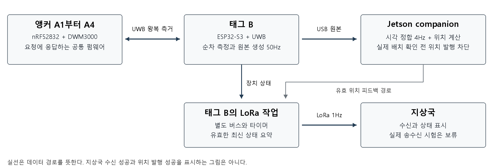

# 단일 태그 UWB 관측 경로의 설계와 검증
설계 제약에서 방법 선택과 개선까지 설명하는 심사 보고서다.
단일 태그의 구현과 시험 결과를 함께 검토할 때 읽는다.

> 앵커 제약에서 50Hz 원본 수집까지의 선택과 개선

> DroneStock 기술 보고서   |   2026년 10월 16일   |   개정 1

[PDF](uwb_design_review_20261016/report.pdf) · [Word](uwb_design_review_20261016/report.docx) · [검토 및 파일 해시](uwb_design_review_20261016/publication.json)

## 요약

UWB(Ultra-Wideband, 초광대역 무선)로 위치를 추정하려면 거리값과 함께 그 값의 측정 시각과 유효성을 알아야 한다. 태그는 위치를 추정할 대상 장치이고, 앵커는 좌표를 알고 설치하는 기준 장치다. 본 보고서는 앵커 네 대와 태그 B 한 대에서, 네 앵커의 측정 시도 결과를 묶은 원본 회차를 안정적으로 전달하는 문제를 다룬다.

기존 UWB 하드웨어와 이중 왕복 측거, 즉 양쪽의 시간 정보를 사용하는 거리 측정 방식을 유지하고, 태그가 네 앵커를 순차 호출하도록 통신 순서를 단순화했다. 거리·측정 시각·실패 상태를 담은 원본은 기체의 보조컴퓨터인 companion으로 전달한다. 본 구성의 companion은 Jetson Orin Nano다. 태그의 직렬 입력 처리, 앵커의 오류 복구, companion의 수신과 기록을 각각 수정해 초당 50회인 50Hz 원본 수집을 확인했다. [E1, E2]

책상 위 연결 상태에서 장거리·저전력 무선인 LoRa의 상태 송신을 함께 수행한 결과, 1,800초 동안 원본 회차 90,000개를 순번 및 기록 누락 없이 보존했다. 이 가운데 네 거리가 모두 유효한 회차는 89,965개였다. 실제 앵커 좌표가 확인되지 않아 위치 발행을 차단한 조건이므로, 이 결과는 관측 처리량과 기록 완전성을 보여준다. 위치 정확도와 비행 성능은 후속 검증 대상으로 남는다. [E3, E4, E11]

| 판단 대상 | 확인한 내용 | 해석 범위 |
| --- | --- | --- |
| 운영 주기 | 50Hz 원본 수집 / 회차당 20ms | 측정 시도 묶음의 생성과 전달 |
| 기록 완전성 | 90,000개 중 순번 누락 0 / 기록 큐 누락 0 | 최종 30분 시험 구간 |
| 측정 유효성 | 89,965 / 90,000 / 99.9611% | 네 거리 모두 유효한 회차 비율 |
| 위치 및 비행 | 새 위치 발행 0 / 비행 시험 미실시 | 배치 확인과 독립 기준 검증 필요 |

본문은 요구조건을 좁힌 뒤 설계 대안의 선택 근거, 관측 전달 경로의 구현, 병목 진단과 수정, 최종 성능평가를 차례로 설명한다. 마지막 장에서는 결과가 뒷받침하는 결론과 후속 검증의 순서를 정리한다. 수식과 상세 설정은 부록 A, 심사 질문은 부록 B, 근거 자료는 부록 C에 제시한다.

## 1 서론

한 앵커까지의 거리만으로는 태그의 위치를 결정할 수 없다. 여러 앵커의 거리를 결합하려면 앵커 좌표가 일관돼야 하고, 이동하는 태그라면 각 거리를 언제 측정했는지도 알아야 한다. 따라서 위치 계산에 앞서 거리·시각·실패 상태가 보존된 입력을 확보해야 한다. 이번 작업의 질문은 기존 장비로 이 입력을 요구 주기에 맞춰 전달하고, 중간에 손실이나 정체가 생겼을 때 그 원인을 구분할 수 있는가이다.

이번 작업의 장비 범위는 앵커 A1부터 A4까지 네 대와 태그 B 한 대다. 태그와 companion은 USB로 연결되어 있고, 지상국에는 별도 무선 경로로 상태를 보낸다. 기존 펌웨어는 여러 태그가 시간을 나누는 구성을 포함했지만, 이번 요구는 한 태그의 원본 관측을 안정적으로 수집하는 것이었다. [E1, E2]

| 제약조건 | 설계에 미친 영향 |
| --- | --- |
| 태그 B 한 대 | 여러 태그의 슬롯 배정과 가입 관리가 현재 요구에 필요하지 않음 |
| 앵커 네 대와 기존 드라이버 보유 | 부품을 교체하기 전에 측정 순서와 오류 처리의 병목을 검증 |
| 한 회차의 거리들은 순차 측정 | 앵커별 시각을 보존하고 companion 시간축에 대응 |
| 원본 50Hz와 상태 통신 동시 수행 | 측정 대기시간을 제한하고 송수신 및 저장의 대기를 분리 |
| 실제 배치 좌표 미확보 | 위치 발행을 차단하고 통신 성과와 정확도 성과를 구분 |

하드웨어 유지 판단은 현재 보유 장비와 확인한 병목을 기준으로 한다. 최초 구매 당시 모든 대안을 비교해 선정했다는 근거는 확보하지 않았으므로, 여기서는 기존 장비에서 어떤 구조를 바꾸어 요구조건을 충족했는지 평가한다.

> 그림 1  관측과 상태 통신의 책임 분리. companion의 기존 위치 계산 경로는 유지하며, 실제 배치가 확인되기 전에는 위치를 발행하지 않는다.

그림의 관측 경로를 구현하려면 거리값을 얻는 방법뿐 아니라, 그 방법이 요구하는 시계 처리와 무선 점유시간도 함께 결정해야 한다. 다음 장에서는 이 조건을 기준으로 기존 측거 방식과 통신 순서를 검토한다.

## 2 설계 대안과 선택 근거

### 2 1 UWB 측거와 기존 하드웨어

무선 연결 자체는 거리 정보를 보장하지 않는다. 거리 추정을 위해서는 수신 신호 세기, 전파의 이동시간, 위상 또는 도착 각도 등 거리와 관련된 물리량을 관찰해야 한다. RSSI(Received Signal Strength Indicator)는 수신 신호 세기를 나타낸다. ToF(Time of Flight)는 신호가 송신기에서 수신기까지 이동하는 데 걸린 시간이다.

| 관측 원리 | 장점 | 우리 조건에서 검토한 제약 |
| --- | --- | --- |
| RSSI 기반 추정 | 일반적인 무선 수신 정보 활용 가능 | 거리 외에도 차폐와 안테나 방향이 신호 세기에 영향을 줌 |
| ToF 기반 측거 | 전파 이동시간으로 거리를 계산 | 정밀한 무선 타임스탬프와 시계 오차 처리가 필요 |
| 위상 및 각도 기반 측정 | 지원 하드웨어에서 거리나 방향 정보를 활용 | 안테나와 무선 기능 및 처리 체계를 별도로 확인해야 함 |

현재 장비는 이미 UWB 모듈로 ToF를 측정할 수 있으므로, 거리 원본의 생성과 전달 경로를 개선하는 데 집중했다. RSSI의 환경 민감도를 줄일 다른 선택지도 존재한다. 예를 들어 Bluetooth의 Channel Sounding은 위상과 왕복 시간을 활용한다. 이번 선택은 보유 기능과 구현 범위에 따른 판단이며, 무선 기술 전체의 우열을 비교한 실험 결과는 아니다. [T1, T4]

앵커의 nRF52832는 MCU(Microcontroller Unit), 즉 프로그램과 주변장치를 제어하는 마이크로컨트롤러다. DWM3000은 정밀 송수신 시각을 기록하는 UWB 모듈이다. 제조사 기준 DWM3000은 DW3110 기반이며, 프로젝트의 드라이버는 DW3000 계열 명칭을 사용한다. nRF52832의 내장 Bluetooth 무선부와 별도 UWB 모듈의 역할을 구분해야 한다. [T1, T2]

nRF52832와 UWB 모듈은 SPI(Serial Peripheral Interface), 즉 클록을 공유하는 동기식 직렬 버스로 명령과 레지스터 값을 교환한다. SPI는 보드 내부의 제어 연결이고 UWB는 태그와 앵커 사이의 무선 연결이다. 현재 모듈의 제어 인터페이스와 기존 드라이버가 SPI를 사용하므로, 이 연결을 유지한 상태에서 송수신 절차와 오류 처리를 수정했다.

| 구성요소 | 현재 역할 | 유지 또는 변경 판단 |
| --- | --- | --- |
| 앵커 nRF52832와 UWB | 요청 검증과 정밀 무선 시각 기록 | 하드웨어 유지 및 공통 응답 펌웨어 적용 |
| 태그 ESP32-S3와 UWB | 측정 시작과 거리 계산 및 원본 생성 | 단일 태그 스케줄과 데이터 계약으로 변경 |
| Jetson Orin Nano | 시각 정합과 기존 위치 계산 | 기존 수치 코드 유지 및 새 입력 경로 적용 |
| SX1262 LoRa 무선부 | 지상국 상태 송신 | 기존 무선 설정 유지 및 독립 실행 |

UWB를 선택해도 차폐된 경로의 거리 편향이나 안테나 지연이 자동으로 해결되지는 않는다. 이번 작업은 기존 안테나 지연 상수의 출처를 보존했으며 새 거리 교정을 수행하지 않았다. 거리 유효 판정과 독립 기준에 대한 정확도는 별도 평가 항목이다. [E7]

### 2 2 시계 차이를 처리하는 DS TWR

전파는 1m를 이동하는 데 약 3.3ns가 걸린다. 반면 MCU의 처리, 응답 준비, 전송 대기는 그보다 훨씬 긴 시간 규모에서 발생한다. 따라서 프로그램이 메시지를 처리한 시각만으로 전파 이동시간을 계산할 수 없다. 무선 칩이 기록한 타임스탬프, 즉 송수신 사건이 발생한 시각을 사용해야 한다.

무선 타임스탬프를 얻은 뒤에도 장치별 클록 오프셋과 드리프트가 남는다. 오프셋은 두 시계의 기준점 차이이고, 드리프트는 시간이 흐르는 속도의 차이가 누적되는 현상이다. 서로 다른 시계의 송신 시각과 수신 시각을 그대로 빼면 거리 계산에 이 차이가 섞인다.

| 측거 방식 | 시계 문제를 다루는 방법 | 비용과 선택 판단 |
| --- | --- | --- |
| SS-TWR / 단일 왕복 측거 | 요청과 응답의 왕복 시간에서 응답 대기를 처리 | 교환이 적지만 시계 오차와 응답 지연 영향을 관리해야 함 |
| DS-TWR / 이중 왕복 측거 | 양쪽의 왕복 및 응답 시간 정보를 결합 | 추가 교환 비용을 감수하고 기존 계산 방식 유지 |
| TDoA / 도착 시간차 측위 | 여러 앵커가 관측한 도착 시간 차이 활용 | 대표적 구성에서는 앵커 간 정밀 동기 필요. 다수 태그에 유리한 설계 가능 |

DS-TWR(Double-Sided Two-Way Ranging)는 양쪽의 시간 정보를 결합해 시계 속도 차이에 따른 오차를 줄이는 왕복 측거 방식이다. TDoA(Time Difference of Arrival)는 여러 앵커가 관찰한 도착 시각 차이를 활용하며, 대표적인 구성에서는 앵커 간 정밀 시각 동기가 필요하다. 이번 요구는 태그 한 대가 네 앵커까지의 거리를 얻는 것이므로 기존 DS-TWR를 유지했다. 다수 태그로의 확장성보다 현재 구성의 구현과 검증 범위를 우선한 선택이다. [T3, T7, E2]

현재 한 번의 측거 절차는 POLL(측정 요청), RESPONSE(응답), FINAL(두 번째 왕복 측정을 위한 송신), REPORT(앵커의 시각 정보 보고)로 구성된다. 앞의 세 메시지에서 송수신 시각을 기록한 뒤, REPORT가 앵커 측 시각을 태그에 전달하면 태그가 거리를 계산한다. 따라서 REPORT는 현재 구현의 정보 전달을 위한 추가 메시지이며, DS-TWR의 일반 원리가 항상 네 메시지를 요구하는 것은 아니다. [E2]

여러 메시지를 네 앵커와 차례로 교환하면 그만큼 무선 채널을 점유하고, 각 거리의 측정 시점도 달라진다. 이 비용을 관리하려면 먼저 송신 순서를 정해야 한다. 이어서 한 앵커의 응답 지연이 나머지 관측까지 막지 않도록 대기시간을 제한하고, 순차 측정한 시각을 데이터에 남겨야 한다.

### 2 3 단일 태그의 순차 폴링

같은 채널을 사용하는 장치들은 매체 접근 제어가 필요하다. 매체 접근 제어는 어느 장치가 언제 송신할지 정하는 규칙이다. TDMA(Time Division Multiple Access)는 시간을 슬롯으로 나누어 장치별 사용 구간을 배정하는 방식이다. 폴링은 한 제어자가 상대를 순차적으로 호출하고 응답을 받는 방식이다.

DS-TWR는 거리를 계산하는 방법이고 TDMA와 폴링은 송신 순서를 정하는 방법이다. 두 선택은 서로 다른 계층에 있으므로 DS-TWR와 TDMA를 함께 사용할 수도 있다. 이번에는 DS-TWR를 유지하면서 여러 태그용 시간표를 단일 태그의 순차 폴링으로 바꿨다.

| 접근 방식 | 필요한 관리 | 현재 선택 근거 |
| --- | --- | --- |
| 경쟁 기반 접근 | 충돌 감지 또는 회피와 재시도 | 매 회차 지연의 변동을 별도로 관리해야 함 |
| 여러 태그용 TDMA | 슬롯 배정과 시각 동기 및 상태 관리 | 기존 A/B 운용에는 목적이 있으나 이번 한 태그 범위에는 불필요한 의존 존재 |
| 태그의 순차 폴링 | 태그가 요청과 응답 기한을 관리 | 한 태그가 네 앵커의 순서를 소유하므로 구조가 단순함 |

태그가 회차를 시작해 A1, A2, A3, A4 순서로 요청하도록 하고, A1의 주기적 동기 신호와 태그별 슬롯 수락 조건을 제거했다. 회차 시작에는 시스템 표시 시각의 조정과 무관하게 경과시간을 재는 단조 시계를 사용한다. 네 앵커는 주소만 다른 공통 응답기가 되므로, A1이 응답하지 않더라도 다른 앵커를 호출할 일정은 유지된다. [E2]

이 구조가 제어하는 것은 단일 태그와 네 앵커의 송신 순서다. 외부 간섭과 다른 장치의 송신에 의한 충돌 가능성은 남는다. 같은 채널에 태그를 추가할 때는 태그 간 일정이 필요하므로 TDMA를 포함한 매체 접근 방식을 다시 검토해야 한다.

## 3 관측 전달 경로의 구현

### 3 1 실패를 포함한 주기 설계

여기서 50Hz는 네 앵커의 측정 시도 결과를 묶은 원본 회차의 빈도다. 각 앵커는 태그의 요청에 응답하며, 이 빈도는 개별 앵커의 독립 방송률이나 실제 위치 발행·비행 제어 주기와 구분된다.

주기를 결정하려면 정상 측정의 평균 시간뿐 아니라 응답이 오지 않을 때의 대기시간을 포함해야 한다. 타임아웃은 응답을 기다릴 최대 시간이고, 데드라인은 해당 회차를 마쳐야 할 기한이다. 무제한 재시도는 한 거리의 성공 가능성을 높일 수 있지만 나머지 앵커와 다음 회차를 지연시킨다.

각 앵커의 첫 교환 상한은 3ms다. 네 앵커를 한 번씩 시도하는 명목 상한이 12ms가 되며, 남은 예산에서 최대 한 앵커만 한 번 재시도한다. 회차 완료 목표는 18ms, 다음 회차 시작 간격은 20ms로 정했다. 한 앵커의 응답을 끝없이 기다리는 대신 나머지 관측을 확보하고, 실패한 항목은 원본에 명시하는 구조다. [E2]

스케줄은 측정 완료 뒤 일정 시간을 쉬는 방식이 아니라 절대 단조 시각의 주기 경계를 사용한다. 예를 들어 수행시간 9ms 뒤 20ms를 추가로 쉬면 회차가 약 29ms로 늘어난다. 현재 구현은 이 누적을 피하며, 기한을 놓친 회차를 몰아서 실행하지 않는다. 건너뛴 회차는 순번과 누적 카운터에 반영한다. [E2]

### 3 2 원본 규격과 처리 책임

시간 예산 때문에 일부 거리 측정이 실패할 수 있다. 이때 이전 값을 현재 값으로 복사하면 표면적인 연속성은 유지되지만, 실제로는 서로 다른 시점의 관측을 섞게 된다. 반대로 회차 전체를 버리면 나머지 정상 거리와 실패 원인도 사라진다. 따라서 실패를 명시한 완결 원본 프레임을 전달하도록 했다.

원본 데이터(RAW)는 태그가 얻은 거리와 시각 및 유효성 정보를 포함한 기록이다. 여기서 원본은 전파 파형 자체를 뜻하지 않는다. 프레임은 한 회차의 관련 필드를 묶은 전달 단위이며, 스키마는 그 필드와 자료형을 정한 규격이다. schema 2는 네 거리와 앵커별 시각, 유효 비트, 실패 코드, 회차 순번, 부팅 및 측정 세션을 한 프레임에 담는다. [E2]

| 필드 계열 | 보존하는 의미 | 이 항목이 필요한 이유 |
| --- | --- | --- |
| 거리와 유효성 | 앵커별 사선거리와 실패 상태 | 실패를 과거 거리나 0m로 바꾸지 않음 |
| 측정 시각 | 회차 시작과 종료 및 앵커별 시각 | 순차 측정과 전달 지연을 분리 |
| 순번과 세션 | 회차 순번과 부팅 및 UWB 초기화 식별 | 중복 및 역순과 이전 실행의 관측을 구분 |
| 진단 카운터 | 주기 누락과 대기 원본 교체 등 | 측정 실패와 전달 손실을 서로 다른 계층에서 진단 |

태그와 companion은 기존 USB 직렬 연결을 사용한다. 태그 측 UART(Universal Asynchronous Receiver/Transmitter)는 비동기 직렬 송수신 인터페이스이며, 설정값은 921600 baud다. baud는 심볼 전송률의 단위이므로 관측 빈도를 나타내는 Hz와 구별해야 한다.

데이터는 JSON(JavaScript Object Notation) 객체를 한 줄에 하나씩 담는 JSONL로 표현한다. 이진 형식보다 크기는 커지지만 기존 수신 경로와 호환되고, 거리와 실패 상태를 직접 확인하기 쉽다. 이번에는 이 호환성과 진단 편의를 기준으로 형식을 유지했다. [E2]

수정의 초점은 같은 형식의 데이터를 읽고 저장하는 작업이 서로를 기다리지 않게 하는 데 있다. 직렬 전송 속도만으로 설명되지 않는 정체가 관찰되어, 입력 처리와 저장 대기를 각각 분리했다. 구체적인 병목과 같은 조건에서의 재시험 결과는 개선 과정에서 설명한다.

companion은 로봇 소프트웨어의 통신을 중개하는 ROS 2를 통해 원본을 기존 B_TF 경로에 전달한다. B_TF는 이 프로젝트의 거리 기반 위치 추정 경로다. 이번 배포에서는 B_TF의 수치 코드와 기계어로 컴파일한 native 라이브러리를 유지하고, 입력 스키마와 시각 변환 경로를 바꿨다. 비행제어 소프트웨어인 PX4는 기존처럼 기체 상태 추정과 고도·자세 제어를 담당한다. [E1]

실시간 전송에서는 최신 관측의 지연을 줄이는 것이 중요하지만, 시험 기록에서는 모든 관측을 보존해야 한다. 큐는 소비자가 처리할 때까지 데이터를 보관하는 대기열이며, 두 경로에 같은 정책을 적용하면 이 목적이 충돌한다. 태그는 송신 중인 JSON 줄을 끝까지 보낸 뒤 대기 RAW를 최신 완결 회차 하나로 유지한다. 시험 기록기는 별도의 큰 큐와 누락 카운터를 사용한다. 먼저 들어온 데이터를 먼저 꺼내는 FIFO를 무제한으로 쌓아 두면 오래된 관측이 뒤늦게 전달될 수 있기 때문이다. [E2, E4]

### 3 3 측정 시각의 정합

수신 시각은 측정 시각에 전송과 처리 지연이 더해진 값이다. USB 버퍼와 운영체제 스케줄링 때문에 지연이 변동하므로, companion에 도착한 시각을 실제 측정 시각으로 대체하면 이동 중인 물체의 관측 시점이 흔들린다. 일정한 지연을 한 번 빼는 방법도 변동 지연과 클록 드리프트를 모두 처리하지는 못한다.

시각 정합은 서로 다른 시계의 기록을 같은 시간축에 대응시키는 과정이다. 현재 경로는 UWB 무선 시각을 태그 MCU 시각으로, 다시 companion 시각으로 변환한다. 각 DS-TWR 측정의 대표 시점은 POLL 송신과 FINAL 송신의 중간으로 정의하며, 네 앵커를 동시에 측정한 시점으로 해석하지 않는다. MCU는 UWB 칩의 현재 시각을 읽기 직전과 직후의 시각을 기록해 두 시계를 대응시킨다. 이 읽기 구간이 500μs를 넘으면 해당 측정을 무효화한다. [E2]

태그와 companion 사이에는 네 타임스탬프를 사용하는 왕복 교환을 초당 4회 수행한다. companion 요청 시각 t1, 태그 수신 시각 t2, 태그 응답 시각 t3, companion 수신 시각 t4를 기록한다. 이 기록으로 전송 지연을 제한하고, 반복 관측으로 오프셋과 시계 속도 차이를 함께 추정한다. 측정마다 새로 동기 교환을 기다리지 않으므로 원본 50Hz와 시각 교환 4Hz를 병행할 수 있다. [E2]

두 시계는 아핀 대응 모형(affine model)으로 연결한다. 한 시계의 값을 일정 비율로 늘리거나 줄여 속도 차이를 보정하고, 기준점 차이인 오프셋을 더하는 방식이다. 각 왕복 교환에서 가능한 오프셋 구간을 구한 뒤 여러 구간의 교집합을 사용하므로, 편도 지연을 항상 왕복 지연의 절반으로 확정하지 않는다. 구체적인 식과 수용 조건은 부록 A에 제시한다.

연결·부팅·UWB 세션이 바뀌면 기존 시각 대응을 폐기하고 다시 설정한다. 오래된 관측, 중복, 역순을 거부하고 변환된 시각에는 기존 ClockMap을 다시 적용하지 않는다. 이 ms 단위 대응은 센서 관측을 같은 시간축에 놓는 용도이며, 전파 ToF를 계산하는 정밀 무선 타임스탬프와 역할이 다르다. [E2]

### 3 4 LoRa 상태 통신의 독립 실행

지상국 상태 경로는 SX1262를 사용하는 자체 장치 간 LoRa 통신으로 구성하고, 상태 요약을 약 1Hz로 송신한다. LoRaWAN은 LoRa 위에서 다수 장치와 네트워크를 운영하는 별도 프로토콜이므로 현재 구성과 구분한다. 원본 거리 관측은 기체 내부의 USB 경로로 companion에 전달한다. [T5, E2]

지상국의 상태 갱신과 기체 내부 관측은 요구 대역폭과 갱신 주기가 다르다. 따라서 원본 50Hz 전체를 LoRa로 보내거나 두 경로를 동일한 작업 완료 조건에 묶지 않았다. 기존 지상국과의 호환성을 위해 무선 설정과 메시지 형식을 유지하고, 실행 타이머와 복구를 분리했다.

현재 설정에서 최대 길이 메시지의 계산상 전파 점유시간은 약 399.616ms로, 20ms 측정 주기보다 길다. LoRa 송신 완료를 기다리는 동안에도 UWB가 계속 동작하도록 별도 작업과 SPI 호스트를 사용했다. 이처럼 한 작업의 완료를 기다리는 동안 다른 작업이 진행되는 방식을 비동기 실행이라 한다. 최대 길이 메시지의 실제 지상국 송수신 시험은 수행하지 않았으므로, 계산상 점유시간과 실측 통신 성능을 구분한다. [E2]

UWB 측정이 실패해도 LoRa 무선부가 준비돼 있으면 상태 송신을 계속 시도한다. 다만 companion의 최신 유효 위치가 없거나 만료되면 위치 유효 여부를 나타내는 fix를 false로 보고한다. 원본 시각·세션·순번을 검사하는 이유는 과거 좌표가 현재 위치로 계속 표시되는 것을 막기 위해서다. [E2]

LoRa 송신 완료 카운터는 태그 무선부의 완료 상태다. 이 값은 장치 상태를 주기적으로 알리는 heartbeat 메시지로 관찰한다. 실제 지상국이 메시지를 받았다는 증거는 별도로 확보해야 한다. 또한 LoRa 송신 중 하향 수신을 보장하지 않으며 송신 종료 뒤 수신 상태로 복귀한다. 이번 성과는 UWB와 LoRa 작업의 동시 운용 및 고장 영향 분리 범위로 제한한다. [E1]

## 4 병목 진단과 수정 검증

손실을 개선하려면 어느 계층에서 데이터가 사라졌는지 먼저 구분해야 한다. 무선 측정 실패, 태그의 대기 프레임 교체, companion 수신 누락, 기록기 저장 누락은 원인과 수정 위치가 다르다. 따라서 각 계층의 순번과 카운터를 대조하고 동일한 부하 또는 중단 조건을 반복했다.

### 4 1 수신률과 기록률의 차이

첫 50Hz 600초 기록에는 원본 27,743개만 남아 기록률이 약 46.238Hz였다. 그러나 수신기 자체 카운터는 별도의 약 595초 구간에서 29,750개 증가해 약 50Hz를 보였다. 분모가 다른 두 수치를 동일 표본으로 합치지는 않았지만, 기록 누락 전체를 무선 측정률 저하로 단정할 수 없다는 근거가 됐다. 이후 수신과 저장의 계층별 카운터를 유지했다. [E1]

### 4 2 시각 교환의 거부 기준 조정

초기 시각 교환에서는 왕복 수용 상한 8ms 때문에 116개 응답 중 114개가 거부됐다. 요청과 응답을 직렬화하는 시간까지 포함하면 실제 왕복 지연은 대부분 약 8.7~9.8ms였으므로, 기존 상한은 정상 교환도 배제하고 있었다. 왕복 수용 상한은 12ms로 조정하고 시각 불확실성 허용값 5ms는 유지했다. 앞의 기준은 전송 비용을 수용하기 위한 것이고, 뒤의 기준은 시각 대응의 사용 가능성을 판정하기 위한 것이다. [E1, E2]

### 4 3 입력 부하에 따른 태그 송신 정체

R2 펌웨어에 잘못된 입력 메시지를 연속으로 넣자 측정은 계속됐지만 USB 송신이 약 2초 정체했고 RAW 80개가 교체됐다. UART 드라이버를 확인한 결과, 수신 버퍼가 포화될 때 한 바이트씩 읽는 호출에서 내부 대기가 반복될 수 있었다. 따라서 512바이트 묶음 읽기와 입력 처리량 및 시간 제한을 적용했다. [E1, T6]

R3에서 같은 입력 부하를 반복했을 때 RAW 교체는 0개였다. 이 재시험은 통신 속도나 전체 프레임 형식을 바꾸지 않고도, 내부 대기가 반복되던 읽기 호출과 처리량 제한을 수정해 해당 정체를 해소했음을 보여준다.

### 4 4 CPU 재개 뒤 앵커 응답 복구

각 앵커 CPU를 SWD(Serial Wire Debug, MCU 디버깅 인터페이스)로 8초씩 정지한 뒤 재개했다. 첫 시험에서 A1과 A3는 CPU를 재개해도 응답이 돌아오지 않았다. 내부 SPI 전송 실패 상태가 남았지만 응용 계층이 이를 검사하고 복구하지 않는 경로가 확인됐다. [E1]

앵커 R2에서는 SPI 오류를 직접 확인하고 SPI와 UWB 무선부를 재초기화한다. 실패한 레지스터 읽기의 과거 버퍼를 새로운 무선 상태로 해석하지 않게 했으며, 복구 중에도 거래 및 세션 이력을 보존한다. 같은 8초 CPU 중단을 40Hz와 50Hz에서 반복하자 네 앵커가 모두 응답을 재개했다. 이 결과는 CPU 정지 및 재개 시험이며 물리 전원 차단 복구 시험은 아니다. [E1, E9]

중단 구간에도 나머지 앵커의 거리 관측과 LoRa 상태 송신은 계속 진행됐다. [E1, E9]

### 4 5 파일 쓰기와 UART 읽기의 대기 분리

동기식 파일 쓰기는 저장이 끝날 때까지 호출한 작업을 멈춘다. 첫 50Hz 오류 주입 기록에는 깨진 JSON이 19개 있었지만 태그의 RAW 교체와 주기 누락은 0이어서, 수신 이후의 호스트 경로를 조사했다. 파일 쓰기를 별도 작업으로 분리하고 같은 펌웨어와 같은 오류 주입으로 재시험하자, 쓰기가 최대 2,002.582ms 멈추는 동안에도 UART 읽기 반복의 최대 간격은 8.932ms였고 깨진 JSON은 0개였다. [E10]

ROS 2의 빈번한 타이머 실행에 의존하던 직렬 읽기도 전용 스레드로 분리했다. 스레드는 한 프로세스 안에서 독립적으로 스케줄되는 실행 흐름이다. 이 변경은 읽기 작업의 책임과 대기 원인을 분리한 것이며 운영체제의 모든 스케줄링 지연을 제거한 것은 아니다. [E1]

### 4 6 비동기 기록 이후의 큐 포화

읽기와 저장을 분리한 뒤에도 저장 큐의 용량이 부족하면 기록은 누락된다. 초기 50Hz 30분 시험에서는 수신 순번이 연속이었지만 디스크 기록 큐가 포화되어 여러 토픽 합계 3,184개 이벤트가 빠졌다. 이 값에는 RAW 외 메시지도 포함된다. 저장 파일의 첫 600초만 따로 대조하면 RAW 29,596개와 순번 누락 404개가 확인된다. 해당 파일은 이 차이를 추적할 실패 근거로 보존했다. [E1]

최종 수집기는 대기 큐를 2,048개로 늘리고 주기억장치인 RAM의 임시 공간에 기록하도록 구성했다. 시험 종료 후 디스크로 복사한 파일은 해시 함수 SHA-256으로 원본과 동일한지 대조했다. 이 조합에서 최종 90,000개 원본을 누락 없이 보존했다. 검증된 범위는 해당 시간 동안의 RAM 기록과 디스크 사본 보존이며, 무한히 지속되는 무손실 디스크 기록을 보장하지 않는다. [E3, E4, E12]

## 5 최종 성능평가

### 5 1 시험 조건과 평가 단위

최종 시험은 2026년 10월 16일 00시대 한국 표준시 기준으로 수행했다. ROS 통신 상대를 발견하기 위한 준비 시간 5초를 제외하고 이후 1,800초를 평가 구간으로 삼았다. 태그는 전체 플래시 재기록 후 시험 명령을 비활성화한 배포용 판본을 사용했다. [E1, E8]

시험 환경은 책상 위 연결 상태였으며, 기록에 있는 과거의 6.3m × 4.6m 배치를 실제 시험 좌표로 사용하지 않았다. 태그의 완전한 정지 여부도 별도로 확인되지 않았다. UWB 원본 수집과 LoRa 상태 송신을 함께 동작시켰고, 실제 배치 좌표가 없어 위치 발행을 차단한 상태에서 비행 없이 평가했다. [E11]

평가 단위는 네 앵커의 측정 시도 결과를 담은 원본 회차다. 원본의 수신·보존 여부와 네 거리의 유효 여부를 따로 집계하고, 처리시간과 전달 간격은 별도 시간 지표로 확인했다. 다음 표의 순번 및 기록 큐 누락은 전송·저장의 완전성을, 네 거리 유효 비율은 회차 안의 측정 성공 범위를 나타낸다. [E3, E4]

### 5 2 원본 수신과 보존 완전성

| 지표 | 최종 결과 | 분모와 의미 |
| --- | --- | --- |
| 원본 수신 및 저장 | 90,000개 | 1,800초 측정 구간의 RAW 회차 |
| 평균 원본 수신율 | 50.0003Hz | 타임스탬프 기반 간격 추정값 |
| 네 거리 모두 유효 | 89,965 / 90,000 / 99.9611% | 거리 계산과 유효성 검사를 통과한 회차 |
| 부분 실패 회차 | 35 / 90,000 | 무효 상태를 포함해 원본은 보존 |
| 순번 및 기록 큐 누락 | 각각 0 | 수신 순번과 저장 감사에서 확인 |
| 1초 창 최소 원본 수 | 49개 | 완전한 1초 창 1,800개 중 최솟값 |
| LoRa 완료 증가 | 1,799회 | heartbeat 사이 약 1,799초. 지상국 수신 아님 |
| 새 유효 위치 발행 | 0개 | 실제 배치 미확인으로 차단 |

원본 회차 수를 1,800초로 나눈 수신율은 정확히 50회/초다. 표의 50.0003Hz는 기록된 시각 간격으로 계산한 값이므로, 소수점 차이를 목표 주기 이상의 추가 성능으로 해석하지 않는다. 네 거리 유효 비율은 각 회차에서 측정 계약을 통과한 관측이 모두 있는지를 나타낸다. 이는 독립 기준 위치에 대한 오차를 측정한 정확도 지표와 다르다. [E3]

### 5 3 수행시간과 전달 지연

최종 50Hz 시험의 회차 수행시간은 중앙값 9.225ms, 99백분위수 9.499ms, 관측 최대 12.716ms였다. 99백분위수는 관측값의 99%가 그 이하였다는 뜻이다. 관측 최대도 20ms 주기 안에 있었으므로 이 시험에서는 측정 처리 여유를 확인했다. 다만 관측 최대는 모든 환경의 최악 실행시간을 보장하지 않는다. [E3]

시각 불확실성 추정의 최대는 약 3.096ms였다. 이는 시각 대응 모형이 보고한 범위이며 독립 기준시계로 검교정한 정확도가 아니다. 측정 수행시간, 전달 지연, 시각 불확실성은 서로 다른 시간 지표로 해석해야 한다. [E3]

| 시간 지표 ms | 중앙값 | 99백분위 | 최대 |
| --- | --- | --- | --- |
| 한 회차의 측정 수행 | 9.225 | 9.499 | 12.716 |
| UART 수신 간격 | 20.020 | 23.334 | 37.142 |
| 기록기 원본 수신 처리 간격 | 20.015 | 23.703 | 108.512 |
| 기록기 전달 지연 | 3.244 | 5.556 | 90.156 |
| 기록 시점의 최신 측정 나이 | 12.342 | 16.278 | 98.869 |
| 시각 불확실성 추정 | 2.969 | 3.062 | 3.096 |

기록기에서 100ms를 넘는 간격은 한 번 나타났다. 이때 원본 순번은 25,878에서 25,879로 연속이었고, 태그 회차 간격 20.005ms와 UART 수신 간격 20.063ms도 유지됐다. 늘어난 값은 같은 메시지가 기록기에 전달되기까지의 지연으로, 약 90.156ms였다. 따라서 이 사건은 원본 누락이나 무선 측정 중단이 아닌 ROS 수집 전달 지연으로 분류했다. 기록 완전성이 확보되어도 지터, 즉 도착 간격의 변동은 남을 수 있음을 보여주는 사례다. [E4]

### 5 4 주기 비교와 채택 근거

| 600초 비교 항목 | 40Hz 수정판 | 최종 50Hz 첫 600초 |
| --- | --- | --- |
| 원본 수신 | 24,000개 | 30,000개 |
| 평균 수신율 | 40.0002Hz | 50.0005Hz |
| 네 거리 유효 비율 | 99.9583% | 99.9633% |
| 수신 순번 누락 | 0 | 0 |
| 저장 큐 누락 | 전체 토픽 합계 369개 이벤트 | 0 |

40Hz 결과는 수신 중 메모리 내 집계이며 저장 파일에는 누락이 있었다. 50Hz 결과는 최종 완전 기록의 첫 600초를 추출해 같은 길이로 대조했다. 이 비교에서 채택 기준은 원본 처리량과 기록 가능성이었고, 최종 시험에서는 50Hz로 그 기준을 확인했다. 저장 조건이 완전히 대칭적이지 않으므로 위치 정확도의 우열을 평가한 실험으로 사용할 수 없으며, 작은 유효 비율 차이의 통계적 우월성도 주장하지 않는다. [E5, E6]

| 주기 후보 | 회차당 시간 | 실측과 판단 |
| --- | --- | --- |
| 40Hz | 25ms | 동일 수정판의 600초 수신 통계 확보. 시간 여유가 더 큼 |
| 50Hz | 20ms | 최종 1,800초 원본 완전 기록과 처리시간을 근거로 채택 |
| 100Hz | 10ms | 현재 관측 최대 수행시간 12.716ms보다 짧음. 운영 검증 없음 |

## 6 논의와 결론

최종 시험은 50Hz 원본 수집과 완전 기록을 확인했다. 이 결과로 판단할 수 있는 것은 거리·시각·실패 상태를 전달하는 관측 경로의 동작이며, 아직 위치 계산의 정확도를 판단할 수는 없다. 실제 배치 좌표와 독립 기준 위치가 없기 때문이다. 다음 검증은 이 입력이 실제 배치와 이동 조건에서 얼마나 정확하고 오래되지 않은 위치를 제공하는지에 초점을 맞춰야 한다.

| 후속 확인 | 필요한 근거 | 현재 상태 |
| --- | --- | --- |
| 배치 및 거리 교정 | 앵커 좌표와 높이 및 태그 기준점 실측 | 책상 위 연결만 확인 |
| 위치 정확도 | 독립 기준 위치와 시간 정렬한 오차 분포 | 위치 발행 차단 |
| 이동 중 지연과 가용성 | 속도별 유효 관측률 및 최대 관측 나이 | 미검증 |
| 물리 복구 | 태그 및 앵커 전원 재인가와 USB 재연결 | CPU 중단 및 소프트웨어 재접속만 확인 |
| 지상국 통신 | 실제 LoRa 송수신과 누락 및 길이별 결과 | 실물 시험 보류 |
| 비행제어 입력 | PX4에 송신된 관측의 수용 및 실제 융합 | 이번 작업에서 미검증 |

실제 앵커 좌표와 거리 교정을 확인한 뒤 위치 발행 조건을 해제해야 독립 기준과의 위치 오차를 평가할 수 있다. 이동 시험에서는 원본 측정 시각부터 위치 소비까지의 지연과 관측 나이를 함께 확인하고, 그 다음 비행제어기의 관측 수용과 상태 추정에서의 실제 융합을 구분해 기록한다. 기존 안테나 지연 상수의 유지나 소프트웨어 시험 통과만으로 이 순서를 대신할 수는 없다.

이번 개선은 단일 태그에 맞춘 통신 순서와 시간 예산, 실패를 보존하는 원본 규격, 수신과 기록의 실행 분리를 연결한 결과다. 계층별 카운터와 원본 기록을 함께 남겼기 때문에 정체의 위치를 구분하고 수정 후 같은 조건에서 확인할 수 있었다. 이 관측 경로를 실제 위치 성능으로 이어가는 검증이 다음 단계다.

## 부록 A 전공 검토를 위한 수식과 계약

### A 1 거리 계산과 시각 대응의 서로 다른 목적

아래 식에서 R은 왕복시간, D는 응답 대기시간이며 a와 b는 구간을 구분하는 첨자다. Ra는 태그의 POLL 송신부터 RESPONSE 수신까지, Rb는 앵커의 RESPONSE 송신부터 FINAL 수신까지다. Da는 앵커의 POLL 수신부터 RESPONSE 송신까지, Db는 태그의 RESPONSE 수신부터 FINAL 송신까지다. 각 시간 차는 같은 무선 시계 안에서 계산한다. [T3, E2]

$$
\operatorname{ToF}=\frac{R_aR_b-D_aD_b}{R_a+R_b+D_a+D_b}
$$

$$
d=c\operatorname{ToF}
$$

d는 거리이고 c는 전파 속도다. 무선 시계 단위로 계산한 ToF를 초로 변환한 뒤 c를 곱한다. 이 계산은 응답 대기와 클록 속도 차이의 영향을 줄이지만 안테나 지연과 직접 경로가 차폐된 비가시경로의 편향을 모두 없애지는 않는다. REPORT는 앵커 측 시각을 태그에 전달하며, 실제 구현의 순환 카운터 처리는 별도 프로토콜 검증 대상이다.

companion 시각에는 본문에서 설명한 아핀 대응 모형(affine model)을 적용한다. h₀와 t₀는 대응 기준점이며 α는 두 시계의 속도 비율이다. 이 식은 관측 시각을 맞추기 위한 것으로, 전파 ToF 계산과 목적 및 시간 정밀도 요구가 다르다. [E2]

$$
h(t)=h_0+\alpha(t-t_0)
$$

$$
\operatorname{RTT}=(t_4-t_1)-(t_3-t_2)
$$

RTT(Round-Trip Time)는 태그 내부 처리시간을 제외한 왕복 잔여 지연이다. t₁과 t₄는 companion 시각, t₂와 t₃는 태그 시각이다. 현재 구현은 이 왕복 기록을 이용해 수용 조건을 검사하고 오프셋 허용 구간을 교차한다. 이 식만으로 편도 지연의 비대칭이 독립 검교정되는 것은 아니다.

| 시각 대응 조건 | 현재 값 또는 처리 |
| --- | --- |
| 정상 교환 주기 | 4Hz |
| 왕복 지연 수용 범위 | 0~12ms |
| 자료 보관 | 최대 120개와 최근 30초 |
| 기울기 추정 자료 길이 | 5초 이상 |
| 기울기 허용 범위 | 0.999~1.001 |
| 초기 준비 | 최소 네 교환 필요 |
| 대응 유효기간 | 마지막 유효 교환 뒤 2초 |
| 허용 불확실성 | 5ms. 독립 검교정 정확도와 구분 |
| 원본 나이 제한 | 150ms 초과 수용하지 않음 |
| 변환 중복 방지 | 새 경로의 변환 시각에 기존 ClockMap 재적용 금지 |

### A 2 무선과 전송 설정의 성격

| 계층 | 현재 설정 | 선정 또는 유지 근거 |
| --- | --- | --- |
| UWB 무선 | 채널 5 및 6.8Mbps / 프리앰블 길이 128 | 기존 무선 경로와 양단 일치. 채널별 최적화 비교는 미수행 |
| UART | 921600 baud | 기존 직렬 경로 유지. 처리 대기 병목을 우선 수정 |
| LoRa 무선 | 915MHz 및 BW 125kHz / SF7 및 CR 4/5 / 출력 10dBm | 기존 지상국 호환 설정 유지. 거리 및 전파환경별 최적화 근거 아님 |
| LoRa 패킷 | private sync 0x1424 / CRC 사용 및 최대 255바이트 | 기존 무선 및 메시지 계약 유지 |
| 태그 안테나 지연 | 송신 TX와 수신 RX / 각각 16385 | 원본 소스 상수. 새 실측 보정값 아님 |

프리앰블은 수신 동기와 검출을 위한 앞부분 신호다. BW(Bandwidth)는 대역폭, SF(Spreading Factor)는 확산계수, CR(Coding Rate)은 부호율이다. 이 값들은 전파 점유시간과 수신 특성에 영향을 주므로, 기존 값의 유지와 실제 환경에 대한 최적화를 구분해야 한다. CRC(Cyclic Redundancy Check)는 전송 오류 검출이며 송신자 인증을 제공하지 않는다. [E2]

무선 프레임은 길이, 주소, PAN 식별자, 판본, 세션, 거래 순번을 검사한다. PAN은 여기서 동일 논리 네트워크를 구분하는 식별값이다. 중복과 역순 및 과거 세션을 거부하는 검사는 신선도와 일관성을 위한 것이며, 암호학적 인증이나 공격 내성을 입증한 기능이 아니다. [E2]

## 부록 B 심사 질문에 대한 판단 근거

### B 1 50Hz이면 위치도 초당 50개 나오는가

이번에 확인한 50Hz는 네 앵커의 시도 결과를 담은 원본 회차의 수신율이다. 실제 위치 발행은 배치 확인 조건에 의해 차단됐고 최종 시험에서 새 위치는 0개였다. 위치율은 실측 배치에서 별도로 확인해야 한다.

### B 2 왜 TDoA나 더 높은 주기를 선택하지 않았는가

태그 한 대와 기존 DS-TWR 경로를 사용하는 범위에서 앵커 간 정밀 동기와 새 측위 체계를 추가할 필요가 작았다. 50Hz는 실측 처리시간과 최종 완전 기록을 근거로 선택했다. 100Hz는 현재 관측 최대 처리시간보다 회차 시간이 짧고 운영 시험도 수행하지 않았다. 태그 수가 늘어나면 이 판단은 다시 검토해야 한다.

### B 3 손실이 0인데 일부 거리 측정은 왜 실패했는가

손실 0은 최종 90,000개 원본 회차가 빠지지 않고 저장됐다는 의미다. 35개 회차의 일부 거리 측정 실패는 무효 상태로 기록됐다. 데이터 보존의 완전성과 물리 측정의 성공률은 서로 다른 지표다.

### B 4 비동기화하면 지연과 손실이 모두 없어지는가

비동기화는 한 작업의 대기가 다른 작업을 직접 멈추는 의존성을 줄인다. 소비자가 지속적으로 느리면 큐는 결국 포화될 수 있다. 실제로 초기 장시간 기록에서는 비동기화 뒤에도 저장 누락이 있었고, 최종 RAM 기록과 큐 크기 조정으로 해당 시험의 완전성을 확보했다. 지속 디스크 기록의 처리량과 최대 정체시간은 별도 검증이 필요하다.

### B 5 이번 개선이 AI 정확도 향상을 증명하는가

이번 범위는 관측과 통신의 신뢰성 개선이다. 원본 시각과 실패 상태를 보존하면 이후 추정 알고리즘이 사용할 수 있는 정보의 의미가 명확해지지만, 독립 정답에 대한 위치 정확도 향상을 입증하지는 않는다. 기존 B_TF 수치 코드도 유지했다. 알고리즘 정확도 주장은 별도의 정답 데이터와 비교 실험이 있어야 한다.

### B 6 배포와 복구의 추적성에 남은 제한은 무엇인가

태그의 전체 플래시 백업과 재기록 이미지 대조, 앵커에 기록한 내용을 다시 읽는 readback 대조를 수행했다. 그러나 A1 최초 연결에서는 J-Link의 저장된 자동 잠금 해제 설정 때문에 사전 실물 백업을 확보하기 전에 삭제가 발생했다. 원본 ZIP 이미지로 복구한 뒤 새 판본을 기록했으므로 새 이미지의 기록 여부는 확인했지만, 삭제 전 개별 상태와의 동일성은 확인할 수 없다. 사건과 복구 근거는 실행 기록에 보존했다. 물리 전원 재인가와 USB 분리 시험은 별도로 남아 있다. [E1]

## 부록 C 근거 자료와 판본

프로젝트 근거는 저장소 스냅샷 88f08a094122fd51e07276b887de3c8b9f62103e에서 확인했다. 펌웨어 구현 소스는 b61f1b2, 최종 수집 도구 소스는 d1325c9에 해당한다. 본 보고서 작성 과정에서는 장치나 운영 설정을 변경하지 않았다. 아래 프로젝트 경로는 esp32-single-tag-20261015 작업 트리를 기준으로 한다.

> [E1] 구현 및 실기기 시험과 복구 기록

> [docs/report/esp32_single_tag_execution_20261015.md](esp32_single_tag_execution_20261015.md)

> [E2] 단일 태그 무선 및 직렬 시각 계약

> [docs/reference/single_tag_protocol_v2.md](../reference/single_tag_protocol_v2.md)

> [E3] 최종 1,800초 수신 통계

> [docs/report/evidence/esp32_single_tag_20261015/final50-r3-summary.json](evidence/esp32_single_tag_20261015/final50-r3-summary.json)

> [E4] 저장 완전성과 100ms 이상 공백 감사

> [docs/report/evidence/esp32_single_tag_20261015/final50-recording-audit.json](evidence/esp32_single_tag_20261015/final50-recording-audit.json)

> [E5] 40Hz 수정판의 600초 수신 통계

> [docs/report/evidence/esp32_single_tag_20261015/compare40-r3-summary.json](evidence/esp32_single_tag_20261015/compare40-r3-summary.json)

> [E6] 최종 50Hz 완전 기록의 첫 600초

> [docs/report/evidence/esp32_single_tag_20261015/final50-first600-summary.json](evidence/esp32_single_tag_20261015/final50-first600-summary.json)

> [E7] 안테나 지연 상수의 출처

> [docs/report/evidence/esp32_single_tag_20261015/calibration_provenance.json](evidence/esp32_single_tag_20261015/calibration_provenance.json)

> [E8] 배포 후보와 선택 조합

> [docs/report/evidence/esp32_single_tag_20261015/release_candidates.json](evidence/esp32_single_tag_20261015/release_candidates.json)

> [E9] 50Hz 앵커 CPU 중단 및 복구 분석

> [docs/report/evidence/esp32_single_tag_20261015/anchor-r2-fault50-r3-analysis.json](evidence/esp32_single_tag_20261015/anchor-r2-fault50-r3-analysis.json)

> [E10] 비동기 기록기의 입력 부하 시험

> [docs/report/evidence/esp32_single_tag_20261015/probe50-r3-async-summary.json](evidence/esp32_single_tag_20261015/probe50-r3-async-summary.json)

> [E11] 책상 위 연결과 접근 불가에 대한 사용자 확인

> [docs/report/evidence/esp32_single_tag_20261015/user_test_conditions_20261016.json](evidence/esp32_single_tag_20261015/user_test_conditions_20261016.json)

> [E12] 최종 원본의 디스크 보존과 해시 대조

> [docs/report/evidence/esp32_single_tag_20261015/final50-persistence.json](evidence/esp32_single_tag_20261015/final50-persistence.json)

### 제조사 문서와 기술 자료

> [T1] [Qorvo DWM3000 제품 설명](https://www.qorvo.com/products/p/DWM3000)

> 모듈의 역할과 기반 IC 및 외부 MCU 요구

> [T2] [Nordic nRF52832 제품 설명](https://www.nordicsemi.com/products/nrf52832/getting-started)

> MCU와 주변 인터페이스

> [T3] [Decawave APS013 The implementation of two way ranging with the DW1000](https://forum.qorvo.com/uploads/short-url/x34DrF7EW5fQP9wY3aNESqPKz8z.pdf)

> DS-TWR 원리. DW1000 문헌을 원리 근거로 사용하며 현재 장치 구현은 E2로 확인

> [T4] [Bluetooth SIG Channel Sounding How it works and what it means](https://www.bluetooth.com/blog/bluetooth-channel-sounding-how-it-works/)

> RSSI와 위상 및 왕복 기반 거리 측정의 구분

> [T5] [Semtech What Is LoRa](https://blog.semtech.com/what-is-lora)

> LoRa와 장거리 저전력 상태 통신의 배경

> [T6] [Espressif ESP IDF v4.4.7 UART driver](https://github.com/espressif/esp-idf/blob/v4.4.7/components/driver/uart.c)

> uart_read_bytes와 uart_check_buf_full의 입력 처리 확인

> [T7] [Design and Implementation of Real Time Localization System based on UWB and TDoA Algorithm](https://arxiv.org/abs/2112.04839)

> TDoA와 무선 클록 동기의 설계 배경

기술 자료 확인일은 2026년 10월 16일이다. 제조사의 일반 성능 수치나 다른 시스템의 실험 결과를 본 장치의 측정 성과로 전용하지 않았다.
