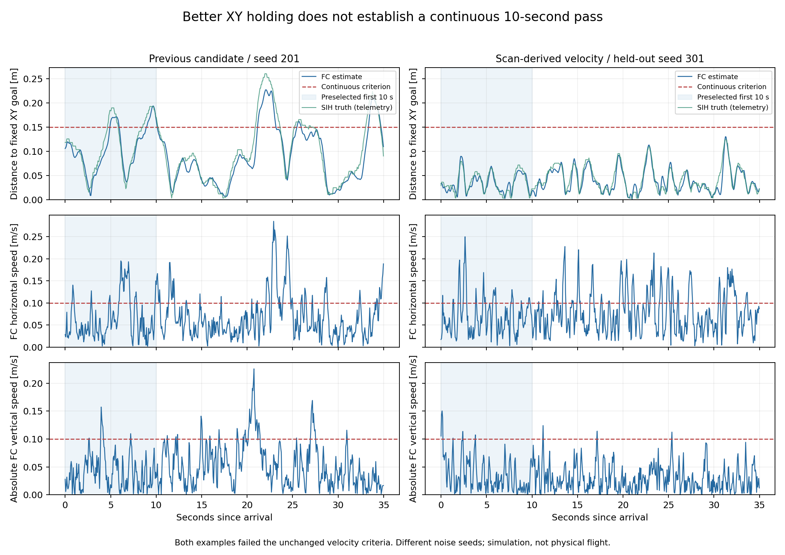

# LiDAR 이동 추정과 10초 호버 — 2026-10-12
PX4 입력 설계와 격리 검증의 수행 기록이다.
3cm 호버 달성 여부와 실기 적용 범위를 판단할 때 읽는다.

후속 [회전 광선·deskew 검증](spinning_lidar_20261012.md)을 추가했다.
아래 수치는 이전 순간 스캔 시험 기록으로 보존한다.

## 결론

**위치 유지 오차는 줄었지만 연속 10초 합격은 미달이다.**
새 seed 301·302·303의 첫 10초를 미리 정해 검사했다.
FC 목표점 RMS는 3.69–3.92cm다.
같은 구간의 SIH 원시 위치 RMS는 3.94–4.13cm다.
3.0cm 이하와 연속 안정 10초를 함께 만족하지 못했다.
세 시행 모두 `hover_stability_timeout`으로 종료했다.
실기 설정과 운영 코드는 변경하지 않았다.

이전 실기 기록의 3.68cm는 FC 내부 목표점 RMS다.
그 기록에는 독립 위치 정답이 없다.
이번 수치가 비슷해도 실기 성능 재현을 뜻하지 않는다.
[실기 중립 호버 기록](neutral_hover_20261011.md)을 참조한다.

## 설계 판단

UWB 위치와 LiDAR 이동 추정을 결합하는 방향은 타당하다.
다만 UWB 앵커 좌표는 WGS84 좌표가 아니다.
현재 미션은 로컬 위치가 유효한 Offboard를 사용한다.
LiDAR 시제품은 지도 최적화 없는 스캔 오도메트리다.
완전한 SLAM이나 LiDAR 단독 비행으로 부르지 않는다.

```text
UWB 거리 -> H80/B_TF -> 앵커 XY -> PX4 EV 위치 입력
                                      |
IMU 예측 + 광류 + TFmini Plus + 기압계 -> PX4 EKF2
                                      |
수평 스캔 -> 상대이동 -> 구간 XY 속도 -> 전용 LiDAR2D 보조 입력
                                      |
                              PX4 XYZ·속도·자세
                                      |
                              PX4 위치·자세 제어
```

벽 회피는 이 추정 결과를 사용하는 별도 이동 판단이다.
이번에는 기존 최외곽 여유 50cm를 유지했다.
필수 파라미터와 센서별 책임은
[입력 설계 문서](../architecture/px4_lidar_localization_design_20261012.md)에 정리했다.

## 이번에 구현한 경로

가상 거리 배열을 실제 정합기로 전달했다.
이전 시험의 정답 속도 직접 입력과 구분한다.

| 부분 | 구현과 경계 |
|---|---|
| 가상 LiDAR | 430광선, 10Hz, 거리 잡음 1cm, 공통 잡음 3mm |
| 원시 상태 사용 | 가상 센서와 오프라인 평가에만 사용 |
| 정합기 입력 | 거리 배열, FC 자세, 측정 하방 거리 |
| 자세 사용 | 기울기 투영과 최초 heading, 독립 관측으로 과신하지 않음 |
| 정합 | 기존 robust keyframe·역방향 일치·퇴화 검사 |
| 출력 | 상대 이동량, XY 속도, 원본 시각·중점 시각·reset |
| 높이·기울기 gate | 바닥 높이 0.75–2.25m, 기울기 10도 이내 |
| 불확실성 | 스캔 잡음·heading·가상 위치 양자화 항 |
| PX4 입력 | LOCAL_NED 수평 속도, vz는 NaN |
| 관측 중단 | 거절한 스캔을 넘어 속도를 만들지 않음 |
| 미구현 | 지도 최적화, 재방문 보정, 실물 spinning scan 보정 |

실물 RAW와 센서 설정은 바꾸지 않았다.
SITL 장착은 IMU와 LiDAR 원점이 일치하는 fixture다.
실물 약 10cm 장착 차이는 이 값으로 대체하지 않는다.
실물 장착 회전·레버암·광선 시각은 별도 검증 대상이다.

## 실패 원인과 변경

위치 이득 하나를 올리는 방식으로는 해결되지 않았다.
개발 시험의 실패 시행도 모두 보존했다.

| 확인한 문제 | 조치 | 검증의 한계 |
|---|---|---|
| 구간 평균 속도를 즉시값과 같은 시각 조건으로 취급 | 스캔 중점 시각, 100ms 융합 버퍼 | 실제 LiDAR 지연 보정값은 아님 |
| 가상 위치의 약 1cm 양자화가 속도 잡음을 만듦 | 12mm 상한의 양자화 공분산 항 | HIL 좌표 전송의 시험 한계 |
| 기본 IMU 모델이 추력 발생 시 SIH 잡음보다 작음 | EKF 과정 잡음 모델 변경 | 실기 IMU 보정값은 아님 |
| 위치·거리계 불확실성 하한이 합성 관측보다 큼 | 합성 관측의 명시 모델에 맞춤 | 실제 UWB 0.30m 설정은 유지 |
| 큰 위치 이득에서 명령 종류가 반복 변경됨 | PX4 수평 속도 상한 조회 후 고정 위치 유지 | 장애물 제한과 정지 우선권 유지 |
| 단일 RMS가 안정 타이머 실패를 숨김 | 각 조건·연속 시간·FC와 truth를 분리 | 합격 조건을 완화하지 않음 |

SIH 소스는 추력이 있을 때 IMU 잡음을 키운다.
가속도 표준편차는 축별 0.5/1.7/1.4m/s²다.
자이로는 0.14/0.07/0.03rad/s다.
0.1m/s²·0.01rad/s는 비시동 구간 값이다.
작업 중 이 두 구간을 구분해 해석을 바로잡았다.
원래 SIH 센서 잡음과 바이너리는 변경하지 않았다.

모델 수정은 작은 잡음의 센서를 새로 만든 것이 아니다.
EKF에 기존 큰 잡음의 불확실성을 더 반영한 것이다.
이 조정만으로 잔여 속도 피크가 사라지지는 않았다.

## 고정한 격리 후보

아래 값은 격리 시험 프로세스에만 전달했다.
ARM 전에 파라미터 응답으로 적용값을 확인했다.
기체나 영구 운영 설정에 쓰지 않았다.

| 파라미터 | 이전 후속 후보 | 이번 후보 |
|---|---:|---:|
| `EKF2_DELAY_MAX` | 50ms | 100ms |
| `EKF2_ASP_DELAY` | 0ms | 0ms |
| `EKF2_TAU_VEL` | 0.10s | 0.05s |
| `EKF2_TAU_POS` | 0.25s | 0.10s |
| `EKF2_ACC_NOISE` | 0.35m/s² | 1.0m/s² |
| `EKF2_GYR_NOISE` | 0.015rad/s | 0.10rad/s |
| `EKF2_EVP_NOISE` | 0.10m | 0.03m |
| `EKF2_RNG_NOISE` | 0.10m | 0.03m |
| `EKF2_RNG_SFE` | 0.05m/m | 0m/m |
| `MPC_XY_P` | 0.95 | 2.0 |
| `MPC_XY_VEL_P_ACC` | 1.8 | 3.0 |
| `MPC_XY_VEL_MAX` | 12m/s | 0.25m/s |

0.25m/s는 명령 상한이다.
실제 속도의 엄밀한 상한으로 해석하지 않는다.
장애물 판단에는 기존 속도 불확실성 0.35m/s를 더한다.

UWB 합성 메시지 표준편차는 계속 0.03m다.
입력 위치 잡음은 축별 0.01m로 유지했다.
PX4 메시지 하한을 0.10m에서 0.03m로 바꿨다.
실기 B_TF 전체 이력 처리의 재현은 아니다.
SITL IMU 적분은 250Hz, 보존 실기 기록은 200Hz다.

높이 기준은 기압계 0, 거리계 보조는 조건부 1이다.
거리계 높이 기준 2 후보는 채택하지 않았다.
한 시행에서 착륙 완료 확인이 불안정했다.
MPC의 고도 제어 이득과 자세 제어는 유지했다.
companion 고도 제어 루프를 만들지 않았다.

## 10초 판정 방법

첫 10초와 미션의 연속 안정 구간을 별도로 검사했다.
좋은 구간을 사후 선택하지 않았다.

| 조건 | 기준 |
|---|---:|
| 고정 목표 XY RMS | FC·SIH 원시 위치 모두 0.03m 이하 |
| 연속 안정 시간 | 10초 이상 |
| 원래 XY 허용 범위 | 0.15m 이하 |
| 원래 UWB 허용 범위 | 0.25m 이하 |
| 수평 속도 | 0.10m/s 이하 |
| 기존 높이 목표 대비 오차 | 0.15m 이하 |
| 수직 속도 절댓값 | 0.10m/s 이하 |
| 상태·연속성 | ARM·공중·OFFBOARD, 표본 간격 0.12초 이하 |

각 시행의 호버 평가 구간은 약 35초다.
아래 첫 10초는 고정 목표 도착 직후 구간이다.
FC ULog 1,251개, SIH 원시 위치 500개를 사용했다.
평균 위치를 빼서 목표 오차를 줄이지 않았다.

| 새 seed | 첫 10초 FC RMS | 첫 10초 truth RMS | 전체 35초 FC RMS | 연속 안정 최장 |
|---|---:|---:|---:|---:|
| 301 | 3.92cm | 4.13cm | 4.55cm | 2.824초 |
| 302 | 3.72cm | 3.94cm | 4.16cm | 2.824초 |
| 303 | 3.69cm | 3.99cm | 4.14cm | 2.104초 |

이전 후보의 첫 10초 FC RMS는 5.38–11.42cm다.
이전 35초 전체 RMS는 8.52–11.00cm다.
이전 시험은 합성 즉시 속도와 다른 seed를 사용했다.
따라서 이 차이를 LiDAR 단독 기여율로 계산하지 않는다.

새 세 시행의 XY·높이는 원래 허용 범위 안에 있었다.
수평 속도 초과는 각각 155/584, 134/584, 139/584개다.
수직 속도 초과는 10/584, 6/584, 13/584개다.
**속도 조건으로 타이머가 끊긴다는 원인은 남아 있다.**

같은 새 seed에서 LiDAR 보조만 끈 3회도 실행했다.
35초 FC 목표점 RMS는 5.07/4.92/4.92cm다.
LiDAR를 켠 값은 4.55/4.16/4.14cm다.
두 구성 모두 10초 연속 호버는 0/3이다.
이 비교는 같은 합성 관측 모델 안의 차이다.
실물 LiDAR의 기여율로 일반화하지 않는다.

스캔 출력과 PX4 실제 융합도 구분했다.
새 일반 시행의 정합 속도 출력은 428/444/412개다.
PX4 보조 융합은 382/411/363개로 확인했다.
지상·이륙·착륙과 재획득 대기 때문에 분모가 다르다.
스캔 속도의 SIH 구간 평균 대비 RMS는 0.056–0.060m/s다.
명목 95% 공분산 영역의 포함률은 99.5–100%였다.
이는 이 fixture의 보수적 모델 점검이다.
실물 공분산 보정이나 독립성 검증은 아니다.



## 벽과 센서 공백

최외곽 여유는 기체 반경 0.20m 밖에서 잰다.
여유 기준 0.50m와 제동 모델은 유지했다.
반경은 실측 기체 제원이 아닌 시뮬레이션 가정이다.
새 벽·공백 시험의 결과는 증빙 JSON에서 확인한다.
정지 뒤 LAND 종료는 정상 경로 완료와 구분한다.

| 조건 | 시행 수 | 확인 결과 |
|---|---:|---|
| 벽 | 3 | 외곽 최소 1.065/1.005/0.990m, 50cm 기준 3/3 |
| 장애물 스캔 공백 | 1 | 0.176초 안에 정지 명령, 0.30초 기준 통과 |
| LiDAR 보조 관측 공백 | 1 | 고장 중간 구간 새 보조 융합 0개, 이후 복구 |
| UWB 2초 공백 | 1 | `uwb_unavailable`로 LAND |
| UWB 1.2m 점프 | 1 | `px4_local_frame_or_pose_jump`로 LAND |

벽 시험은 경로 시간 초과 또는 장애물 대기로 LAND했다.
스캔·LiDAR 공백 뒤에도 잔여 호버 실패는 있었다.
장애물 스캔 공백과 속도 관측 공백은 분리 주입했다.
한 센서의 모든 하위 경로가 동시에 끊긴 시험은 아니다.
전용 속도 융합은 활성 시험 10/10에서 관측했다.
13개 최종 시행에서 이동 시작 뒤 z·vz reset은 없었다.
UWB 고장 시행에는 XY reset이 있으므로 따로 보존했다.

## 검증 범위와 남은 작업

실제 PX4 ARM·공중·Offboard·피드백을 사용했다.
개별 Linux user/network namespace에 loopback만 뒀다.
실기 접속·FC 파라미터 쓰기·펌웨어 배포는 없었다.
실행 중이던 다른 PX4 인스턴스는 중지하지 않았다.

Python 회귀 검사는 247 passed, 9 skipped다.
ROS·웹 의존성 검사 파일 5개는 별도 제외했다.
ROS FlightNode 전체 통합 검증은 미실시다.
그림은 렌더링 후 확인했다.

시행 수는 개발 25회와 선정 후 검증 13회다.
모두 실행기 종료와 기준 합격을 구분했다.
새 seed는 UWB·LiDAR 합성 잡음에만 적용된다.
SIH 내부 잡음 seed는 upstream의 1234를 유지했다.
실행 스케줄 차이는 있으므로 완전한 쌍별 replay는 아니다.

| 남은 항목 | 현재 판단 |
|---|---|
| 목표점 3.0cm 이하 | 미달 |
| 속도 조건 포함 연속 10초 | 미달 |
| 실물 스캔 시각·deskew·장착 | 미검증 |
| 실물 공분산·독립 위치 정확도 | 미검증 |
| SLAM 지도·재방문 보정 | 미구현 |
| 실기 적용 | 보류 |

후속 원인 분리는 더 정밀한 가상 센서 시각·좌표가 필요하다.
HIL 경위도 양자화가 스캔 속도 오차에 포함된다.
실기 IMU 잡음과 SIH 추력 구간 잡음도 구분해야 한다.
합격을 위해 입력 잡음을 줄이거나 기준을 완화하지 않았다.

## 증빙과 재현

- [보존 실기 입력 파라미터](evidence/uwb_lidar_hover10_20261012/px4_run8_input_parameters_20261012.json)
- [기존 후보의 동일 10초 분석](evidence/uwb_lidar_hover10_20261012/hover10_baseline_native_20261012.json)
- [새 시드 10초 분석](evidence/uwb_lidar_hover10_20261012/hover10_heldout_clear_20261012.json)
- [새 시드 실패 조건](evidence/uwb_lidar_hover10_20261012/hover10_heldout_failures_20261012.json)
- [LiDAR 비활성 비교](evidence/uwb_lidar_hover10_20261012/hover10_heldout_noaid_20261012.json)
- [벽·공백·실제 융합 감사](evidence/uwb_lidar_hover10_20261012/hover10_final_audit_20261012.json)
- [스캔 속도·공분산 점검](evidence/uwb_lidar_hover10_20261012/hover10_frontend_heldout_20261012.json)
- [SIH 추력 구간 잡음 소스](evidence/uwb_lidar_hover10_20261012/sih_imu_noise_source.txt)
- [전체 시행·해시 목록](evidence/uwb_lidar_hover10_20261012/hover10_trial_catalog_20261012.json)
- [격리 재현 절차](../runbooks/uwb_lidar_hover10_reproduce_20261012.md)
