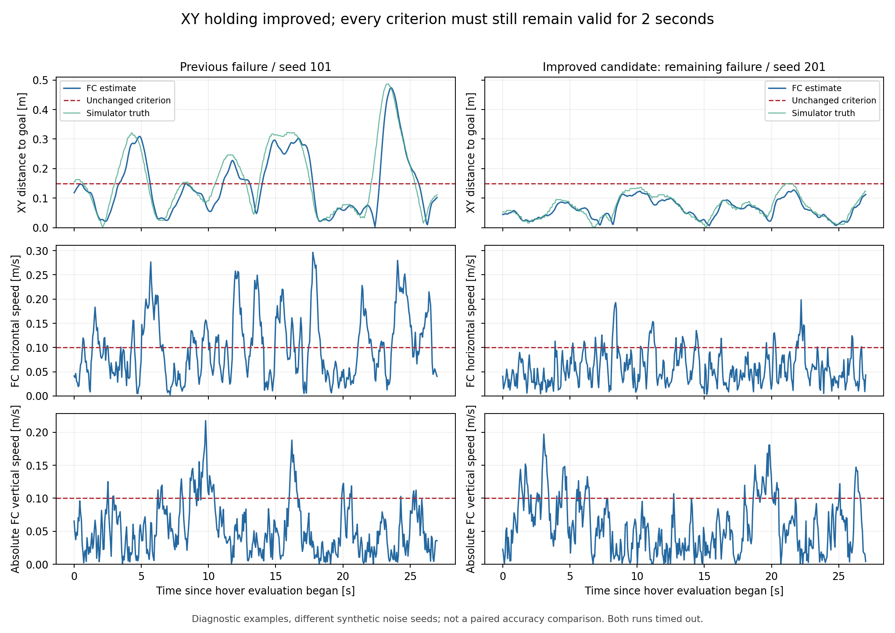

# 호버 실패 원인과 후속 격리 검증
2026-10-12 정상 미션 0/3의 후속 분석이다.
개선 내용과 남은 실패를 구분할 때 읽는다.

후속 [10초 호버·스캔 정합 검증](uwb_lidar_hover10_20261012.md)이 있다.
아래 2초 기준의 결과와 10초 기준을 구분한다.

## 결론

수평 위치 유지는 개선됐다. 정상 완료는 아직 조건부다.
기존 세 조건은 0/3에서 3/3으로 바뀌었다.
선정 뒤 새 난수 조건에서는 2/3을 완료했다.
두 묶음을 나누어 보고한다. 실기 성공률이 아니다.

| 항목 | 결과 |
|---|---|
| 기존 조건 101·102·103 | 후보 3/3 복귀·착륙·시동 해제 |
| 새 조건 201·202·203 | 후보 2/3, 201 호버 시간 초과 |
| 새 조건 벽 접근 | 후보 3/3 외곽 간격 50cm 이상 |
| 후보의 최소 벽 간격 | 94.46·84.68·83.17cm |
| 스캔 끊김 | 0.240초 후 제동 명령 |
| 소프트웨어 회귀 | 237 passed, 9 skipped |
| 이번 추가 실행 | 개발 21회 + 후속 검증 25회 |
| 실기 설정·펌웨어·서비스 변경 | 없음 |

호버 허용 오차와 지속 시간은 넓히지 않았다.
실기 배포와 전체 정상 완료 보장은 미완료다.
이전 [구현 기록](uwb_lidar_integration_20261012.md)을 보존한다.

## 0/3이 된 직접 원인

호버 타이머가 위치·속도 이탈마다 초기화됐다.
도착 판정과 호버 완료 판정은 서로 다르다.
후자는 아래 조건을 연속 2초 요구했다.

| 조건 | 유지한 한계 |
|---|---:|
| FC XY와 고정 목표 거리 | 0.15m 이하 |
| UWB XY와 고정 목표 거리 | 0.25m 이하 |
| FC 수평 속도 크기 | 0.10m/s 이하 |
| FC 고도와 기존 높이 목표 차이 | 0.15m 이하 |
| FC 수직 속도 절댓값 | 0.10m/s 이하 |
| 연속 호버 | 2초 |
| 호버 대기 한계 | 기존 leg 25초 + dwell 2초 |

이전 로그의 각 조건 이탈을 다시 계산했다.
같은 표본에서 여러 조건이 실패할 수 있다.

| 이전 시행 | 표본 | XY 이탈 | 수평 속도 | 고도 | 수직 속도 | 연속 통과 상한 |
|---|---:|---:|---:|---:|---:|---:|
| 101 | 451 | 184 | 202 | 25 | 59 | 1.504초 |
| 102 | 451 | 72 | 133 | 35 | 101 | 1.920초 |
| 103 | 450 | 190 | 177 | 22 | 83 | 1.264초 |

옛 mission 로그에는 UWB snapshot이 없다.
위 상한은 기록 가능한 네 조건만 사용했다.
UWB를 넣으면 시간이 더 짧아질 수 있다.
Z·vz는 같은 시각의 MAVLink 로그와 맞췄다.
단순히 최종 오류 문자열만 센 결과가 아니다.
[원인 통계](evidence/uwb_lidar_hover_followup_20261012/hover_baseline_diagnosis_20261012.json)를 보존했다.

## 원인 가설을 나눈 시험

고정 목표 위치 유지로 바꾸는 것만으로는 실패했다.
LiDAR 입력 누락만으로도 설명되지 않았다.
위치 유지 시험 101의 보조 속도는 896/909회 융합됐다.
동일 시각 truth와 관측 속도의 RMS 차이는 0.030m/s다.
하지만 호버 중 FC 출력 속도 차이는 0.142m/s였다.

PX4는 과거 시각에서 센서를 융합한다.
그 결과를 IMU로 현재 시각까지 이어 계산한다.
출력 보정은 `EKF2_TAU_VEL`의 영향을 받는다.
실험에서는 이 시간 설정의 영향이 컸다.
실기에서 같은 원인이라는 뜻은 아니다.

| 개발 단계 | 최대 지연 설정 | 속도 출력 보정 | 후보 정상 완료 |
|---|---:|---:|---:|
| 이전 속도 명령 | 200ms | 0.25초 | 0/3 |
| PX4 고정 목표 위치 유지 | 200ms | 0.25초 | 0/3 |
| 지연 설정만 축소 | 100ms | 0.25초 | 1/3 |
| 미사용 airspeed 지연도 제거 | 50ms | 0.25초 | 2/3 |
| 속도 출력 보정 응답도 변경 | 50ms | 0.10초 | 3/3 |
| 선정 후 새 조건 검증 | 50ms | 0.10초 | 2/3 |

이 표의 개발 난수는 101·102·103이다.
마지막 행만 새 난수 201·202·203을 썼다.
SIH 자체 센서 난수는 기존 1234를 유지했다.
새 seed는 합성 UWB·LiDAR 잡음에만 적용된다.
프로세스 실행 순서까지 결정적이지는 않다.
작은 표본을 인과 효과의 정밀 추정으로 쓰지 않는다.

50ms 요청이 100ms로 올라간 시험도 3회 있다.
그 개발 시험은 정상 완료 2/3이었다.
PX4의 미사용 `EKF2_ASP_DELAY=100`이 원인이었다.
이를 실제 50ms 검증으로 합치지 않았다.
이후 요청값과 readback이 다르면 ARM 전에 중단한다.

## 구현 내용

호버의 고정 목표와 장애물 우선권을 함께 유지한다.

```text
MOVING / RETURNING
    목표 오차 → 제한 XY 속도 → PX4
DWELL
    장애물 검사가 clear → 고정 목표 → PX4 위치 유지
    제한 필요 → 제한 XY 속도
    차단 / 만료 → 한 번 고정한 제동 위치
    장기 차단 → 기존 LAND
```

| 변경 | 목적 |
|---|---|
| 고정 목표를 PX4 위치 유지에 전달 | companion의 호버 속도 명령 반복 축소 |
| 위치 게인 상한을 명시 | 위치 복구 명령이 속도 제한을 우회하지 않음 |
| `MPC_XY_P <= 1` readback | 실험의 위치 게인 가정 확인 |
| 제동 위치를 한 번만 고정 | 드리프트를 따라 목표를 옮기지 않음 |
| 차단 중 호버 시간 누적 중지 | 장애물 대기를 정상 호버로 세지 않음 |
| 위치·속도별 명령 피드백 구분 | 이전 모드의 응답을 새 명령 확인으로 쓰지 않음 |
| phase 이전·현재 snapshot 기록 | 마지막 호버 통과 tick도 분석 가능 |
| 설정 readback·소스 해시 기록 | 적용값과 재현 대상 확인 |

운영 `FlightNode`는 실험 클래스를 만들지 않는다.
기존 `LocalXYMission`의 기본 동작은 유지했다.
companion에 고도 PID나 자세 제어를 추가하지 않았다.
높이 목표·PX4 제어 게인·센서 잡음 크기는 유지했다.
속도 출력 보정값은 Z 추정에도 영향을 줄 수 있다.
따라서 수평 개선을 수직 무영향으로 해석하지 않는다.

## 남은 정상 미션 실패

새 조건 201은 수평 위치를 유지했지만 끝내지 못했다.
27초·451표본의 FC XY 오차는 최대 12.79cm다.
시뮬레이터 truth 기준 최대 거리는 14.90cm다.
이 구간에서는 XY·UWB 거리 조건 이탈이 없었다.

| 이탈 조건 | 표본 수 / 451 |
|---|---:|
| 수평 속도 | 52 |
| 고도 | 15 |
| 수직 속도 | 80 |
| 모든 조건 동시 충족 | 321 |

겹치는 이탈이 있으므로 각 행을 더하지 않는다.
동시 충족의 최장 연속 시간은 1.624초다.
기존 2초 기준을 충족하지 못해 LAND했다.
성공으로 바꾸거나 실패 시행을 제외하지 않았다.
[새 조건 진단](evidence/uwb_lidar_hover_followup_20261012/hover_validation_diagnosis_20261012.json)을 따른다.



그림의 두 시행은 난수 조건이 다르다.
두 시행 모두 27초 뒤 호버 시간 초과로 종료했다.
같은 축으로 개선 항목과 잔여 조건을 보여준다.
대응 표본의 정확도 개선률을 뜻하지 않는다.

## 벽·고장·추정 상태 재검증

후속 25회 중 24회가 실제 이동 단계에 들어갔다.
후보 17회는 모두 보조 속도 융합을 확인했다.
명령 반환 코드 0을 전체 기준 통과로 해석하지 않는다.

| 시험 | 관찰 | 미션 종료와의 구분 |
|---|---|---|
| 후보 벽 3회 | 최소 94.46·84.68·83.17cm | 차단 시간 초과 LAND, 정상 END 아님 |
| LiDAR 없는 비교 벽 | 72.63cm 통과, 49.30cm 실패 | 1회는 이륙 시간 초과로 이동 미실시 |
| 스캔 2초 공백 | 0.240초 후 제동, 재개 확인 | 이후 호버 시간 초과 |
| 전방 unknown | 위치 hold 뒤 기존 LAND | 장애물 대기를 성공으로 세지 않음 |
| LiDAR 속도 2초 공백 | 고장 중앙 구간 새 융합 0회 | 정상 END |
| LiDAR +2m/s 점프 | 중앙 15관측, 융합 0회 | innovation 거부 후 END |
| LiDAR 오래된 시각 | 중앙 14회 시각 거부 | 새 융합 0회, END |
| LiDAR 중복 시각 | 중앙 15회 시각 거부 | 새 융합 0회, 이후 호버 시간 초과 |
| LiDAR 잘못된 frame | 중앙 15회 거부 | 새 융합 0회, END |
| LiDAR 잘못된 covariance | 중앙 15회 거부 | 새 융합 0회, END |
| LiDAR reset | 재획득 뒤 중앙 15/15 융합 | END |
| UWB 2초 공백 | 양쪽 구성 모두 `uwb_unavailable` | 기존 LAND |
| UWB 1.2m 점프 | 양쪽 구성 모두 좌표 점프 보호 | 기존 LAND |

중앙 구간은 이동 시작 +1.4~2.9초다.
과도 구간의 남은 이전 관측과 새 관측을 구분한다.
이동한 24회에서 이후 Z·vz reset 증가가 없었다.
UWB 이상 시험의 XY reset과 혼동하지 않는다.

수직 추정의 변화는 혼재했다.
새 정상 시행의 Z 변화 오차를 함께 보존한다.

| seed | LiDAR 없음 Z 변화 RMS | 후보 Z 변화 RMS | 후보 절대 Z 차이 RMS |
|---|---:|---:|---:|
| 201 | 0.0798m | 0.0972m | 0.3093m |
| 202 | 0.0457m | 0.0419m | 0.7349m |
| 203 | 0.0446m | 0.0541m | 0.1764m |

변화 RMS는 이동 첫 표본의 상수 차이를 뺀 값이다.
절대 차이에는 보정하지 않은 높이 원점 차이가 포함된다.
서로 다른 완료 시간의 표본을 사용했다.
이 수치로 고도 정확도 향상이나 무영향을 선언하지 않는다.
[ULog 분석](evidence/uwb_lidar_hover_followup_20261012/hover_final_audit_20261012.json)에 원본 해시와 분모가 있다.

## 검증 범위와 남은 작업

이번 결과는 격리 SIH의 합성 센서 결과다.
실제 4개 RAW의 정확도·실기 비행 결과로 확대하지 않는다.
이번 작업에서는 RAW를 변경하지 않았다.

| 구분 | 범위 |
|---|---|
| PX4 | 기존 d6f12ad 기반 LiDAR2D 실험 바이너리 |
| 네트워크 | 실행마다 독립 namespace, loopback만 허용 |
| 제어 경로 | 실제 미션 상태 기계·MAVLink·PX4 폐루프 |
| ROS FlightNode 종단 | 미실시 |
| 합성 관측 | UWB 위치·LiDAR 속도·광류·하방 거리 |
| 실물 LiDAR 시간·장착·공분산 | 미보정 |
| 고도 제어 | 기존 PX4 높이 목표와 제어기 유지 |
| 1.7m 연속 10초 현장 호버 | 이번 2초 미션과 다른 기준, 미검증 |

50ms는 실물의 권장 지연값이 아니다.
실험의 낮은 전달 지연에 맞춘 후보값이다.
10Hz 관측 주기를 50ms 지연으로 바꾼 것도 아니다.
실제 최대 지연과 도착 간격을 따로 검증해야 한다.
늦은 관측의 허용 범위와 버퍼 길이도 맞춰야 한다.
이유: 과거 버퍼보다 오래된 관측을 새 값으로 쓸 수 없다.

다음 안정화 대상은 수평·수직 속도의 잔여 이탈이다.
위치 유지 개선과 정상 미션 완료를 별도 지표로 유지한다.
실기 적용은 시간·장착·공분산 검증 뒤 판단한다.
이번 요청 범위에서는 실기 설정을 건드리지 않았다.

## 재현과 근거

[재현 절차](../runbooks/uwb_lidar_reproduce_20261012.md)의 후속 명령을 따른다.
[46회 시행 목록](evidence/uwb_lidar_hover_followup_20261012/hover_trial_catalog_20261012.json)에 해시가 있다.
개발 21회와 새 조건 25회를 구분했다.
이전 26회와 분모를 합치지 않았다.

Python 회귀의 제외 파일 5개는 이전과 같다.
`rclpy`·web 의존성 부재로 ROS·web 시험은 미실시다.
9개 skipped도 전체 통과 수에 넣지 않는다.
코드·문서·그림은 UTF-8 경로에서 생성·확인했다.
