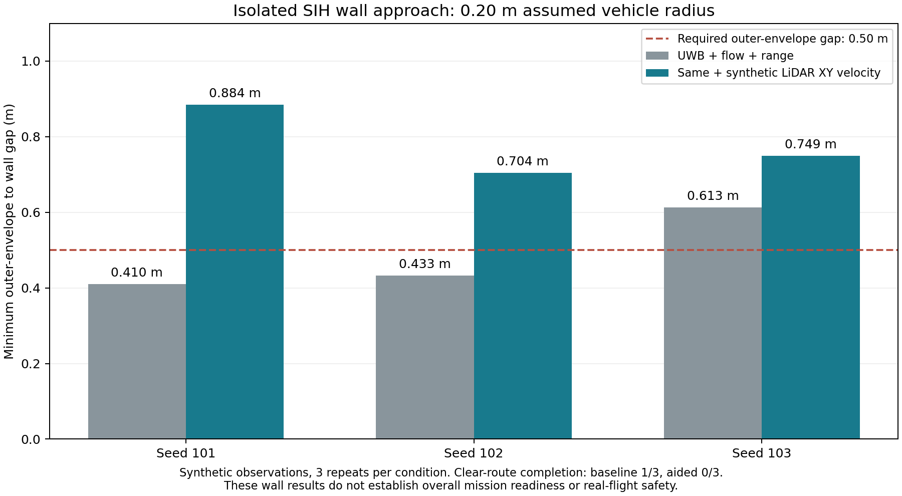
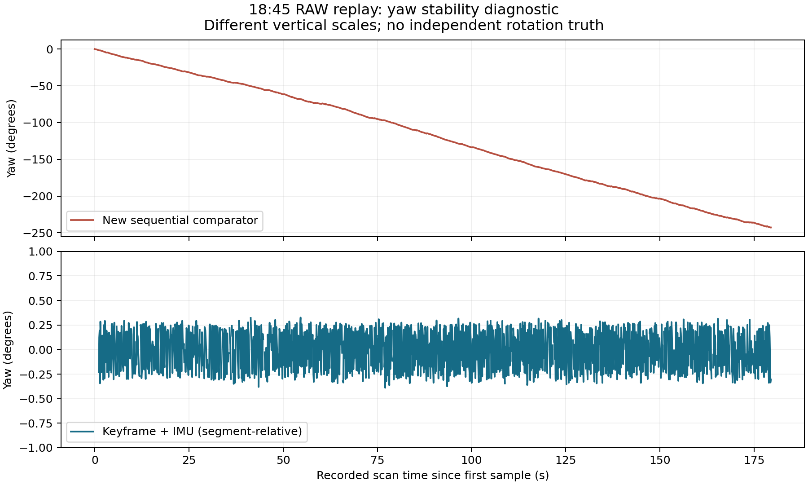

# UWB·LiDAR 통합 구현·재생·SITL 기록
2026-10-12 후속 구현과 실제 실행 결과다.
변경 범위와 실기 반영 가능 여부를 판단할 때 읽는다.

후속 호버 개선은 [별도 검증 기록](uwb_lidar_hover_followup_20261012.md)에 있다.
기존 조건 3/3, 새 조건 2/3 완료를 구분했다.
아래 0/3과 이전 시험 수치는 당시 결과로 보존한다.

## 결론

**독립 2D 입력을 후속 실험 경로로 선택했다.**
비행 상태의 최종 추정기는 PX4 EKF2다.
실기 펌웨어·파라미터·서비스는 변경하지 않았다.

| 항목 | 결과 |
|---|---|
| 원본 확보 | 55개 보관 목록 조사, RAW 4개 해시 검증 |
| 원본 재생 | 4,750스캔, 설정별 비교 6회 |
| 정합 | keyframe·IMU 보조·퇴화·재획득 통합 |
| PX4 | UWB EV와 독립된 XY 속도 입력 구현 |
| 장애물 기준 | 프로펠러 최외곽부터 최소 50cm |
| Python 회귀 | 235 passed, 9 skipped |
| 50cm 벽 기준 | LiDAR 추가 3/3, 기존 센서 1/3 |
| 정상 경로 완료 | LiDAR 추가 0/3, 기존 센서 1/3 |
| 운영 적용 | 미실시 |

RAW 정합에는 보정된 공분산이 아직 없다.
실제 정합 결과의 FC 출력은 비활성이다.
SITL 속도 입력은 simulator truth 기반 합성값이다.
RAW→실제 EKF의 종단 검증으로 해석하지 않는다.

## 기준과 변경 위치

기준 소스와 실행 중인 다른 작업을 보존했다.

| 기준 | 값 |
|---|---|
| ROS2 FINAL | `7a1ad0cb2a6fce5ef2c0362c562d34f495f932bf` |
| 추가 조사 | `feature_uwb=8cfe94cd80e5e6094f1fb5bd173b47ebed5e293e` |
| 작업 브랜치 | `codex/uwb-lidar-integration-20261012` |
| PX4 기준 | `d6f12ad1c4f70ad3230afd7d86e971421e02fef4` |
| PX4 변경분 | `src/drone_uwb/tools/px4_lidar2d.patch` |

[관측 계약](../architecture/uwb_lidar_observation_contract.md)에
호출 경로·좌표·시각·covariance·timeout을 정리했다.

| 변경 파일 | 동작 |
|---|---|
| `integration/lidar_contract.py` | 시각·구간 속도·레버암·공분산 검사 |
| `experiments/lidar_scanmatch.py` | keyframe·양방향 검사·퇴화·재획득 |
| `experiments/lidar_replay.py` | RAW 해시·IMU 회전 비교·출력 보존 |
| `horizontal_obstacles.py` | 미관측 차단·기체 외곽·정지 여유 |
| `guarded_local_xy.py` | 실험용 XY 속도 제한·고정 위치 hold |
| `local_command.py` | XY 명령·고정 높이의 MAVROS 필드 |
| `local_xy.py`, `node.py` | 공통 연결점·명령·피드백 구분 |
| `prepare_px4_lidar2d.py` | 고정 PX4 커밋의 패치 준비 |
| `obstacle_sitl.py` | 격리·합성 센서·실제 PX4 제어 |

운영 FlightNode는 실험 클래스를 생성하지 않는다.
기존 위치 목표 경로를 기본값으로 유지한다.
속도 경로의 도착 판정 불일치를 고쳤다.
위치 램프의 1cm 조건을 실측 위치에 잘못 적용했다.
기존 실측 15cm·UWB 25cm·안정 속도 조건을 유지했다.

## 원본과 시행 시간축

확보한 RAW를 시간·정합 진단에 사용했다.
불명확한 비행 상태를 재질문하지 않았다.

| 2026-10-11 KST | RAW 크기 | 스캔 | 사용 목적 |
|---|---:|---:|---|
| 17:00:10.231–17:00:57.756 | 40,917,502 bytes | 456 | 동적 정합 가용성 |
| 18:41:19.963–18:42:32.442 | 63,959,541 bytes | 723 | LiDAR 단독·IMU 축 비교 |
| 18:45:37.856–18:48:37.369 | 158,292,299 bytes | 1,791 | 동일 설정 후속 재생 |
| 19:03:54.583–19:06:54.346 | 163,434,778 bytes | 1,780 | 동일 설정 후속 재생 |
| 자동 실행 8 START 20:28:25.404 | ULog 1,063,627 bytes | 별도 | 실제 EKF·제어 사건 |

RAW는 `work/capture-archive-20261011/`에 보존했다.
전송 manifest의 크기와 SHA-256을 대조했다.
실행 8은 `work/lidar-ekf-audit/log-21.ulg`다.
위 경로는 이 작업의 `new-chat` 기준이다.

17:00:13.784–17:00:24.353은 ARM/POSCTL/IN_AIR다.
신선한 FC odom 318개의 자체 평균 XY RMS는 4.47cm다.
중립 호버나 물리적 정확도의 증거는 아니다.
다른 기록의 전원·비행 상태는 완전하지 않다.
사용자 지시에 따라 센서 개선 목적에 활용했다.

| 비교 항목 | 수동 RAW | 자동 실행 8 |
|---|---|---|
| sender gate OFF | 시행별 직접 근거 부족 | ULog만으로 확인 불가 |
| 실제 EV 융합 | aid-source 원본 부족 | EV 수평 위치 융합 확인 |
| 시각 | header·수신·TIMESYNC 보존 | FC boot·미션 사건 |
| 직접 성능 비교 | 동일 조건의 최종 수동 비교 미완료 | 독립 원인 분석에 사용 |

실행 8의 공중 상태는 ARM+2.188초부터다.
광류 융합은 ARM+3.188초부터다.
ARM+8.051초에 UWB 나이 0.283581초로 LAND했다.
미션의 0.25초 제한을 넘었다.
XY 변화는 마지막 UWB 공백 이전부터 있었다.
마지막 공백 하나로 앞선 변화를 설명하지 않는다.
1.7m·10초 안정 호버 성공으로 표기하지 않는다.

## 시간·H80 응답

동작 주기와 관측 시각을 유지했다.

| 측정 | 결과 | 해석 |
|---|---|---|
| 스캔 header 주기 | 약 9.97–9.98Hz | 실측 스캔율 |
| 광선 시간 합/scan_time | 중앙값 약 1.0725 | 시각 계약 불일치 |
| 수신−header | 중앙값 약 103ms | 획득 시간 포함, EKF 지연 아님 |
| 18:45 TIMESYNC RTT | 최대 1,090.6ms | 순간 통신 이상 |
| H80 중첩 출력 상관 | 25ms 간격 0.898–0.931 | 합성 정지·5개 seed |

드라이버는 각도별 칸으로 출력을 재배열한다.
조사 SDK는 원 점 개수로 시간 간격을 만든다.
고정 해상도는 이후 점 개수를 바꾼다.
설치 SDK와 같은 버전인지는 미확정이다.
1.01 검사를 완화하거나 deskew를 적용하지 않았다.
이유: 배열 순서를 광선 획득 순서로 확정할 수 없다.

H80의 0.8초 창은 고정 지연이 아니다.
고정 solver의 합성 정현파 응답을 계산했다.

| 입력 주파수 | 이득 | 위상 기준 등가 지연 |
|---:|---:|---:|
| 0.10Hz | 1.021 | 6.7ms |
| 0.25Hz | 1.116 | 36.0ms |
| 0.50Hz | 1.318 | 98.2ms |
| 1.00Hz | 1.408 | 186.8ms |

실제 무선·B_TF 전체·EKF 지연의 실측이 아니다.
EV_DELAY에 그대로 대입하지 않는다.
H80 설정도 변경하지 않았다.

## 정합 원본 재생

누적 회전의 안정성과 유효 출력률을 함께 평가했다.

| 기록·구성 | 유효 변위/가능 구간 | 비율 | 최대 출력 공백 | 구간 마지막 yaw |
|---|---:|---:|---:|---|
| 17:00 LiDAR 단독 | 113/455 | 24.84% | 0.501s | +1.620° |
| 18:41 LiDAR 단독 | 653/722 | 90.44% | 0.501s | −0.332° |
| 18:41 IMU 보조 | 638/722 | 88.37% | 0.601s | −0.333° |
| 18:45 IMU 보조 | 1,633/1,790 | 91.23% | 0.501s | 구간별 −0.294°, −0.305° |
| 19:03 IMU 보조 | 1,640/1,779 | 92.19% | 0.402s | +0.085° |

새 연속 정합 비교기의 마지막 yaw는 크게 누적됐다.
18:41은 −82.37°, 18:45는 −242.79°다.
19:03은 −183.93°다.
keyframe 값은 각 구간 시작 기준이다.
단절 전후 구간을 임의로 이어 붙이지 않았다.
독립 회전 정답이 없어 정확도 개선율은 계산하지 않았다.

IMU는 초기 회전과 일관성 검사에 사용했다.
18:41의 유효 출력률은 LiDAR 단독보다 낮았다.
모든 지표가 개선됐다고 주장하지 않는다.
윗면 천장 방향이라는 사용자 설명을 반영했다.
정밀 IMU→scan 회전과 gyro bias는 미보정이다.
처리 시간 p95는 재생 호스트에서 약 14.9–19.5ms다.
후보와 비교기 2개의 계산을 포함한다.
Jetson 실시간 지연으로 해석하지 않는다.

과거 `analyze.py`의 −267° 자체는 재현하지 못했다.
새 비교기를 과거 분석의 동일 재현으로 표기하지 않는다.
별도 작업의 코드·합성 결과를 해시 확인해 재사용했다.
그 합성 결과 70건·정지 EV 진단 140건은 별도 출처다.
이번 RAW 재생·비행 SITL의 분모에 합산하지 않았다.
출처는 `evidence/uwb_lidar_integration_20261012/previous_work/`다.

## PX4 2D 입력 선택

A안은 독립 수평 속도 입력의 격리 시제품이다.

| 항목 | 구현 |
|---|---|
| 수신 | ODOMETRY LIDAR 전용 분기 |
| 좌표 | 보정 완료된 IMU 원점 LOCAL_NED |
| 관측 | vx/vy·2×2 공분산, vz=NaN |
| 시각 | 별도 시각·150ms 나이·중복 거절 |
| reset | 입력 버퍼만 비움, 상태 reset 없음 |
| covariance | 교차항을 포함한 보수적 대각 상한 |
| 융합 | 기존 보조 수평 속도 융합 |
| 의존성 | 다른 수평 aiding이 있어야 융합 |
| 기본값 | 비활성, 실기 배포 없음 |

대각 상한은 `diag(Cnn+abs(Cne), Cee+abs(Cne))`다.
원 공분산과의 차이가 PSD인 형태를 사용한다.
실제 정합 공분산을 보정한 것은 아니다.
직접 Z 관측이 없어도 상태 상관을 통한 영향은 가능하다.
SITL에서 Z·vz·reset도 함께 평가한다.

B의 통합 외부 관측은 설계 단계로 남겼다.
표준 EV 속도는 유한 XYZ를 요구한다.
공통 시각·reset과 상관 처리도 필요하다.
재사용한 실제 EKF 호출 시험은 수직 reset 위험을 보였다.
큰 Z 분산을 준 vz=0 편법을 채택하지 않았다.
이는 B의 모든 가능한 설계를 배제하는 결론은 아니다.

## 장애물·폐루프 SITL

프로펠러 외곽에서 벽까지 50cm를 기준으로 삼았다.
기체 중심 기준 거리에는 반경을 더한다.
감속 개시에는 정지 거리·지연·오차를 더한다.

| 선언한 시험 조건 | 값 |
|---|---:|
| 가정한 기체·프로펠러 반경 | 0.20m |
| 외곽 최소 여유 | 0.50m |
| 명령 최대 XY 속도 | 0.25m/s |
| 가정 감속도 하한 | 0.50m/s² |
| 명령 지연 | 0.20s + 관측 나이 |
| 스캔 최대 나이 | 0.25s |
| 속도 오차의 실험용 경계 | 0.35m/s |
| 만료 후 제동 명령 기준 | 0.30s 이내 |

속도 오차를 제동 시간 동안의 거리 여유로 팽창한다.
기체 반경·50cm·거리/장착 오차와 별도로 더한다.
이 값들은 실측 기체 인증값이 아니다.
최소 거리만 늘려 제동 검증을 대신하지 않았다.

별도 네트워크 namespace의 loopback만 사용했다.
실기 연결이나 ROS 그래프는 사용하지 않았다.
PX4 instance 52·53을 실행별로 임대했다.
기존 PX4·Gazebo 프로세스는 종료하지 않았다.
미션→공통 명령→MAVLink→PX4 경로를 실행했다.
ROS FlightNode 자체의 종단 실행은 미실시다.

UWB+광류+거리계와 LiDAR 추가 조건을 비교했다.
같은 패치 binary와 센서 설정을 사용했다.
LiDAR 입력 허용 파라미터만 비교 조건에 따라 달랐다.
UWB noise seed는 101·102·103이다.
LiDAR noise는 각 seed+10000으로 분리했다.
SIH 소스는 고정 srand(1234)를 사용한다.
프로세스 스케줄링 차이까지 같은 반복은 아니다.

50cm 결과는 `sitl_50cm_20261012.json`에 기록한다.
종료 코드 0은 실행 완료이며 성능 통과가 아니다.
벽 차단 후 hold_timeout은 LAND 경로다.
정상 미션 성공과 안전 중단은 구분한다.
이전 10cm 조건 33회는 개발 기록으로 보존했다.
50cm 결과의 성공 분모에 합산하지 않는다.

### 50cm 반복 결과

벽 여유는 개선됐지만 전체 미션은 미통과다.

| seed | 기존 센서 최소 간격 | LiDAR 추가 최소 간격 |
|---:|---:|---:|
| 101 | 0.410m, 미달 | 0.884m, 충족 |
| 102 | 0.433m, 미달 | 0.704m, 충족 |
| 103 | 0.613m, 충족 | 0.749m, 충족 |

정상 경로 완료는 기존 1/3, 추가 구성 0/3이다.
추가 구성 3회는 호버 안정 시간 초과로 중단했다.
임계값을 낮춰 성공으로 만들지 않았다.
따라서 실기 적용 가능 판정을 내리지 않는다.

정상 이동 구간의 XY RMS는 다음과 같다.
기존 0.061–0.084m, 추가 구성 0.039–0.053m다.
각 시행의 이동·대기 구간 길이는 서로 다르다.
같은 시간 구간의 정확도 개선율로 환산하지 않는다.
Z 변화 오차 RMS는 기존 0.066–0.086m다.
추가 구성은 0.054–0.116m다.
처음 이동 샘플의 상수 높이 차이를 뺀 값이다.
수직 상태가 무영향이거나 개선됐다고 단정하지 않는다.

| 오류 주입 | 확인한 결과 |
|---|---|
| 스캔 단절 | 첫 누락 후 0.240초에 제동 명령 |
| 전방 무효 관측 | 고정 위치 hold 후 기존 LAND 경로 |
| LiDAR 속도 +2m/s 오정합 | 수신 허용, innovation으로 융합 거절 |
| LiDAR 0.5초 오래된 시각 | admission에서 거절 |
| LiDAR 중복 시각 | 중복·이후 만료 거절 |
| 비양정 covariance | admission에서 거절 |
| 잘못된 frame | 별도 재시행에서 admission 거절 |
| LiDAR reset | 버퍼 재시작, 직접 상태 reset 없음 |
| UWB 2초 단절 | 기존 uwb_unavailable LAND 유지 |
| UWB 1.2m 점프 | 상태 점프 검사로 중단 |

기본 반복 25회 중 이동 조건은 24회 성립했다.
잘못된 frame 시행 1회는 이륙 대기에서 종료됐다.
그 시행을 frame 검사 통과로 계산하지 않았다.
별도 재시행 1회에서 이동 후 오류 주입을 확인했다.
총 실행은 기본 25회와 재시행 1회다.
이전 실패 기록을 재시행으로 덮어쓰지 않았다.
LiDAR 활성 17회 모두 실제 보조 속도 융합이 기록됐다.
수신 허용과 실제 융합은 별도로 계산했다.
이동 이후 z/vz reset counter 증가는 관찰되지 않았다.
UWB 단절·점프에서는 XY reset이 있어 따로 남겼다.

속도 오차 0.35m/s 경계를 넘은 정상 시행도 있었다.
이 수치를 인증된 오차 상한으로 사용하면 안 된다.
그림의 세 번 통과가 모든 조건의 보장을 뜻하지 않는다.

| 조건별 추가 범위 | 상태 |
|---|---|
| 정상 이동·단절·점프·reset·벽 접근 | 실제 PX4 SIH에서 실행 |
| 복도·퇴화·가림 | 합성 정합·단위 시험 |
| roll/pitch와 10cm 레버암 | 수학·단위 시험, 실측 미실시 |
| 기울어진 실제 scan·높이별 단면 | 종단 재생 미실시 |
| 실제 동적 장애물·전체 3D 기체 | 실물 시험 미실시 |

이 결과를 전체 S01–S14 통과로 표기하지 않는다.

## 검증 범위와 남은 작업

실행한 시험과 실물 입력 부족을 구분했다.

| 단계 | 상태 | 남은 범위 |
|---|---|---|
| 구조·기준선 | 완료 | 운영 변경 없음 |
| 로그·시간 진단 | 완료 | 최종 수동 동일 조건 비교는 입력 부족 |
| 좌표·시간 계약 코드 | 완료 | 광선 순서·정밀 장착 실측 |
| 정합·RAW 재생 | 완료 | 이동 정답·공분산·deskew |
| 장애물 명령 경로 | 구현·SITL 실행 | 실물 제동·크기·3D 가림 |
| PX4 후보 비교 | A 시제품·SITL 실행 | 정상 미션 안정성·실물 연결 |
| 실기 설정·비행 | 미실시 | 별도 시험 지시 필요 |

Python 결과는 235 passed, 9 skipped다.
전체 수집은 rclpy/websockets 누락으로 처음 실패했다.
관련 파일 5개를 제외한 회귀 결과다.
이를 ROS·web 전체 통과로 부르지 않는다.
WSL에도 ROS Humble setup이 없어 ROS 시험은 미실시다.

실제 정합 속도의 FC 입력에는 실측이 필요하다.
광선 시각·장착·레버암·공분산을 먼저 측정한다.
평면 밖 장애물·동적 물체의 실물 시험도 남았다.
[지상 절차](../runbooks/uwb_lidar_ground_validation.md)에 정리했다.

## 근거와 재현

RAW와 결과는 구분해 보존했다.
다음 파일은 `new-chat/outputs/` 기준이다.

| 근거 | 파일 |
|---|---|
| RAW 전송 크기·해시 | `capture_transfer_manifest_20261012.json` |
| 보관 목록 | `capture_catalog_audit_20261012.json` |
| 시행별 시간·주기 | `manual_*_audit_20261012.json`, `sensor_1903_audit_20261012.json` |
| 정합 비교 | `lidar_replay_comparison_20261012.json` |
| H80 응답 | `h80_response_20261012.json` |
| 개발 SITL 33회 | `sitl_development_10cm_20261012.json` |
| 50cm SITL | `sitl_50cm_20261012.json` |
| frame 재시행 | `sitl_frame_retry_20261012.json` |
| 입력·출력·변경 해시 | `uwb_lidar_implementation_manifest_20261012.json` |

[실험 재현 절차](../runbooks/uwb_lidar_reproduce_20261012.md)를 따른다.
문헌은 [관측 계약](../architecture/uwb_lidar_observation_contract.md)에 있다.

